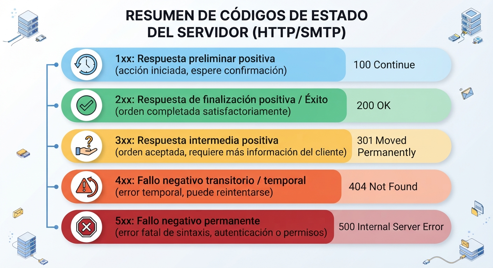
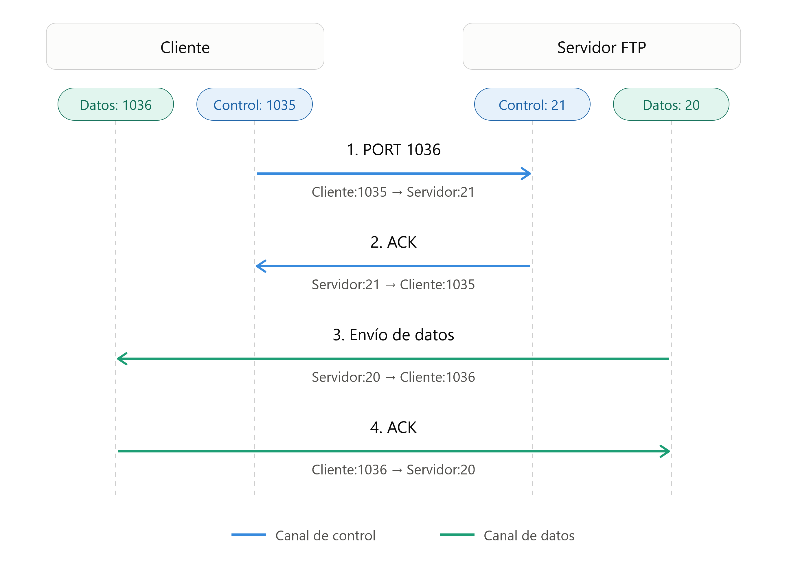
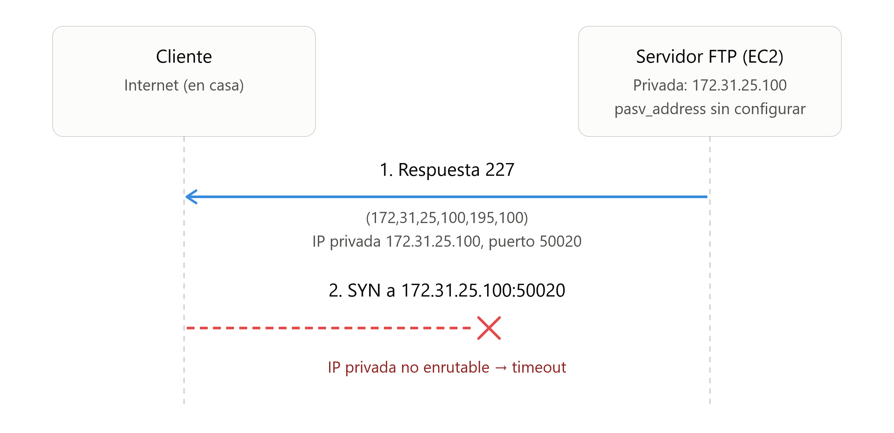

{ .img2 .marginbottom40}

**Resultados de aprendizaje y criterios de evaluacion que se evaluarán en esta unidad.**  

| **Resultados de aprendizaje de la unidad didáctica:**|
||
| **RA3. Gestiona servicios de transferencia de ficheros describiendo sus características e instalando los servidores y clientes correspondientes.**|

|**Criterios de evaluación de la unidad didáctica:**|
||
|**a) Se ha establecido la utilidad y modo de operación del servicio de transferencia de ficheros.**|
|**b)** Se ha instalado un servicio de transferencia de ficheros. |
|**c)** Se han creado usuarios y grupos para acceso remoto al servidor.|
|**d)** Se ha configurado el acceso anónimo.|
|**e)** Se han establecido límites en los distintos modos de acceso.|
|**f)** Se ha comprobado el acceso al servidor, tanto en modo activo como en modo pasivo.|
|**g)** Se han realizado pruebas con clientes en línea de comandos y en modo gráfico.|

!!! warning "Nota:"
    Los criterios de evaluación en negrita será evaluados durante la FCT.

## 1 - Presentación y evolución de los servicios de transferencia de ficheros

- La transferencia de archivos a través de redes informáticas constituye uno de los **servicios cliente-servidor** más antiguos y esenciales de la arquitectura TCP/IP.
- Antes del desarrollo de la World Wide Web (www) y del protocolo HTTP(S), la necesidad primordial de los centros de cálculo universitarios y militares era compartir programas ejecutables, conjuntos de datos masivos y documentos entre ordenadores distantes y con **sistemas operativos heterogéneos**.

### 1.1 Evolución histórica: Del RFC 114 al RFC 959

- El protocolo **FTP (File Transfer Protocol)** nació formalmente el 16 de abril de 1971 con la publicación del **RFC 114** por Abhay Bhushan en el MIT, operando sobre las primeras redes de conmutación de paquetes de ARPANET y la pila NCP (*Network Control Program*).
- Con la transición definitiva a la arquitectura de Internet basada en TCP/IP en 1980, el protocolo se rediseñó en el **RFC 765** y finalmente se consolidó en octubre de 1985 con la publicación del **RFC 959**, que continúa siendo el estándar fundacional vigente hoy en día.
- A lo largo de las décadas, FTP ha evolucionado mediante diversas ampliaciones (*RFC extensions*), destacando:
   1. **RFC 2228 (FTP Security Extensions):** Introduce mecanismos de autenticación y cifrado mediante comandos como `AUTH TLS`.
   1. **RFC 2428 (FTP Extensions for IPv6 and NATs):** Define los comandos `EPRT` (*Extended Port*) y `EPSV` (*Extended Passive*) para dar soporte al direccionamiento IPv6 y facilitar la interoperabilidad con pasarelas NAT complejas.
   1. **RFC 3659 (Extensions to FTP):** Añade comandos modernos como `MLST` y `MLSD` para obtener listados de ficheros con metadatos estandarizados e información horaria en UTC.

### 1.2 FTP y modelo TCP/IP

{.sietecinco .margintop10 marginbottom20 .marco}

- FTP se sitúa en la **Capa de Aplicación** (capa 4 de TCP/IP).
- Para el transporte de la información, se apoya de forma estricta en el protocolo **TCP (Transmission Control Protocol)** en la capa de transporte.
- La elección de TCP (frente a protocolos no orientados a conexión como UDP) es indispensable por tres factores determinantes:  
    1. **Fiabilidad absoluta:** Cada paquete de datos debe ser confirmado mediante ACKs para asegurar que ni un solo byte del fichero transferido se pierda o llegue corrupto.
    1. **Entrega secuencial y ordenada:** Garantiza que los segmentos fragmentados en la red se reensamblen en el destino en el orden exacto.
    1. **Control de flujo y congestión:** Regula la velocidad de transmisión adaptándose a la capacidad del receptor y a las condiciones de congestión de los enlaces de red.

### 1.3 Modelo cliente-servidor y arquitectura de servicios

{.sietecinco .margintop10 marginbottom20 .marco}

- FTP sigue el paradigma **cliente-servidor**:  
  - El **servidor FTP** es un proceso que permanece a la escucha de peticiones en el puerto TCP 21, esperando que los clientes se conecten y soliciten transferencias de ficheros o listados de directorios.
  - El **cliente FTP** es un programa que se ejecuta en la máquina del usuario final, capaz de establecer la conexión con el servidor, enviar órdenes y recibir datos.

### 1.3 Casos de uso corporativos en la administración de sistemas

A pesar del auge de protocolos web (HTTP/HTTPS) y APIs REST, los servicios de transferencia de ficheros basados en FTP, FTPS y SFTP siguen siendo pilares en las infraestructuras de IT:

1. **Despliegue y mantenimiento de portales web:** Carga de contenidos HTML, scripts PHP, hojas de estilo CSS y elementos multimedia en servidores web de alojamiento (*hosting* compartido o dedicado).
1. **Gestión de dispositivos de red y telecomunicaciones:** Actualización masiva de firmwares e imágenes de sistemas operativos (Cisco IOS, JunOS), y volcado de configuraciones en *switches*, *routers* y cortafuegos.
1. **Copias de seguridad remotas (*backups*):** Automatización nocturna del envío de volcados de bases de datos (SQL) y ficheros de archivo comprimidos hacia servidores de almacenamiento remoto (*off-site*).
1. **Intercambio B2B (*Business-to-Business*):** Intercambio automático de albaranes, facturas electrónicas (EDI) y ficheros de transacciones bancarias entre sistemas centrales de diferentes organizaciones.

## 2 - Protocolo FTP (RFC 959)

### 2.1 Canal de control y Canal de datos

La gran particularidad de FTP frente a casi todos los demás protocolos de red (HTTP, SSH o SMTP) radica en que **no utiliza una única conexión para todo**, sino que desacopla la comunicación en **dos conexiones TCP independientes con ciclos de vida y propósitos completamente distintos**:

{.cien}

!!! info "Canal de control (Puerto 21 TCP por defecto)"
    - Es la conexión principal (*out-of-band signaling*). Se establece al inicio de la sesión entre el cliente y el puerto de escucha 21 TCP del servidor.
    - Permanece **abierta de forma continua** durante toda la sesión del usuario.
    - Por este canal circulan exclusivamente órdenes cortas en texto ASCII (como `USER`, `PASS`, `LIST`, `RETR`, `QUIT`) emitidas por el cliente y las correspondientes respuestas numéricas de estado de 3 dígitos generadas por el servidor.
    - Por este canal **nunca viaja el contenido de los archivos** ni los listados de directorios.

!!! info "Canal de datos (Puertos variables TCP / Puerto 20 en modo activo)"
    - Es una conexión efímera que se abre **bajo demanda** únicamente cuando el cliente solicita una acción que implica intercambio de información volumétrica: transferir un fichero (subida con `STOR` o descarga con `RETR`) o solicitar el listado de archivos de una carpeta (`LIST` o `NLST`).
     - Una vez finalizada la transmisión del archivo o entregado el listado, el canal de datos **se cierra inmediatamente**. Si el usuario desea descargar otro fichero a continuación, se negociará y abrirá una nueva conexión de datos independiente.

!!! question "💡 ¿Por qué FTP desacopló el control de los datos?"
    - Este diseño permite al cliente enviar órdenes de interrupción (como el comando `ABOR` para abortar una descarga) a través del canal de control mientras un archivo enorme se está descargando por el canal de datos, sin tener que esperar a que termine de llegar la totalidad del flujo de bytes.

### 2.2 Tipos de datos: ASCII vs Binario

- El RFC 959 contempla distintos modos de interpretar la información transmitida a través del canal de datos
- Su correcta elección permitirá evitar la corrupción irreversible de los ficheros transferidos, especialmente cuando se trabaja con sistemas operativos heterogéneos (Windows, Linux, macOS):

| Modo de Transferencia | Comando FTP | Comportamiento del protocolo | Tipos de ficheros compatibles | Riesgo de corrupción |
|---|:---:|---|---||
| **Modo ASCII / Texto** | `TYPE A` | - Convierte automáticamente los caracteres de salto de línea entre sistemas operativos emisores y receptores. - En Windows las líneas terminan en `CR+LF` (`\r\n`, bytes `0x0D 0x0A`), mientras que en Linux/UNIX terminan únicamente en `LF` (`\n`, byte `0x0A`). | Ficheros de texto plano (`.txt`, `.html`, `.css`, `.csv`, `.php`). | **Muy alto:** Si se transfiere un ejecutable, imagen o zip en modo ASCII, el servidor alterará los bytes `0x0D` y `0x0A`, destruyendo por completo la estructura del archivo. |
| **Modo Binario / Imagen** | `TYPE I` | Transmite el archivo byte a byte de forma idéntica, sin interpretar ni modificar ningún carácter ni secuencia de escape. | Ejecutables (`.exe`), imágenes (`.png`, `.jpg`), comprimidos (`.zip`, `.tar.gz`), bases de datos, PDFs. | **Nulo:** Conserva la integridad matemática del fichero íntegra. Es el modo por defecto en clientes modernos como FileZilla. |

### 2.3 Repertorio de comandos estándar de FTP (RFC 959)

Las órdenes que viajan por el canal de control son palabras mnemotécnicas de 3 o 4 caracteres en texto plano ASCII seguidas de parámetros y delimitadas por el terminador `CRLF` (`\r\n`):

!!! tip "Autenticación e inicio de sesión:"
    - `USER <nombre>`: Envía el identificador del usuario que desea iniciar sesión.
    - `PASS <contraseña>`: Envía la contraseña de dicho usuario.
    - `QUIT`: Cierra la conexión de control y finaliza la sesión en el servidor.

!!! tip "Navegación e inspección del sistema de ficheros:"
    - `PWD` (*Print Working Directory*): Muestra la ruta del directorio de trabajo actual en el servidor.
    - `CWD <ruta>` (*Change Working Directory*): Cambia al directorio especificado (equivalente a `cd`).
    - `CDUP` (*Change to Parent Directory*): Sube un nivel en el árbol jerárquico de directorios (equivalente a `cd ..`).
    - `MKD <directorio>` (*Make Directory*): Crea una nueva carpeta en la ruta remota.
    - `RMD <directorio>` (*Remove Directory*): Elimina la carpeta remota indicada.

!!! tip "Operaciones de transferencia y gestión de ficheros:"
    - `LIST`: Solicita el listado detallado de ficheros y directorios (permisos, tamaño, fecha de modificación, similar a `ls -la`). Se entrega a través del canal de datos.
    - `NLST` (*Name List*): Solicita una lista simple con únicamente los nombres de los ficheros.
    - `RETR <fichero>` (*Retrieve*): Descarga el archivo solicitado desde el servidor hacia el cliente.
    - `STOR <fichero>` (*Store*): Sube y almacena un archivo desde el cliente en el servidor.
    - `DELE <fichero>` (*Delete*): Elimina el fichero especificado del servidor.

!!! tip "Negociación del canal de datos:"
    - `PORT <h1,h2,h3,h4,p1,p2>`: Indica al servidor la dirección IP y el puerto TCP en el que el cliente espera la conexión de datos (Modo Activo).
    - `PASV`: Solicita al servidor que abra un puerto pasivo y espere la conexión del cliente (Modo Pasivo).
    - `TYPE <A|I>`: Establece el tipo de representación de los datos (`A` para ASCII, `I` para binario/imagen).

### 2.4 Códigos de respuesta del servidor

- Cada vez que el cliente emite una orden por el canal de control, el servidor responde obligatoriamente con un **código numérico de tres dígitos** acompañado de un texto descriptivo legible para humanos.

- La taxonomía del primer dígito categoriza de manera unívoca la respuesta:

{.cien}

| Código | Significado canónico del RFC 959 | Contexto habitual en el laboratorio y producción |
|:-:|---||
| `150` | *File status okay; about to open data connection.* | Notificación previa al inicio del flujo de datos en operaciones `LIST`, `RETR` o `STOR`. |
| `200` | *Command okay.* | La orden solicitada (por ejemplo, `TYPE I` o `PORT`) se ha procesado con éxito. |
| `220` | *Service ready for new user.* | Mensaje de bienvenida (*banner*) enviado por el servidor nada más abrir el canal de control en el puerto 21. |
| `226` | *Closing data connection. Requested file action successful.* | La transferencia del archivo o el listado del directorio ha finalizado completamente sin errores. |
| `227` | *Entering Passive Mode (h1,h2,h3,h4,p1,p2).* | Respuesta a la orden `PASV`, proporcionando la IP y puerto efímero del servidor para la conexión de datos. |
| `230` | *User logged in, proceed.* | Autenticación correcta de las credenciales introducidas. El usuario entra a su directorio raíz. |
| `331` | *User name okay, need password.* | Respuesta al comando `USER`; el nombre de cuenta es reconocido y el servidor aguarda el comando `PASS`. |
| `421` | *Service not available, closing control connection.* | El servidor está saturado de conexiones o se ha superado el tiempo máximo de inactividad (*timeout*). |
| `425` | *Can't open data connection.* | Fallo de negociación de red al intentar abrir el canal de datos (típico cuando un firewall bloquea los puertos). |
| `500` | *Syntax error, command unrecognized.* | La orden enviada por el cliente no existe o contiene parámetros sintácticamente inválidos. |
| `530` | *Not logged in.* | Credenciales erróneas (usuario/contraseña incorrectos) o acceso anónimo denegado por directiva. |
| `550` | *Requested action not taken. File unavailable or access denied.* | **El código de error más frecuente:** El usuario intenta leer, escribir o borrar un fichero sobre el que no tiene permisos NTFS/Linux, o la ruta indicada no existe. |

### 2.5 Modos de transferencia: Modo Activo (PORT) vs Modo Pasivo (PASV)

- La diferencia fundamental entre ambos modos radica en **quién toma la iniciativa para abrir la conexión TCP del canal de datos**:

#### 2.5.1 Modo Activo

{.cien .marco .marginbottom20}

1. El cliente abre la conexión de control desde un puerto local (1035) hacia el puerto 21 del servidor.
1. Antes de transferir, el cliente abre el puerto 1036 en escucha y se lo comunica al servidor con PORT 192,168,1,50,4,12 (puerto = 4 × 256 + 12 = 1036).
1. El servidor confirma el comando con un ACK por el canal de control (21 → 1035).
1. El servidor inicia la conexión de datos desde su puerto 20 hacia la IP del cliente y el puerto 1036, y envía los datos.
1. El cliente confirma la recepción con un ACK (1036 → 20).

!!! question ":one: ¿Qué comando FTP de envío de datos ilustra la imagen anterior? :two: ¿Qué comando se usaría para enviar datos en vez de recirbirlos?"

!!! warning "Limitaciones del modo activo"

    - Los clientes domésticos y corporativos suelen estar detrás de **un router con NAT/PAT y un cortafuegos con inspección de estado**.
    - El **comando PORT** incluye la IP privada del cliente, que no es alcanzable desde Internet**.
    - **Cuando el servidor envía el SYN desde su puerto 20** hacia el puerto del cliente, **el cortafuegos lo trata como tráfico entrante no solicitado y lo descarta** (normalmente en silencio). La conexión de control no sirve de referencia, porque es otra conexión.
    - **Solo funciona si el router tiene un ALG de FTP activo que reescriba la IP y el puerto en PORT y abra el puerto dinámicamente**. Con FTPS el ALG no puede inspeccionar el tráfico, así que la conexión de datos falla igualmente.
    - Por eso en Internet se usa casi siempre **el modo pasivo**, donde es el cliente quien inicia ambas conexiones.

#### 2.5.2 Modo Pasivo

Para solventar el bloqueo originado por los cortafuegos de los clientes, se introdujo el modo pasivo:

{.cien .marco .marginbottom20}

1. El cliente abre la conexión de control desde un puerto local (1035) hacia el puerto 21 del servidor.
1. Al necesitar datos, el cliente envía la orden PASV.
1. El servidor reserva un puerto efímero libre (ej. TCP 50020) y responde por el canal de control con 227 Entering Passive Mode (203,0,113,10,195,100). El puerto es 195 × 256 + 100 = 50020.
1. El cliente inicia la conexión de datos desde otro puerto local (1036) hacia el puerto 50020 del servidor. El servidor responde con SYN-ACK y el cliente cierra el handshake con ACK.
1. Como el cliente inicia ambas conexiones (1035 → 21 y 1036 → 50020), los cortafuegos locales y los routers NAT admiten los paquetes de respuesta en estado ESTABLISHED / RELATED.

### 2.6 Problemática del Modo Pasivo en entornos NAT y Cloud (AWS)

- El modo pasivo evita que el cliente tenga que aceptar conexiones entrantes, pero traslada el problema al servidor: si el servidor está detrás de un NAT o en la nube (por ejemplo, AWS), hay que configurarlo para que el cliente pueda alcanzar el puerto de datos.

- Caso sin configurar, donde la conexión de datos falla.
    {.cien .marco .marginbottom20 .margintop10}

- Puntos a configurar:  

    !!! tip ":one: - El servidor desconoce su IP pública."
        - En AWS EC2, la máquina virtual solo ve su IP privada (ej. 172.31.25.100).
        - La IP pública la gestiona el Internet Gateway de Amazon, que hace la traducción.
        - Sin configuración adicional, el servidor responde a PASV con su IP privada: 227 Entering Passive Mode (172,31,25,100,195,100).
        - El cliente intenta conectarse a esa IP, que no es enrutable desde Internet, y la conexión termina por timeout.

    !!! tip ":two: - Hay que indicar la IP pública en el servidor."
        - El administrador debe configurar la IP pública para que se envíe en la respuesta 227:
        - En vsftpd: parámetro pasv_address.
        - En IIS (Windows): campo Firewall External IP Address.
        - En AWS conviene usar una Elastic IP, porque la IP pública normal cambia al detener y volver a iniciar la instancia.
  
    !!! tip ":three: - Hay que limitar el rango de puertos pasivos."
        - Por defecto, el servidor puede elegir cualquier puerto efímero del sistema (unos 16.000 en Windows, más de 28.000 en Linux).
        - Abrir un rango tan grande en el cortafuegos es inviable e inseguro. Se debe fijar un rango reducido, por ejemplo del 50000 al 50100, y dimensionarlo según las transferencias simultáneas esperadas (cada transferencia usa un puerto).
  
    !!! tip ":four: - Hay que abrir los puertos en todos los cortafuegos."
        Deben permitirse las conexiones entrantes en:
         1. El Security Group de AWS (Inbound Rules): puerto 21 (control) y el rango pasivo (50000-50100).
         1. El cortafuegos del sistema operativo (Windows Firewall o iptables/ufw): los mismos puertos.
        !!! note "Los Security Groups son stateful, así que no hace falta una regla de salida para las respuestas."

- Escenario con pasv_address configurado con la IP públicac. El Internet Gateway reenvía el tráfico hacia la IP privada del servidor.
    {.cien .marco .marginbottom20 .margintop10}

## 3 - Seguridad en los protocolos de transferencia y acceso remoto

### 3.1 Vulnerabilidades del protocolo FTP tradicional

- El protocolo FTP original fue concebido a principios de los años 80 bajo un paradigma de confianza mutua dentro de redes académicas cerradas.
- Como consecuencia, **carece por completo de mecanismos criptográficos nativos**:  
    1. **Exposición total de credenciales:** Las órdenes `USER` y `PASS` viajan en texto plano por el canal de control. Cualquier analizador de protocolos conectado a la red local o en puntos intermedios de enrutamiento puede interceptar las contraseñas sin esfuerzo (*sniffing*  + `Wireshark`).
    1. **Intercepción y manipulación de datos:** Los archivos transferidos carecen de firmas de integridad o cifrado confidencial, permitiendo a un atacante en posición de intermediario (*Man-in-the-Middle*) leer el contenido o inyectar código malicioso en descargas de ejecutables.

### 3.2 FTPS: FTP sobre TLS

- FTPS añade cifrado TLS al protocolo FTP sin cambiar su modelo de comandos.
- La RFC 4217 define su funcionamiento, basado en la extensión de seguridad de la RFC 2228.
- El servidor se identifica con un certificado digital X.509.

#### 3.2.1 FTPS explícito (FTPES)

1. El cliente se conecta al puerto 21 TCP en texto claro y recibe el banner de bienvenida.
1. El cliente envía AUTH TLS para pedir que se cifre la conexión. Si el servidor acepta, responde 234.
1. Ambos realizan el handshake TLS. El servidor presenta su certificado y el cliente lo valida. Desde ese momento, el canal de control va cifrado con el algoritmo negociado.
1. El cliente envía USER y PASS ya por el canal cifrado.
1. Para cifrar también los datos, el cliente envía PBSZ 0 y PROT P (nivel Private). Sin PROT P, los datos viajan en claro.
1. Si el servidor no admite TLS (por ejemplo, responde 534), es el cliente quien decide si continúa sin cifrar o aborta.

#### 3.2.2 FTPS implícito (en desuso)

1. El cliente se conecta a un puerto dedicado: 990 TCP para control (y 989 TCP como puerto de origen de datos en modo activo).
1. El handshake TLS se realiza nada más abrir la conexión, antes de cualquier comando FTP. No existe AUTH TLS.
1. Estado actual: no está estandarizado y se considera obsoleto. Requiere puertos adicionales y no permite negociar capacidades como el explícito. Aun así, sigue presente en sistemas heredados.

!!! warning "Una consecuencia práctica que enlaza con el modo activo y pasivo:"
    - Como el canal de control va cifrado, los ALG de los routers no pueden leer PORT ni 227.
    - Por eso en FTPS conviene usar **el modo pasivo con un rango de puertos fijo y la IP externa configurada**.
