{ .img2 .marginbottom40}

**Resultados de aprendizaje y criterios de evaluacion que se evaluarán en esta unidad.**  

| **Resultados de aprendizaje de la unidad didáctica:**|
||
| **RA3. Gestiona servicios de transferencia de ficheros describiendo sus características e instalando los servidores y clientes correspondientes.**|

|**Criterios de evaluación de la unidad didáctica:**|
||
|**a) Se ha establecido la utilidad y modo de operación del servicio de transferencia de ficheros.**|
|**b)** Se ha instalado un servicio de transferencia de ficheros. |
|**c)** Se han creado usuarios y grupos para acceso remoto al servidor.|
|**d)** Se ha configurado el acceso anónimo.|
|**e)** Se han establecido límites en los distintos modos de acceso.|
|**f)** Se ha comprobado el acceso al servidor, tanto en modo activo como en modo pasivo.|
|**g)** Se han realizado pruebas con clientes en línea de comandos y en modo gráfico.|

!!! warning "Nota:"
    Los criterios de evaluación en negrita será evaluados durante la FCT.

## 1 - Presentación y evolución de los servicios de transferencia de ficheros

- La transferencia de archivos a través de redes informáticas constituye uno de los **servicios cliente-servidor** más antiguos y esenciales de la arquitectura TCP/IP.
- Antes del desarrollo de la World Wide Web (www) y del protocolo HTTP(S), la necesidad primordial de los centros de cálculo universitarios y militares era compartir programas ejecutables, conjuntos de datos masivos y documentos entre ordenadores distantes y con **sistemas operativos heterogéneos**.

### 1.1 Evolución histórica: Del RFC 114 al RFC 959

- El protocolo **FTP (File Transfer Protocol)** nació formalmente el 16 de abril de 1971 con la publicación del **RFC 114** por Abhay Bhushan en el MIT, operando sobre las primeras redes de conmutación de paquetes de ARPANET y la pila NCP (*Network Control Program*).
- En 1980 el protocolo se rediseñó en el **RFC 765** para funcionar sobre TCP/IP. ARPANET abandonó definitivamente NCP y adoptó TCP/IP el **1 de enero de 1983**, y en octubre de 1985 se consolidó FTP con la publicación del **RFC 959**, que continúa siendo el estándar fundacional vigente hoy en día.
- A lo largo de las décadas, FTP ha evolucionado mediante diversas ampliaciones (*RFC extensions*), destacando:
   1. **RFC 2228 (FTP Security Extensions):** Introduce mecanismos de autenticación y cifrado mediante comandos como `AUTH TLS`.
   1. **RFC 2428 (FTP Extensions for IPv6 and NATs):** Define los comandos `EPRT` (*Extended Port*) y `EPSV` (*Extended Passive*) para dar soporte al direccionamiento IPv6 y facilitar la interoperabilidad con pasarelas NAT complejas.
   1. **RFC 3659 (Extensions to FTP):** Añade comandos modernos como `MLST` y `MLSD` para obtener listados de ficheros con metadatos estandarizados e información horaria en UTC.
   1. **RFC 4217 (Securing FTP with TLS):** Define el funcionamiento de FTPS explícito sobre la base de la RFC 2228.

### 1.2 FTP y modelo TCP/IP

{.sietecinco .margintop10 .marginbottom20 .marco}

- FTP se sitúa en la **Capa de Aplicación** (capa 4 de TCP/IP, que equivale a las capas 5, 6 y 7 del modelo OSI: sesión, presentación y aplicación).
- Para el transporte de la información, se apoya de forma estricta en el protocolo **TCP (Transmission Control Protocol)** en la capa de transporte.
- La elección de TCP (frente a protocolos no orientados a conexión como UDP) es indispensable por tres factores determinantes:  
    1. **Fiabilidad absoluta:** Cada paquete de datos debe ser confirmado mediante ACKs para asegurar que ni un solo byte del fichero transferido se pierda o llegue corrupto.
    1. **Entrega secuencial y ordenada:** Garantiza que los segmentos fragmentados en la red se reensamblen en el destino en el orden exacto.
    1. **Control de flujo y congestión:** Regula la velocidad de transmisión adaptándose a la capacidad del receptor y a las condiciones de congestión de los enlaces de red.

!!! info "Contraejemplo: TFTP (Trivial FTP, RFC 1350)"
    - Existe una versión simplificada llamada **TFTP** que utiliza **UDP (puerto 69)**, no tiene autenticación, ni listado de directorios, ni cifrado, y implementa su propia confirmación por bloques.
    - Se usa en redes locales para el **arranque por red (PXE)** y para cargar firmwares y configuraciones en equipos de red (routers, switches, teléfonos IP).
    - Nunca debe exponerse a Internet.

### 1.3 Modelo cliente-servidor y arquitectura de servicios

{.sietecinco .margintop10 .marginbottom20 .marco}

- FTP sigue el paradigma **cliente-servidor**:  
  - El **servidor FTP** es un proceso que permanece a la escucha de peticiones en el puerto TCP 21, esperando que los clientes se conecten y soliciten transferencias de ficheros o listados de directorios.
  - El **cliente FTP** es un programa que se ejecuta en la máquina del usuario final, capaz de establecer la conexión con el servidor, enviar órdenes y recibir datos.

### 1.4 Casos de uso corporativos en la administración de sistemas

A pesar del auge de protocolos web (HTTP/HTTPS) y APIs REST, los servicios de transferencia de ficheros basados en FTP, FTPS y SFTP siguen siendo pilares en las infraestructuras de IT:

1. **Despliegue y mantenimiento de portales web:** Carga de contenidos HTML, scripts PHP, hojas de estilo CSS y elementos multimedia en servidores web de alojamiento (*hosting* compartido o dedicado).
1. **Gestión de dispositivos de red y telecomunicaciones:** Actualización masiva de firmwares e imágenes de sistemas operativos (Cisco IOS, JunOS), y volcado de configuraciones en *switches*, *routers* y cortafuegos.
1. **Copias de seguridad remotas (*backups*):** Automatización nocturna del envío de volcados de bases de datos (SQL) y ficheros de archivo comprimidos hacia servidores de almacenamiento remoto (*off-site*).
1. **Intercambio B2B (*Business-to-Business*):** Intercambio automático de albaranes, facturas electrónicas (EDI) y ficheros de transacciones bancarias entre sistemas centrales de diferentes organizaciones.

### 1.5 Alternativas a FTP para mover ficheros

FTP no es la única forma de compartir ficheros. Conviene saber cuándo usar cada tecnología:

| Tecnología | Puerto(s) | Uso típico | Observaciones |
|---|:---:|---||
| **TFTP** | UDP 69 | Arranque PXE, firmwares y configuraciones de equipos de red | Sin autenticación ni cifrado. Solo en redes locales de confianza |
| **SMB / CIFS** | TCP 445 | Carpetas compartidas en redes Windows (y Samba en Linux) | Pensado para la red local, no para Internet. Se estudia en la unidad de recursos compartidos |
| **rsync (sobre SSH)** | TCP 22 | Copias de seguridad y sincronización incremental | Solo transfiere las diferencias entre ficheros. Alternativa moderna a `scp` |
| **WebDAV** | TCP 80 / 443 | Edición de ficheros remotos sobre HTTP(S) | Atraviesa fácilmente los cortafuegos al usar el puerto 443 |
| **HTTP(S)** | TCP 80 / 443 | Descarga pública de ficheros | Solo descarga de forma habitual. Es lo más sencillo para repositorios públicos |

### 2.2 Tipos de datos: ASCII vs Binario

- El RFC 959 contempla distintos modos de interpretar la información transmitida a través del canal de datos
- Su correcta elección permitirá evitar la corrupción irreversible de los ficheros transferidos, especialmente cuando se trabaja con sistemas operativos heterogéneos (Windows, Linux, macOS):

| Modo de Transferencia | Comando FTP | Comportamiento del protocolo | Tipos de ficheros compatibles | Riesgo de corrupción |
|---|:---:|---|---||
| **Modo ASCII / Texto** | `TYPE A` | - Convierte automáticamente los caracteres de salto de línea entre sistemas operativos emisores y receptores.<br>- En Windows las líneas terminan en `CR+LF` (`\r\n`, bytes `0x0D 0x0A`), mientras que en Linux/UNIX terminan únicamente en `LF` (`\n`, byte `0x0A`). | Ficheros de texto plano (`.txt`, `.html`, `.css`, `.csv`, `.php`). | **Muy alto:** Si se transfiere un ejecutable, imagen o zip en modo ASCII, el servidor alterará los bytes `0x0D` y `0x0A`, destruyendo por completo la estructura del archivo. |
| **Modo Binario / Imagen** | `TYPE I` | Transmite el archivo byte a byte de forma idéntica, sin interpretar ni modificar ningún carácter ni secuencia de escape. | Ejecutables (`.exe`), imágenes (`.png`, `.jpg`), comprimidos (`.zip`, `.tar.gz`), bases de datos, PDFs. | **Nulo:** Conserva la integridad matemática del fichero íntegra. Es el modo por defecto en clientes modernos como FileZilla. |

## 2 - Protocolo FTP (RFC 959)

### 2.1 Canal de control y Canal de datos

La gran particularidad de FTP frente a casi todos los demás protocolos de red (HTTP, SSH o SMTP) radica en que **no utiliza una única conexión para todo**, sino que desacopla la comunicación en **dos conexiones TCP independientes con ciclos de vida y propósitos completamente distintos**:

{.cien}

!!! info "Canal de control (Puerto 21 TCP por defecto)"
    - Es la conexión principal (*out-of-band signaling*). Se establece al inicio de la sesión entre el cliente y el puerto de escucha 21 TCP del servidor.
    - Permanece **abierta de forma continua** durante toda la sesión del usuario.
    - Por este canal circulan exclusivamente órdenes cortas en texto ASCII (como `USER`, `PASS`, `LIST`, `RETR`, `QUIT`) emitidas por el cliente y las correspondientes respuestas numéricas de estado de 3 dígitos generadas por el servidor.
    - Por este canal **nunca viaja el contenido de los archivos** ni los listados de directorios.

!!! info "Canal de datos (Puertos variables TCP / Puerto 20 en modo activo)"
    - Es una conexión efímera que se abre **bajo demanda** únicamente cuando el cliente solicita una acción que implica intercambio de información volumétrica: transferir un fichero (subida con `STOR` o descarga con `RETR`) o solicitar el listado de archivos de una carpeta (`LIST` o `NLST`).
    - Una vez finalizada la transmisión del archivo o entregado el listado, el canal de datos **se cierra inmediatamente**. Si el usuario desea descargar otro fichero a continuación, se negociará y abrirá una nueva conexión de datos independiente.

!!! question "💡 ¿Por qué FTP desacopló el control de los datos?"
    - Este diseño permite al cliente enviar órdenes de interrupción (como el comando `ABOR` para abortar una descarga) a través del canal de control mientras un archivo enorme se está descargando por el canal de datos, sin tener que esperar a que termine de llegar la totalidad del flujo de bytes.

### 2.2 Tipos de datos: ASCII vs Binario

- El RFC 959 contempla distintos modos de interpretar la información transmitida a través del canal de datos.
- Su correcta elección permitirá evitar la corrupción irreversible de los ficheros transferidos, especialmente cuando se trabaja con sistemas operativos heterogéneos (Windows, Linux, macOS):

| Modo de Transferencia | Comando FTP | Comportamiento del protocolo | Tipos de ficheros compatibles | Riesgo de corrupción |
|---|:---:|---|---||
| **Modo ASCII / Texto** | `TYPE A` | - Convierte automáticamente los caracteres de salto de línea entre sistemas operativos emisores y receptores.<br>- En Windows las líneas terminan en `CR+LF` (`\r\n`, bytes `0x0D 0x0A`), mientras que en Linux/UNIX terminan únicamente en `LF` (`\n`, byte `0x0A`). | Ficheros de texto plano (`.txt`, `.html`, `.css`, `.csv`, `.php`). | **Muy alto:** Si se transfiere un ejecutable, imagen o zip en modo ASCII, el servidor alterará los bytes `0x0D` y `0x0A`, destruyendo por completo la estructura del archivo. |
| **Modo Binario / Imagen** | `TYPE I` | Transmite el archivo byte a byte de forma idéntica, sin interpretar ni modificar ningún carácter ni secuencia de escape. | Ejecutables (`.exe`), imágenes (`.png`, `.jpg`), comprimidos (`.zip`, `.tar.gz`), bases de datos, PDFs. | **Nulo:** Conserva la integridad matemática del fichero íntegra. |

!!! warning "¿Qué modo se usa por defecto?"
    - Según el RFC 959, el tipo por defecto de una sesión FTP es **ASCII** (`TYPE A`). Por eso, con el cliente de consola `ftp`, conviene escribir `binary` antes de transferir ficheros que no sean de texto.
    - **FileZilla** usa por defecto el modo **Auto**: transfiere en ASCII los ficheros cuya extensión está en su lista de tipos de texto y en binario el resto. Se puede forzar en *Editar → Configuración → Transferencias → Tipos de archivo*.
    - **SFTP no tiene este problema**: transfiere siempre los bytes tal cual, sin conversión de saltos de línea.

### 2.3 Repertorio de comandos estándar de FTP (RFC 959)

Las órdenes que viajan por el canal de control son palabras mnemotécnicas de 3 o 4 caracteres en texto plano ASCII seguidas de parámetros y delimitadas por el terminador `CRLF` (`\r\n`):

!!! tip "Autenticación e inicio de sesión:"
    - `USER <nombre>`: Envía el identificador del usuario que desea iniciar sesión.
    - `PASS <contraseña>`: Envía la contraseña de dicho usuario.
    - `QUIT`: Cierra la conexión de control y finaliza la sesión en el servidor.

!!! tip "Navegación e inspección del sistema de ficheros:"
    - `PWD` (*Print Working Directory*): Muestra la ruta del directorio de trabajo actual en el servidor.
    - `CWD <ruta>` (*Change Working Directory*): Cambia al directorio especificado (equivalente a `cd`).
    - `CDUP` (*Change to Parent Directory*): Sube un nivel en el árbol jerárquico de directorios (equivalente a `cd ..`).
    - `MKD <directorio>` (*Make Directory*): Crea una nueva carpeta en la ruta remota.
    - `RMD <directorio>` (*Remove Directory*): Elimina la carpeta remota indicada.

!!! tip "Operaciones de transferencia y gestión de ficheros:"
    - `LIST`: Solicita el listado detallado de ficheros y directorios (permisos, tamaño, fecha de modificación, similar a `ls -la`). Se entrega a través del canal de datos.
    - `NLST` (*Name List*): Solicita una lista simple con únicamente los nombres de los ficheros.
    - `RETR <fichero>` (*Retrieve*): Descarga el archivo solicitado desde el servidor hacia el cliente.
    - `STOR <fichero>` (*Store*): Sube y almacena un archivo desde el cliente en el servidor.
    - `DELE <fichero>` (*Delete*): Elimina el fichero especificado del servidor.
    - `RNFR <origen>` / `RNTO <destino>` (*Rename From / Rename To*): Renombran un fichero. Se envían siempre en pareja.
    - `REST <posición>` (*Restart*): Indica el byte desde el que se reanuda una transferencia interrumpida.
    - `ABOR` (*Abort*): Aborta la transferencia en curso. Se envía por el canal de control.

!!! tip "Negociación del canal de datos:"
    - `PORT <h1,h2,h3,h4,p1,p2>`: Indica al servidor la dirección IP y el puerto TCP en el que el cliente espera la conexión de datos (Modo Activo).
    - `PASV`: Solicita al servidor que abra un puerto pasivo y espere la conexión del cliente (Modo Pasivo).
    - `EPRT` / `EPSV`: Versiones extendidas de `PORT` y `PASV` (RFC 2428) con soporte de IPv6. Se explican en el apartado 2.5.3.
    - `TYPE <A|I>`: Establece el tipo de representación de los datos (`A` para ASCII, `I` para binario/imagen).

<!-- NUEVO: comandos de seguridad y utilidades que el texto menciona pero no listaba -->
!!! tip "Seguridad e información del servidor:"
    - `AUTH TLS`: El cliente solicita cifrar el canal de control con TLS (RFC 2228 y 4217).
    - `PBSZ 0`: Fija el tamaño de búfer de protección. En TLS siempre vale 0.
    - `PROT <P|C>`: Fija el nivel de protección del canal de datos: `P` (*Private*, cifrado) o `C` (*Clear*, sin cifrar).
    - `SYST`: El servidor indica su sistema operativo (por ejemplo, `215 Windows_NT`).
    - `FEAT`: El servidor lista las extensiones que admite (`AUTH TLS`, `EPSV`, `MLST`, `UTF8`...).
    - `SIZE <fichero>` y `MDTM <fichero>`: Tamaño y fecha de modificación de un fichero.
    - `NOOP`: No hace nada. Sirve para mantener viva la conexión de control.

!!! note "No confundir los comandos del protocolo con los comandos del cliente"
    Los comandos anteriores son los que **viajan por la red**. Los clientes de consola (`ftp`, `lftp`) tienen sus propios comandos más amigables, que internamente se traducen a los del protocolo:

    | Escribes en el cliente `ftp` | El cliente envía al servidor |
    |---|---|
    | `open servidor` + usuario y contraseña | `USER` y `PASS` |
    | `ls` / `dir` | `PASV` (o `PORT`) + `LIST` |
    | `cd carpeta` | `CWD carpeta` |
    | `pwd` | `PWD` |
    | `get fichero` | `PASV` (o `PORT`) + `RETR fichero` |
    | `put fichero` | `PASV` (o `PORT`) + `STOR fichero` |
    | `delete fichero` | `DELE fichero` |
    | `mkdir carpeta` | `MKD carpeta` |
    | `binary` / `ascii` | `TYPE I` / `TYPE A` |
    | `bye` / `quit` | `QUIT` |

    Para ver estos comandos en pantalla se puede activar el modo depuración (`debug` en `ftp`, o el panel de mensajes de FileZilla).

### 2.4 Códigos de respuesta del servidor

- Cada vez que el cliente emite una orden por el canal de control, el servidor responde obligatoriamente con un **código numérico de tres dígitos** acompañado de un texto descriptivo legible para humanos.

- La taxonomía del primer dígito categoriza de manera unívoca la respuesta:

{.cien}

| Primer dígito | Tipo de respuesta | Significado |
|:-:|---||
| `1xx` | Positiva preliminar | La orden se ha aceptado y se está iniciando la acción. Hay que esperar otra respuesta |
| `2xx` | Positiva de finalización | La acción se ha completado con éxito |
| `3xx` | Positiva intermedia | La orden se ha aceptado, pero el servidor necesita más información (por ejemplo, la contraseña) |
| `4xx` | Negativa transitoria | La acción no se ha realizado, pero el error puede ser temporal. Se puede reintentar |
| `5xx` | Negativa permanente | La acción no se ha realizado y repetirla igual no servirá. Hay que cambiar algo |

El segundo dígito indica la categoría: `x0x` sintaxis, `x1x` información, `x2x` conexiones, `x3x` autenticación y `x5x` sistema de ficheros.

| Código | Significado canónico del RFC 959 | Contexto habitual en el laboratorio y producción |
|:-:|---|---|
| `125` | *Data connection already open; transfer starting.* | Variante de `150` cuando el canal de datos ya estaba abierto. |
| `150` | *File status okay; about to open data connection.* | Notificación previa al inicio del flujo de datos en operaciones `LIST`, `RETR` o `STOR`. |
| `200` | *Command okay.* | La orden solicitada (por ejemplo, `TYPE I` o `PORT`) se ha procesado con éxito. |
| `220` | *Service ready for new user.* | Mensaje de bienvenida (*banner*) enviado por el servidor nada más abrir el canal de control en el puerto 21. |
| `221` | *Service closing control connection.* | Respuesta a `QUIT`. La sesión se cierra correctamente. |
| `226` | *Closing data connection. Requested file action successful.* | La transferencia del archivo o el listado del directorio ha finalizado completamente sin errores. |
| `227` | *Entering Passive Mode (h1,h2,h3,h4,p1,p2).* | Respuesta a la orden `PASV`, proporcionando la IP y puerto efímero del servidor para la conexión de datos. |
| `229` | *Entering Extended Passive Mode (\|\|\|puerto\|).* | Respuesta a `EPSV`: solo incluye el puerto, no la IP. |
| `230` | *User logged in, proceed.* | Autenticación correcta de las credenciales introducidas. El usuario entra a su directorio raíz. |
| `234` | *AUTH command OK; starting TLS handshake.* | El servidor acepta `AUTH TLS` y comienza el cifrado (FTPS explícito). |
| `250` | *Requested file action okay, completed.* | Respuesta correcta a `CWD`, `DELE`, `RMD`, `RNTO`... |
| `257` | *"PATHNAME" created.* | Respuesta a `PWD` y a `MKD`: indica la ruta. |
| `331` | *User name okay, need password.* | Respuesta al comando `USER`; el nombre de cuenta es reconocido y el servidor aguarda el comando `PASS`. |
| `421` | *Service not available, closing control connection.* | El servidor está saturado de conexiones o se ha superado el tiempo máximo de inactividad (*timeout*). |
| `425` | *Can't open data connection.* | Fallo de negociación de red al intentar abrir el canal de datos (típico cuando un firewall bloquea los puertos). |
| `426` | *Connection closed; transfer aborted.* | La conexión de datos se cortó a mitad de transferencia (red inestable, `ABOR` o timeout). |
| `450` | *Requested file action not taken. File unavailable (busy).* | Fichero ocupado o bloqueado temporalmente. Se puede reintentar. |
| `500` | *Syntax error, command unrecognized.* | La orden enviada por el cliente no existe o contiene parámetros sintácticamente inválidos. |
| `530` | *Not logged in.* | Credenciales erróneas (usuario/contraseña incorrectos) o acceso anónimo denegado por directiva. |
| `534` | *Request denied for policy reasons.* | El servidor exige TLS y el cliente intenta conectar sin cifrar, o no admite TLS. |
| `550` | *Requested action not taken. File unavailable or access denied.* | **El código de error más frecuente:** El usuario intenta leer, escribir o borrar un fichero sobre el que no tiene permisos NTFS/Linux, o la ruta indicada no existe. |

### 2.5 Modos de transferencia: Modo Activo (PORT) vs Modo Pasivo (PASV)

- La diferencia fundamental entre ambos modos radica en **quién toma la iniciativa para abrir la conexión TCP del canal de datos**:

#### 2.5.1 Modo Activo

{.cien .marco .marginbottom20}

1. El cliente abre la conexión de control desde un puerto local (1035) hacia el puerto 21 del servidor.
1. Antes de transferir, el cliente abre el puerto 1036 en escucha y se lo comunica al servidor con PORT 192,168,1,50,4,12 (puerto = 4 × 256 + 12 = 1036).
1. El servidor confirma el comando con un ACK por el canal de control (21 → 1035).
1. El servidor inicia la conexión de datos desde su puerto 20 hacia la IP del cliente y el puerto 1036, y envía los datos.
1. El cliente confirma la recepción con un ACK (1036 → 20).

!!! question "Actividad"
    :one: ¿Qué comando FTP de envío de datos ilustra la imagen anterior?  
    :two: ¿Qué comando se usaría para enviar datos en vez de recibirlos?

??? success "Solución"
    1. En la imagen es el **servidor quien envía los datos al cliente**, es decir, una descarga con **`RETR`** (el mismo mecanismo se aplica a `LIST`, porque el listado también viaja por el canal de datos).
    1. Para **enviar** un fichero desde el cliente al servidor se usaría **`STOR`**. En ese caso es el cliente quien envía los datos por el canal de datos, pero la conexión se sigue abriendo igual: desde el puerto 20 del servidor hacia el cliente.

!!! warning "Limitaciones del modo activo"
    - Los clientes domésticos y corporativos suelen estar detrás de **un router con NAT/PAT y un cortafuegos con inspección de estado**.
    - El **comando PORT** incluye la IP privada del cliente, que no es alcanzable desde Internet.
    - **Cuando el servidor envía el SYN desde su puerto 20** hacia el puerto del cliente, **el cortafuegos lo trata como tráfico entrante no solicitado y lo descarta** (normalmente en silencio). La conexión de control no sirve de referencia, porque es otra conexión.
    - **Solo funciona si el router tiene un ALG de FTP activo que reescriba la IP y el puerto en PORT y abra el puerto dinámicamente**. Con FTPS el ALG no puede inspeccionar el tráfico, así que la conexión de datos falla igualmente.
    - Por eso en Internet se usa casi siempre **el modo pasivo**, donde es el cliente quien inicia ambas conexiones.

#### 2.5.2 Modo Pasivo

Para solventar el bloqueo originado por los cortafuegos de los clientes, se introdujo el modo pasivo:

{.cien .marco .marginbottom20}

1. El cliente abre la conexión de control desde un puerto local (1035) hacia el puerto 21 del servidor.
1. Al necesitar datos, el cliente envía la orden PASV.
1. El servidor reserva un puerto efímero libre (ej. TCP 50020) y responde por el canal de control con 227 Entering Passive Mode (203,0,113,10,195,100). El puerto es 195 × 256 + 100 = 50020.
1. El cliente inicia la conexión de datos desde otro puerto local (1036) hacia el puerto 50020 del servidor. El servidor responde con SYN-ACK y el cliente cierra el handshake con ACK.
1. Como el cliente inicia ambas conexiones (1035 → 21 y 1036 → 50020), los cortafuegos locales y los routers NAT admiten los paquetes de respuesta en estado ESTABLISHED / RELATED.

#### 2.5.3 Modos extendidos: EPRT y EPSV

- El RFC 2428 definió `EPRT` y `EPSV` para soportar IPv6, porque `PORT` y `PASV` solo pueden transportar direcciones IPv4 de 32 bits.
- Con **`EPSV`** el servidor responde únicamente con el puerto: `229 Entering Extended Passive Mode (|||50020|)`. **No envía su IP**, y el cliente usa la misma dirección con la que abrió el canal de control.
- Esto **atenúa el problema de la IP privada** del apartado 2.6: aunque el servidor no conozca su IP pública, el cliente conectará a la dirección correcta. Sigue siendo necesario limitar y abrir el rango de puertos pasivos.
- Los clientes modernos (FileZilla, `curl`, `lftp`) prueban `EPSV` primero y recurren a `PASV` si el servidor no lo admite.

### 2.6 Problemática del Modo Pasivo en entornos NAT y Cloud (AWS)

- El modo pasivo evita que el cliente tenga que aceptar conexiones entrantes, pero traslada el problema al servidor: si el servidor está detrás de un NAT o en la nube (por ejemplo, AWS), hay que configurarlo para que el cliente pueda alcanzar el puerto de datos.

- Caso sin configurar, donde la conexión de datos falla.
    {.cien .marco .marginbottom20 .margintop10}

- Puntos a configurar:  

    !!! tip ":one: - El servidor desconoce su IP pública."
        - En AWS EC2, la máquina virtual solo ve su IP privada (ej. 172.31.25.100).
        - La IP pública la gestiona el Internet Gateway de Amazon, que hace la traducción.
        - Sin configuración adicional, el servidor responde a PASV con su IP privada: 227 Entering Passive Mode (172,31,25,100,195,100).
        - El cliente intenta conectarse a esa IP, que no es enrutable desde Internet, y la conexión termina por timeout.

    !!! tip ":two: - Hay que indicar la IP pública en el servidor."
        - El administrador debe configurar la IP pública para que se envíe en la respuesta 227:
        - En vsftpd: parámetro `pasv_address`.
        - En IIS (Windows): campo *External IP Address of Firewall* (en la característica *Compatibilidad con firewall FTP* del sitio).
        - En AWS conviene usar una **Elastic IP**, porque la IP pública normal **cambia al detener y volver a iniciar la instancia**. Como en las prácticas se detienen las instancias al terminar (apartado 5.8), sin Elastic IP habría que reconfigurar la IP pública del servidor FTP en cada sesión.
  
    !!! tip ":three: - Hay que limitar el rango de puertos pasivos."
        - Por defecto, el servidor puede elegir cualquier puerto efímero del sistema (unos 16.000 en Windows, más de 28.000 en Linux).
        - Abrir un rango tan grande en el cortafuegos es inviable e inseguro. Se debe fijar un rango reducido, por ejemplo del 50000 al 50100, y dimensionarlo según las transferencias simultáneas esperadas (cada transferencia usa un puerto).
        - En vsftpd: parámetros `pasv_min_port` y `pasv_max_port`.
        - En IIS: *Data Channel Port Range* en *Compatibilidad con firewall FTP* del nodo del servidor.
  
    !!! tip ":four: - Hay que abrir los puertos en todos los cortafuegos."
        Deben permitirse las conexiones entrantes en:
         1. El Security Group de AWS (Inbound Rules): puerto 21 (control) y el rango pasivo (50000-50100).
         1. El cortafuegos del sistema operativo (Windows Firewall o iptables/ufw): los mismos puertos.
        !!! note "Los Security Groups son stateful, así que no hace falta una regla de salida para las respuestas."

- Escenario con `pasv_address` configurado con la IP pública. El Internet Gateway reenvía el tráfico hacia la IP privada del servidor.
    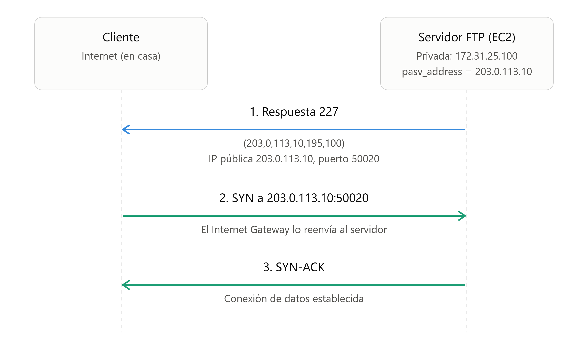{.cien .marco .marginbottom20 .margintop10}

!!! example "Resumen de la configuración pasiva en vsftpd"
    ```ini
    pasv_enable=YES
    pasv_min_port=50000
    pasv_max_port=50100
    pasv_address=203.0.113.10
    ```

## 3 - Seguridad en los protocolos de transferencia y acceso remoto

### 3.1 Vulnerabilidades del protocolo FTP tradicional

- El protocolo FTP original fue concebido en los años 70 y fijado en su forma actual en 1985, bajo un paradigma de confianza mutua dentro de redes académicas cerradas.
- Como consecuencia, **carece por completo de mecanismos criptográficos nativos**:  
    1. **Exposición total de credenciales:** Las órdenes `USER` y `PASS` viajan en texto plano por el canal de control. Cualquier analizador de protocolos conectado a la red local o en puntos intermedios de enrutamiento puede interceptar las contraseñas sin esfuerzo (*sniffing*  + `Wireshark`).
    1. **Intercepción y manipulación de datos:** Los archivos transferidos carecen de firmas de integridad o cifrado confidencial, permitiendo a un atacante en posición de intermediario (*Man-in-the-Middle*) leer el contenido o inyectar código malicioso en descargas de ejecutables.

### 3.2 FTPS: FTP sobre TLS

- FTPS añade cifrado TLS al protocolo FTP sin cambiar su modelo de comandos.
- La RFC 4217 define su funcionamiento, basado en la extensión de seguridad de la RFC 2228.
- El servidor se identifica con un certificado digital X.509.

#### 3.2.1 FTPS explícito (FTPES)

1. El cliente se conecta al puerto 21 TCP en texto claro y recibe el banner de bienvenida.
1. El cliente envía AUTH TLS para pedir que se cifre la conexión. Si el servidor acepta, responde 234.
1. Ambos realizan el handshake TLS. El servidor presenta su certificado y el cliente lo valida. Desde ese momento, el canal de control va cifrado con el algoritmo negociado.
1. El cliente envía USER y PASS ya por el canal cifrado.
1. Para cifrar también los datos, el cliente envía PBSZ 0 y PROT P (nivel Private). Sin PROT P, los datos viajan en claro.
1. Si el servidor no admite TLS (por ejemplo, responde 534), es el cliente quien decide si continúa sin cifrar o aborta.

#### 3.2.2 FTPS implícito (en desuso)

1. El cliente se conecta a un puerto dedicado: 990 TCP para control (y 989 TCP como puerto de origen de datos en modo activo).
1. El handshake TLS se realiza nada más abrir la conexión, antes de cualquier comando FTP. No existe AUTH TLS.
1. Estado actual: no está estandarizado y se considera obsoleto. Requiere puertos adicionales y no permite negociar capacidades como el explícito. Aun así, sigue presente en sistemas heredados (IIS y vsftpd todavía lo admiten).

!!! warning "Una consecuencia práctica que enlaza con el modo activo y pasivo:"
    - Como el canal de control va cifrado, los ALG de los routers no pueden leer PORT ni 227.
    - Por eso en FTPS conviene usar **el modo pasivo con un rango de puertos fijo y la IP externa configurada**.

### 3.3 SFTP: SSH File Transfer Protocol (El estándar seguro monocanal)

Existe una confusión conceptual muy extendida: **SFTP NO es FTP con cifrado**. Tampoco es FTP "tunelizado" dentro de SSH ni *Simple FTP*.

- **SFTP (SSH File Transfer Protocol)** es un protocolo totalmente independiente, diseñado desde cero por el grupo de trabajo `secsh` de la IETF como un **subsistema de SSH-2 (Secure Shell)**. Es un protocolo de **acceso remoto a ficheros**: permite transferir, pero también listar, renombrar, borrar, cambiar permisos y reanudar transferencias. Nunca se publicó como RFC definitivo (quedó como borrador, *draft*), pero la versión 3 está implementada de forma universal.
- **Arquitectura de conexión única (Monocanal):** A diferencia de la doble conexión de FTP, SFTP canaliza absolutamente todo (autenticación, navegación, listados, transferencias y control de flujo) a través de **un único puerto TCP: el puerto 22**.
- **Beneficios operativos determinantes:**
    1. **Cero problemas con NAT y cortafuegos:** Basta con permitir el puerto 22 TCP en los grupos de seguridad y reglas de red. No requiere rangos de puertos efímeros ni configuraciones de IP pública pasiva.
    1. **Cifrado extremo a extremo nativo:** Todo el canal viaja protegido por los algoritmos de intercambio de claves Diffie-Hellman y cifrados simétricos de alta seguridad (ChaCha20, AES-GCM).
    1. **Autenticación avanzada:** Se integra de forma nativa con los mecanismos de autenticación de SSH, permitiendo el acceso tanto por contraseñas como mediante **parejas de claves asimétricas pública/privada** sin intervención de contraseñas.

### 3.4 SCP: Secure Copy Protocol

- Es una utilidad de transferencia punto a punto no interactiva basada en el protocolo `rcp` (*Remote Copy*) de los sistemas BSD, operando igualmente sobre el túnel seguro de **SSH (puerto 22 TCP)**. Para copiar, el cliente abre una sesión SSH y ejecuta en el servidor el propio comando `scp` en modo origen o destino.
- **Diferencia con SFTP:** SCP está orientado a la copia directa de archivos mediante una orden puntual de línea de comandos (ej. `scp archivo.txt usuario@servidor:/ruta/`). No mantiene una sesión interactiva de gestión del sistema de ficheros. SFTP, por contra, permite además reanudar descargas, listar directorios, crear o borrar carpetas y modificar permisos y atributos de ficheros.
- **¿Por qué se desaconseja?** El protocolo SCP/RCP original deja que sea el **servidor** quien decida qué nombres de fichero envía, sin que el cliente pueda comprobarlo del todo. Un servidor malicioso o comprometido podía sobrescribir ficheros del cliente. Es un defecto de diseño y no se corrige sin romper la compatibilidad.
- **Situación actual:** desde **OpenSSH 9.0**, el comando `scp` transfiere internamente usando **SFTP**. El comando se mantiene por comodidad (sintaxis conocida), pero el protocolo antiguo ya no se usa por defecto. Para scripts nuevos se recomienda `sftp` o `rsync` sobre SSH.

### 3.5 Tabla resumen de protocolos

| Criterio técnico | FTP clásico (RFC 959) | FTPS Explícito (FTPES) | FTPS Implícito (Legacy) | SFTP (SSH File Transfer) | SCP (Secure Copy) |
|---|:---:|:---:|:---:|:---:||
| **Protocolo base** | FTP | FTP + TLS/SSL | FTP + TLS/SSL | SSH-2 (Subsistema) | SSH-2 (ejecuta `scp` en remoto sobre la sesión) |
| **Cifrado de datos y credenciales** | ❌ No (Texto claro) | ✔️ Sí (TLS 1.2 / 1.3) | ✔️ Sí (TLS 1.2 / 1.3) | ✔️ Sí (Cifrado SSH) | ✔️ Sí (Cifrado SSH) |
| **Puertos de red utilizados** | TCP 21 (control) + TCP 20/dinámicos (datos) | TCP 21 (control) + Puertos pasivos (datos) | TCP 990 (control) + TCP 989/dinámicos | **Únicamente TCP 22** | **Únicamente TCP 22** |
| **Número de conexiones TCP** | 2 independientes | 2 independientes | 2 independientes | **1 única multiplexada** | **1 única conexión** |
| **Complejidad en NAT / Firewalls** | Muy alta (bloqueo en modo activo) | Alta (requiere abrir rango pasivo e IP pública) | Alta (requiere abrir puertos específicos) | **Mínima (solo requiere abrir el puerto 22)** | **Mínima (solo requiere abrir el puerto 22)** |
| **Mecanismo de autenticación** | Usuario / Contraseña en texto plano | Usuario / Contraseña (cifradas por TLS). **El certificado X.509 identifica al servidor**; el del cliente es opcional | Usuario / Contraseña (cifradas por TLS). **El certificado X.509 identifica al servidor**; el del cliente es opcional | Contraseña o **Claves asimétricas (RSA/Ed25519)** | Contraseña o **Claves asimétricas (RSA/Ed25519)** |
| **Interoperabilidad interactiva** | Sí (cliente gráfico y consola) | Sí (cliente gráfico y consola) | Sí (compatibilidad reducida) | Sí (FileZilla, consola interactiva `sftp`) | No (comando directo de copia puntual) |
| **Estado actual (en desuso vs. uso vigente)** | 🚫 **En desuso.** No debe usarse en redes no confiables: expone credenciales y datos. Solo se tolera en redes aisladas o por compatibilidad con equipos antiguos. | ✅ **Vigente.** Es la forma estándar de FTPS (RFC 4217). Se usa cuando se necesita mantener infraestructura FTP con cifrado y certificados. | 🚫 **En desuso (legacy).** Nunca fue estandarizado oficialmente (anterior a RFC 4217). Solo se mantiene por compatibilidad; se recomienda migrar a FTPES o SFTP. | ✅ **Recomendado.** Es el estándar de facto actual para transferencias seguras de ficheros, en servidores, automatización y entornos cloud. | ⚠️ **Obsoleto / desaconsejado.** El protocolo SCP/RCP original tiene debilidades de seguridad conocidas. OpenSSH 9.0+ lo implementa internamente sobre SFTP, y el comando `scp` se mantiene solo por comodidad. Se recomienda `sftp` o `rsync` sobre SSH. |

### 3.6 Verificación de la identidad del servidor

Hasta ahora hemos visto cómo el servidor identifica al usuario. Pero el **cliente también debe comprobar que habla con el servidor auténtico**, y no con un atacante que se hace pasar por él (*Man-in-the-Middle*).

#### 3.6.1 En SSH/SFTP: la huella de la clave del servidor

1. En la **primera conexión**, el cliente muestra un aviso como este:
    ```text
    The authenticity of host '203.0.113.10' can't be established.
    ED25519 key fingerprint is SHA256:3b0kR...q9Yw.
    Are you sure you want to continue connecting (yes/no/[fingerprint])?
    ```
1. El administrador debería **comparar esa huella con la real** del servidor, que se obtiene en el propio servidor con:
    ```bash
    ssh-keygen -lf /etc/ssh/ssh_host_ed25519_key.pub
    ```
1. Al aceptar, la clave se guarda en `~/.ssh/known_hosts` del cliente.
1. En conexiones posteriores, si la clave **cambia**, el cliente muestra `WARNING: REMOTE HOST IDENTIFICATION HAS CHANGED!` y se niega a conectar. Puede ser una reinstalación legítima del servidor... o un ataque. Si es legítimo, se elimina la entrada antigua con `ssh-keygen -R servidor`.

#### 3.6.2 En FTPS: el certificado X.509

- El cliente valida que el certificado esté **firmado por una CA de confianza**, que el nombre del certificado **coincida con el del servidor** y que **no esté caducado**.
- En el laboratorio se suele usar un **certificado autofirmado** (sin CA). Por eso FileZilla muestra el diálogo *Certificado desconocido* con la huella del certificado, y el usuario decide si confiar en él (`Confiar siempre en este certificado`).
- En producción debe usarse un certificado emitido por una CA reconocida (por ejemplo, Let's Encrypt), para que los clientes no tengan que aceptar avisos que acostumbran a ignorar.

!!! warning "Aceptar sin leer anula el cifrado"
    Si el usuario acepta siempre cualquier aviso, el cifrado sigue existiendo, pero un atacante en medio podría presentar su propia clave o certificado y descifrar todo el tráfico.

## 4 - Ecosistema de software: Servidores y Clientes (Windows y Linux)

### 4.1 Software de Servidor

- **Internet Information Services (IIS - Rol Servidor FTP):** Servidor FTP empresarial desarrollado por Microsoft e integrado de forma nativa en las ediciones de Windows Server. Proporciona administración centralizada mediante interfaz gráfica (`inetmgr`) o PowerShell, soportando FTPS (explícito, y también implícito si se enlaza al puerto 990), aislamiento de usuarios basado en directorios o Active Directory, y registro de logs en formato W3C.

!!! warning "IIS no ofrece SFTP"
    El servidor FTP de IIS solo implementa FTP y FTPS. Para ofrecer **SFTP** en Windows hay que instalar **OpenSSH Server**.

- **vsftpd (Very Secure FTP Daemon):** Servidor FTP estándar de referencia en distribuciones Linux (Ubuntu, Debian, Red Hat). Reconocido por su seguridad extrema frente a desbordamientos de búfer, bajo consumo de recursos y alto rendimiento. Su configuración reside en el fichero de texto plano `/etc/vsftpd.conf` en Debian y Ubuntu, y en `/etc/vsftpd/vsftpd.conf` en Red Hat y derivadas.
- **OpenSSH Server (`sshd`):** Servicio de administración y acceso remoto multiplataforma que proporciona simultáneamente servicios de consola remota, SFTP y SCP. Disponible de forma nativa tanto en distribuciones Linux (`/etc/ssh/sshd_config`) como característica opcional en Windows Server (`C:\ProgramData\ssh\sshd_config`).

### 4.2 Software de Cliente

- **FileZilla Client:** Herramienta gráfica multiplataforma (Windows, Linux, macOS) líder en el sector. Presenta una interfaz de doble panel (árbol local a la izquierda y árbol remoto a la derecha), con soporte nativo para FTP, FTPS y SFTP, gestor de sitios protegidos y reanudación automática de transferencias interrumpidas.
- **WinSCP:** Cliente gráfico para Windows de SFTP, SCP y FTP(S). Muy usado en administración y permite automatizar tareas con scripts.
- **PuTTY y PuTTYgen:** Suite de utilidades de conectividad para entornos Windows. Permite el acceso a la consola SSH remota de servidores y, mediante la herramienta **PuTTYgen**, la generación, conversión y gestión de parejas de claves criptográficas en formato propietario `.ppk` (*PuTTY Private Key*).
- **Clientes integrados de consola (CLI):** Utilidades nativas en terminales de Linux y PowerShell en Windows, como `ftp`, `sftp`, `scp`, `ssh` y `curl`. Otros clientes de consola muy completos son `lftp` (Linux) y `curl`.

### 4.3 Instalación de los servicios en Windows y Linux

#### 4.3.1 Tarea-RA3-CEb-1 - Servidor FTP de IIS (Windows Server) y OpenSSH

!!! warning "Obligatorio seguir las normas para la presentación de trabajos escritos."

- En esta tarea se abordará la puesta en marcha de dos servicios de transferencia de ficheros sobre un servidor Windows, con enfoques y niveles de seguridad distintos.
- Por un lado, se instalará y configurará el **servicio FTP de Microsoft IIS**, que permite publicar un sitio FTP con control de usuarios, permisos de acceso, aislamiento de directorios y cifrado opcional mediante FTPS (TLS/SSL con certificado X.509).
- Por otro lado, se desplegará **OpenSSH Server**, que ofrece SFTP a través de un único puerto (TCP 22) y admite autenticación por contraseña o por claves asimétricas.

##### 4.3.1.1 Lanzar una instancia EC2 con Windows Server 2025 en AWS

- En la consola de **EC2** lanzar una instancia con los siguientes parámetros:

    ==Realizar captura de pantalla==  

    | Parámetro de configuración | Valor requerido |
    |||
    | **Nombre** | `Servidor_FTPSSH` |
    | **Imagen de aplicaciones** | `Microsoft Windows Server 2025 Base` (64 bits x86) |
    | **Tipo de instancia** | **`t3.large`** (Recomendado — 2 vCPU, 8 GiB RAM |
    | **Par de claves** | `vockey` (par de claves RSA `.pem` proporcionado por AWS Academy) |
    | **Configuración de red** | VPC predeterminada (**172.31.0.0/16**) |
    | **Configuración de red** | Subred (**172.31.32.0/20**) |
    | **Configuración de red** | Asignar IP pública automáticamente (**Habilitar**) |
    | **Firewall (grupos de seguridad)** | Crear grupo de seguridad / Nombre: SG-WindowsServer-FTP |
    | **Configurar almacenamiento** | `30 GiB` gp3 (SSD de uso general) |

##### 4.3.1.2 Preparación de la instancia en AWS y apertura de puertos

Antes de configurar los servicios en la máquina, debemos configurar el **Security Group** de AWS para que autorice las conexiones RDP, SSH y los puertos requeridos por FTP.

1. Acceder a la consola de AWS → **EC2** → Seleccionar nuestra instancia → en la tabla resumen buscar **Seguridad** y hacer clic en **Grupos de seguridad**.

1. En la sección **Reglas de entrada** → pulsar en el botón **Editar reglas de entrada** → **Agregar regla**:  
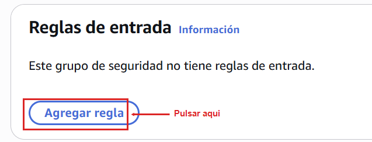{.marco .leftcincocero .margintop10 .marginbottom20}

1. Añadir las 5 reglas requeridas:
    1. **RDP:** Puerto `3389` TCP (para administrar gráficamente la máquina).
    1. **SSH:** Puerto `22` TCP (para el servidor OpenSSH).
    1. **FTP Control:** Puerto `21` TCP.
    1. **FTP Pasivo (Windows):** Rango de puertos `50000-50100` TCP.
    1. **FTP Pasivo (Ubuntu):** Rango de puertos `40000-40100` TCP.

    ==Realizar captura de pantalla==  
    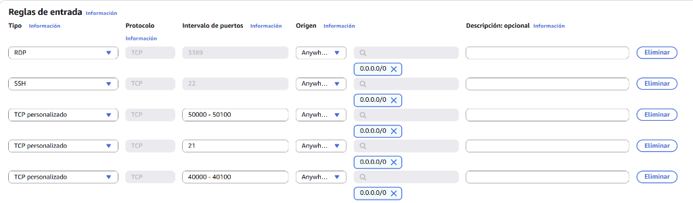{.marco .margintop10}

##### 4.3.1.3 Conexión RDP a la instancia de Windows Server

- Para administrar gráficamente nuestra instancia nos conectaremos a través del protocolo **RDP (Remote Desktop Protocol)** utilizando el cliente nativo de Windows (*Conexión a Escritorio remoto* / `mstsc`).
- Como las máquinas desplegadas en AWS EC2 se crean con una contraseña aleatoria y cifrada, debemos descifrarla primero utilizando la clave privada `.pem`.

!!! warning "Atención al inicio de sesión en ordenadores con dominio del instituto (SICE / Dominio corporativo)"
    - Si realizamos la práctica desde un equipo del aula que está integrado en un dominio corporativo o educativo, Windows asumirá por defecto que el usuario pertenece al dominio del centro (ej. `CENTRO\Administrator`). Esto provocará un fallo de credenciales erróneas.
    !!! success "Solución"
        - Pulsar en **Más opciones** → **Usar otra cuenta** → escribir como **Nombre de usuario**: `.\Administrator`

##### 4.3.1.4 Instalación del rol Servidor FTP (IIS)

1. En **Server Manager**, pulsar en el enlace central **Add roles and features**.
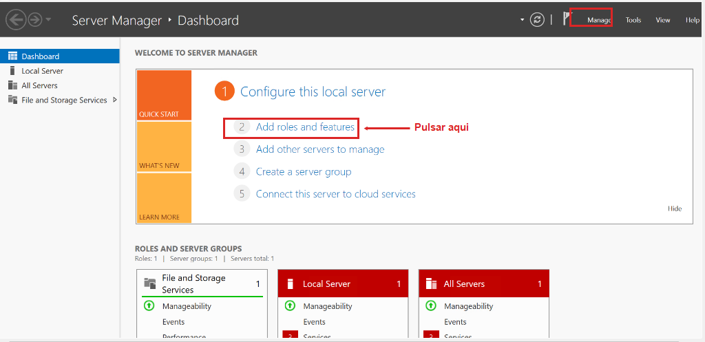{.marco .margintop10 .marginbottom20}

1. Avanzar por las pantallas preliminares (**Before You Begin**, **Installation Type** y **Server Selection**) manteniendo los valores por defecto pulsando **Next**.
1. En la pantalla **Server Roles**:
   - Marcar la casilla **Web Server (IIS)** (si aparece la ventana emergente solicitando características requeridas, confirmar haciendo clic en **Add Features**).
1. Avanzar por **Features** y **Web Server Role (IIS)** hasta llegar a la pantalla **Role Services**:
   - Desplegar la categoría **FTP Server** y marcar las casillas **FTP Service** y **FTP Extensibility**.
   - Verificar que en **Management Tools** queda marcada la **IIS Management Console**.  
   ==Realizar captura de pantalla==  
    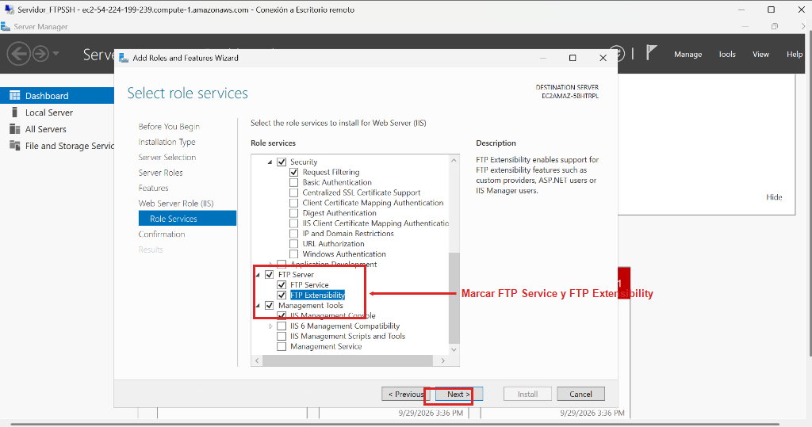{.marco .margintop10 .marginbottom20}
1. En la pantalla **Confirmation**, revisar los elementos y pulsar el botón **Install**.
1. Una vez completado el proceso, la barra de progreso mostrará el mensaje **Installation succeeded** y se activará el botón **Close**.  
==Realizar captura de pantalla==  
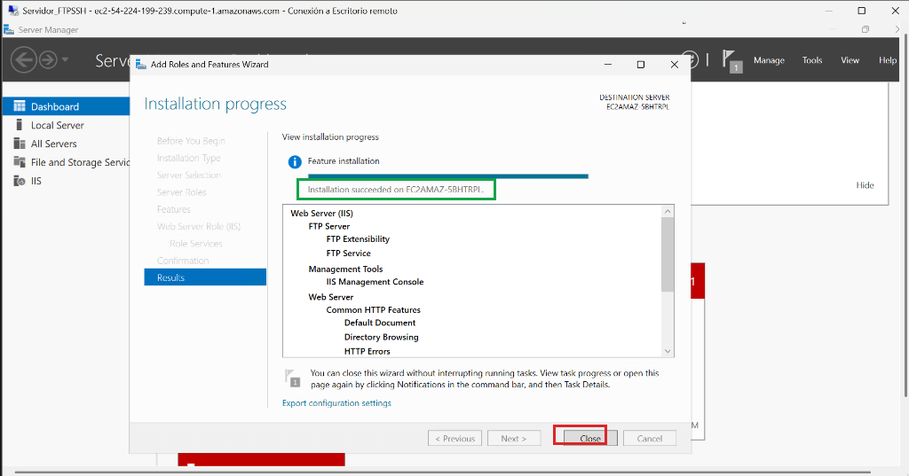{.marco .margintop10 .marginbottom20}

##### 4.3.1.5 Instalación del rol Servidor FTP (IIS) por CLI

1. Como método alternativo a la interfaz gráfica, podremos usar una línea de comandos.
1. Abrir una consola de `PowerShell` como **administrador**.
1. Para instalar el rol FTP (IIS) ejecutaremos los siguientes comandos:

    !!! warning "No ejecutar los comandos si ya habeís instalado los roles"
    ```powershell
    Install-WindowsFeature -Name Web-Server, Web-Ftp-Server, Web-Ftp-Service, Web-Ftp-Ext, Web-Mgmt-Console
    ```

1. Para comprobar que los servicios se han instalado correctamente, ejecutaremos el siguiente comando.
    ```powershell
    Get-WindowsFeature Web-Ftp*
    ```
    ==Realizar captura de pantalla==  
    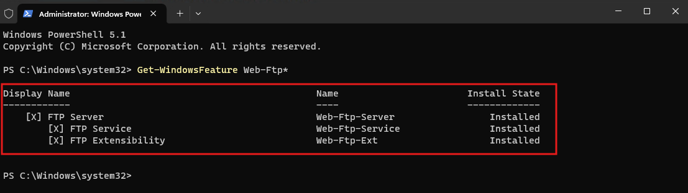{.margintop10 .marginbottom20}


<!-- 1. Crear el sitio en el Administrador de IIS (`inetmgr`): *Sitios → Agregar sitio FTP...* y definir el nombre, la ruta física (`C:\inetpub\ftproot`), el enlace (IP y puerto 21), el certificado SSL, la autenticación y la autorización.
1. Abrir el puerto de control y el rango pasivo en el Firewall de Windows:  
   ```powershell
   New-NetFirewallRule -DisplayName "FTP control 21" -Direction Inbound -Protocol TCP -LocalPort 21 -Action Allow
   New-NetFirewallRule -DisplayName "FTP pasivo 50000-50100" -Direction Inbound -Protocol TCP -LocalPort 50000-50100 -Action Allow
   ```
1. Fijar el rango de puertos pasivos y la IP externa en *Compatibilidad con firewall FTP* (a nivel de servidor y de sitio) y reiniciar el servicio:
   ```powershell
   ```
   Restart-Service ftpsvc -->

##### 4.3.1.6 Instalación y activación del Servidor OpenSSH

- En las imágenes oficiales de Windows Server proporcionadas por Amazon Web Services (AWS EC2), la característica de **OpenSSH Server** ya viene preinstalada en el sistema como característica opcional (**Optional feature**), por lo que únicamente es necesario verificar su presencia e iniciar su servicio.

!!! tip "Comprobación gráfica mediante Configuración:"
    1. Pulsar el botón **Inicio** de Windows → hacer clic en **Settings**.
    1. Ir a **System** → **Optional features**.
    1. En la sección **Added features** (Características añadidas), escribir `ssh` en el filtro de búsqueda.
    1. Comprobar que **OpenSSH Server** figura ya como instalado (la casilla de selección solo sirve si deseamos desinstalar el servicio).
    1. Pulsar **Close** para cerrar la ventana.  
    ==Realizar captura de pantalla==
    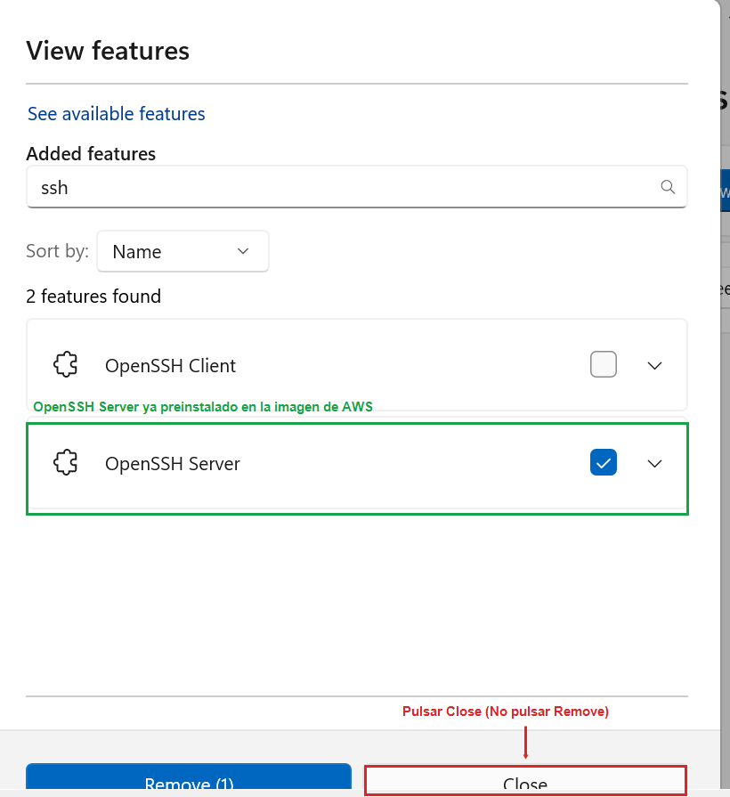{.marco .leftcincocero .margintop10 .marginbottom20 }

!!! tip "Inicio y arranque del servicio OpenSSH (Consola gráfica de Servicios):"
    1. Pulsar `Windows + R`, escribir `services.msc` y pulsar Enter (o desde **Server Manager** -> menú superior **Tools** -> **Services**).
    1. Localizar en la lista el servicio **OpenSSH SSH Server**.
    1. Hacer clic derecho sobre él → ir a **Properties**.
        1. Cambiar el **Tipo de inicio** (**Startup type**) a **Automático** (**Automatic**).
        1. Pulsar en el botón **Iniciar** (**Start**).
        1. Pulsar **OK**.  
    ==Realizar captura de pantalla==
    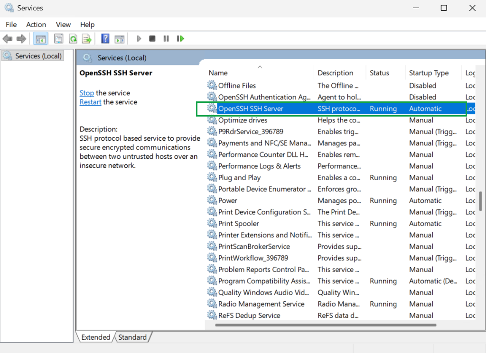{.marco .cien .margintop10 .marginbottom20}

!!! abstract "Alternativa por PowerShell"
    - Abrir una consola de **PowerShell como Administrador** y ejecutar:  
    ```powershell
    Add-WindowsCapability -Online -Name OpenSSH.Server~~~~0.0.1.0
    Start-Service sshd
    Set-Service -Name sshd -StartupType Automatic
    ```

##### 4.3.1.7 Entrega de la tarea

!!! warning "Entrega de la tarea"

    - Subir vuestra tarea guardando el archivo como RA3-CEb-1 a la tarea correspondiente de aules.
    - La estrutura de vuestra tarea deberá seguir las [**Normas para la Presentación de Trabajos Escritos**](./0_RedaccionTareas.md). 
    - Realizar las capturas de pantalla mínimas exigidas en los apuntes.
    - Comentar las capturas de pantalla explicando el trabajo realizado para llegar a ese punto y el resultado obtenido.
    - A partir del momento de apertura de la tarea, dispondréis de **2 semanas** para subir vuestros trabajos.
    - Pasado ese tiempo la tarea se cerrará y ya no será posible subir vuestras respuestas.

#### 4.3.2 Tarea-RA3-CEb-2 - Instalar VSFTP en Ubuntu Server 26.04 LTS

##### 4.3.2.1 Lanzar una instancia EC2 con Ubuntu Server 26.04 en AWS

- En la consola de **EC2** lanzar una instancia con los siguientes parámetros:

    ==Realizar captura de pantalla==  

    | Parámetro de configuración | Valor requerido |
    |||
    | **Nombre** | `Servidor_VSFTPD` |
    | **Imagen de aplicaciones** | `Ubuntu Server 26.04 LTS` |
    | **Tipo de instancia** | **`t3.large`** (Recomendado — 2 vCPU, 8 GiB RAM |
    | **Par de claves** | `vockey` (par de claves RSA `.pem` proporcionado por AWS Academy) |
    | **Configuración de red** | VPC predeterminada (**172.31.0.0/16**) |
    | **Configuración de red** | Subred (**172.31.32.0/20**) |
    | **Configuración de red** | Asignar IP pública automáticamente (**Habilitar**) |
    | **Firewall (grupos de seguridad)** | **Seleccionar un grupo de seguridad existente → SG-WindowsServer-FTP** |
    | **Configurar almacenamiento** | `20 GiB` gp3 (SSD de uso general) |

- Resultado esperado.
    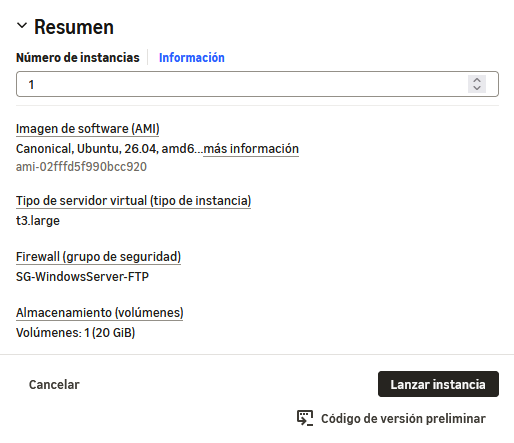{.marco .leftsietecero .margintop10 .marginbottom20}

##### 4.3.2.2 Preparación de la instancia en AWS y apertura de puertos

- Al igual que en la tarea anterior , debemos configurar el **Security Group** de AWS para que autorice las conexiones RDP, SSH y los puertos requeridos por FTP.
- En este caso no será necesario realizar ninguna operación al utilizar el mismo grupo de seguridad `SG-WindowsServer-FTP` que la instancia `Servidor_FTPSSH`, que ya hemos configurado previamente.

    ==Realizar captura de pantalla==  
    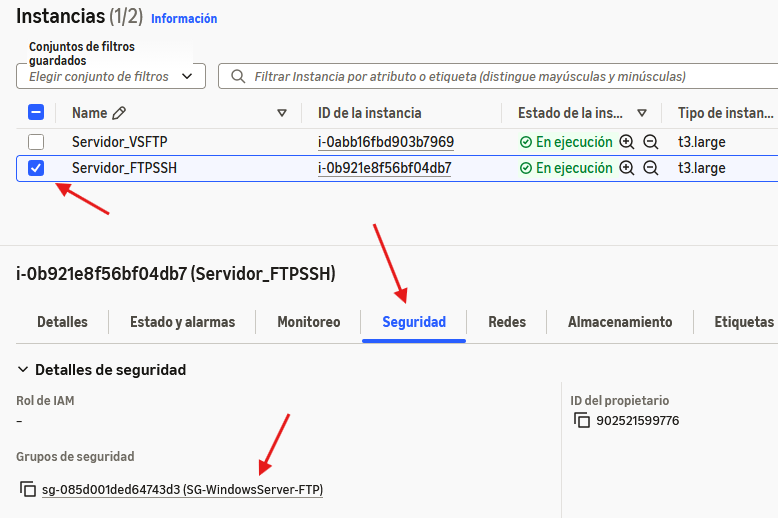{.marco .leftsietecero .margintop10 .marginbottom20}

##### 4.3.2.3 Instalación del servicio VSFTPD (Linux, Debian/Ubuntu)

1. Para instalar el servicio ejecutaremos los siguientes comandos

    ```bash
    sudo apt update
    sudo apt upgrade -y
    sudo apt install vsftpd
    sudo systemctl enable --now vsftpd
    sudo systemctl status vsftpd
    sudo ufw allow 21/tcp
    sudo ufw allow 50000:50100/tcp
    ```

    !!! tip "Explicación de los comandos"
        1. `sudo apt install vsftpd`→ Instala vsftpd (Very Secure FTP Daemon).
        1. `sudo systemctl enable --now vsftpd` → Hace dos cosas a la vez:
            - `enable`: El servicio arrancará automáticamente cada vez que se inicie el sistema.
            - `--now`: Lo arranca ya mismo, sin esperar a reiniciar.
        1. `sudo systemctl status vsftpd` → Muestra el estado del servicio → Si todo va bien → active (running) en verde.
        1. `sudo ufw allow 21/tcp`→ Abre el puerto 21 en el firewall UFW. Es el puerto de control de FTP.
        1. `sudo ufw allow 50000:50100/tcp` → Abre un rango de puertos (50000 a 50100) para el modo pasivo de FTP. **Este rango debe coincidir con lo que configures en `/etc/vsftpd.conf`**:
            ```bash
            pasv_enable=YES
            pasv_min_port=50000
            pasv_max_port=50100
            ```

1. Si todo ha ido bien veremos al final del log el `status del servicio`:  
    ==Realizar captura de pantalla==  
    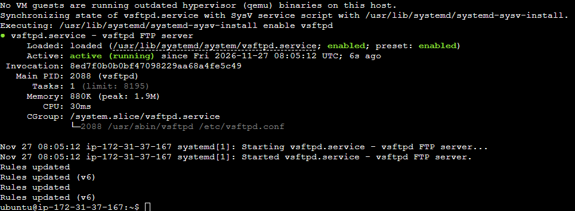{ .cien .margintop10 .marginbottom20}

1. Configuración mínima de `VSFTPD`  

    !!! warning "Importante:"
        Después de cada cambio en `/etc/vsftpd.conf` hay que reiniciar el servicio con `sudo systemctl restart vsftpd`.

    !!! tip "Editar el archivo `/etc/vsftpd.conf` e introducir la siguiente configuración"
        ```ini
        # Acceso
        listen=YES
        anonymous_enable=NO
        local_enable=YES
        write_enable=YES
        local_umask=022
        # listen_ipv6 # se debe comentar esta directiva
        # Enjaulado
        chroot_local_user=YES
        # Modo pasivo
        pasv_enable=YES
        pasv_min_port=50000
        pasv_max_port=50100
        pasv_address=<IP pública> 34.201.130.98
        # Registro
        xferlog_enable=YES
        vsftpd_log_file=/var/log/vsftpd.log
        ```

1. Activar **FTPS explícito**
    - Para activar **FTPS explícito** debemos generar **un certificado** y añadir estas directivas al archivo `/etc/vsftpd.conf`:

    - Generar un certificado.
    ```bash
    sudo openssl req -x509 -nodes -days 365 -newkey rsa:2048 \
    -keyout /etc/ssl/private/vsftpd.key -out /etc/ssl/certs/vsftpd.pem
    ```

        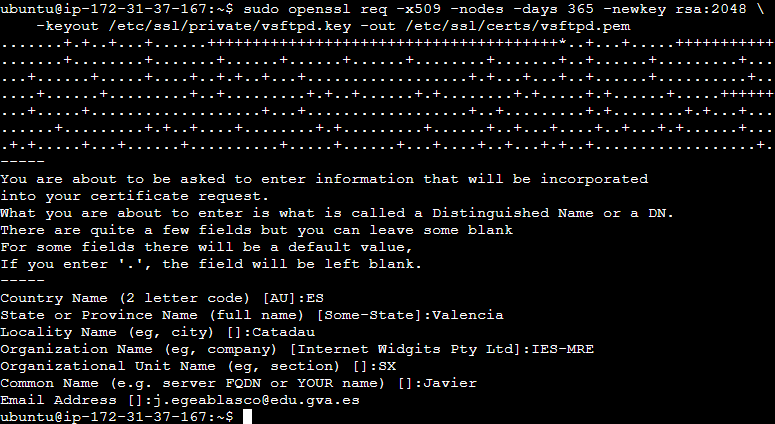{ .cien .margintop10 .marginbottom20}

    - Añadir / modificar las siguientes directivas del archivo `/etc/vsftpd.conf`.
    ```ini
    ssl_enable=YES
    rsa_cert_file=/etc/ssl/certs/vsftpd.pem
    rsa_private_key_file=/etc/ssl/private/vsftpd.key
    force_local_logins_ssl=YES
    force_local_data_ssl=YES
    ssl_tlsv1=NO
    ssl_sslv2=NO
    ssl_sslv3=NO
    require_ssl_reuse=NO
    ```

1. Reiniciar el servicio y comprobar su estado.
    - Reinciaremos y comprobaremos el servicio con:
    ```bash
    sudo systemctl restart vsftpd
    sudo systemctl status vsftpd
    ```
    ==Realizar captura de pantalla==
        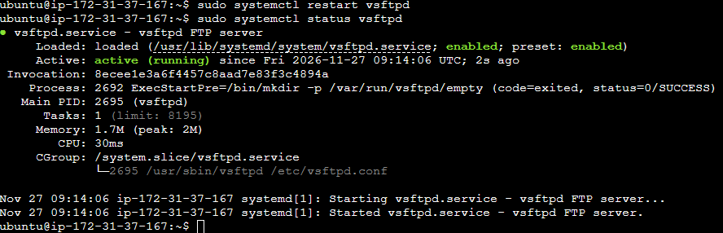{ .cien .margintop10 .marginbottom20}

    !!! tip "Error típico con FileZilla"
        Si FileZilla muestra `522 SSL connection failed; session reuse required`, añade `require_ssl_reuse=NO` y reinicia vsftpd.


##### 4.3.2.4 Entrega de la tarea

!!! warning "Entrega de la tarea"

    - Subir vuestra tarea guardando el archivo como RA3-CEb-2 a la tarea correspondiente de aules.
    - La estrutura de vuestra tarea deberá seguir las [**Normas para la Presentación de Trabajos Escritos**](./0_RedaccionTareas.md). 
    - Realizar las capturas de pantalla mínimas exigidas en los apuntes.
    - Comentar las capturas de pantalla explicando el trabajo realizado para llegar a ese punto y el resultado obtenido.
    - A partir del momento de apertura de la tarea, dispondréis de **2 semanas** para subir vuestros trabajos.
    - Pasado ese tiempo la tarea se cerrará y ya no será posible subir vuestras respuestas.


## 5 - Gestión de usuarios, aislamiento, bastionado y auditoría

### 5.1 Tipologías de usuarios en un servidor de ficheros (Anónimos, Locales y Virtuales)

Un aspecto clave en la administración de un servicio de transferencia de ficheros es determinar cómo se identifican los usuarios y qué alcance de permisos reciben:

1. **Acceso anónimo (`anonymous` o `ftp`):**
    - **Propósito:** Permitir que cualquier usuario de Internet descargue recursos públicos (manuales, documentación, parches, distribuciones de software) sin necesidad de contar con una cuenta previa en el sistema.
    - **Credenciales:** Se utiliza convencionalmente el identificador `anonymous` y, como contraseña, cualquier cadena de texto (tradicionalmente la dirección de correo del visitante).
    - **Regla de seguridad vital:** Los usuarios anónimos deben configurarse con **permisos estrictos de solo lectura (`Read-only`)**. Otorgar permisos de escritura o borrado a usuarios anónimos constituye una negligencia crítica, ya que permitiría a actores maliciosos utilizar el almacenamiento del servidor para alojar contenido ilegal, herramientas de ataque o malware.

2. **Usuarios locales del sistema operativo:**
    - **Propósito:** Empleados o usuarios autorizados que disponen de una cuenta de usuario creada en la base de datos de seguridad local del sistema operativo anfitrión (la base de datos SAM en Windows Server o los ficheros `/etc/passwd` y `/etc/shadow` en Linux).
    - **Riesgo:** Si un atacante compromete la contraseña de un usuario local a través de FTP sin cifrar, podría llegar a reutilizar dichas credenciales para acceder a otros servicios locales del servidor (como RDP o SSH).

3. **Usuarios virtuales:**
    - **Propósito:** Cuentas de usuario que existen únicamente en la configuración interna del servicio FTP o en una base de datos externa (MySQL, MariaDB, ficheros Berkeley DB), sin correspondencia directa con cuentas de inicio de sesión del sistema operativo.
    - **Beneficio:** Todas las cuentas virtuales se mapean a un único usuario del sistema sin privilegios de ejecución (como el usuario `nobody` o `ftp`), logrando el máximo grado de aislamiento y seguridad frente a posibles brechas de acceso.

### 4.2 Mecanismos de enjaulado y aislamiento de usuarios (chroot y LocalUser)

- Por defecto, si un servidor FTP autentica a un usuario local sin medidas de confinamiento, el usuario aterrizará en su carpeta personal pero tendrá la capacidad técnica de emitir órdenes `cd ..` y navegar libremente hacia directorios raíz del sistema (como `C:\Windows\System32` o `/etc`), pudiendo consultar ficheros confidenciales del sistema operativo.

- Para impedirlo, se aplica el mecanismo de **enjaulado** (*chroot jail* / *User Isolation*):

#### 4.2.1 Enjaulado en Linux con `vsftpd` (`chroot`)

1. **La directiva `chroot_local_user=YES`** instruye a `vsftpd` a realizar una llamada de sistema `chroot()`, convirtiendo el directorio asignado al usuario en su nueva raíz lógica del sistema de ficheros (`/`). Cualquier intento de subir a un nivel superior es bloqueado por el propio kernel.
1. **La directiva `allow_writeable_chroot`:** Por motivos de seguridad estricta, `vsftpd` implementa una defensa contra vulnerabilidades conocidas de elevación de privilegios: 
    - Si el directorio raíz donde queda confinado el usuario tiene permisos de escritura en Linux, el servidor aborta la conexión con el error:  
    `500 OOPS: vsftpd: refusing to run with writable root inside chroot()`  
    - Para resolverlo de forma segura en entornos docentes y productivos se habilita la directiva:
    ```ini
    allow_writeable_chroot=YES
    ```
    *(o alternativamente, se retiran los permisos de escritura del directorio raíz con `chmod a-w` y se crea una subcarpeta interna con permisos de escritura).*

#### 4.2.2 Aislamiento de usuarios en Windows Server (IIS `LocalUser`)

1. En el Administrador de IIS, la característica **Aislamiento de usuarios FTP** (*FTP User Isolation*) se configura seleccionando la opción **Directorio de nombre de usuario**.
1. El servidor exige crear una estructura de carpetas estricta bajo la raíz del sitio FTP denominada `LocalUser`:
    - `C:\inetpub\ftproot\LocalUser\<nombre_de_usuario>`: Cada usuario local autenticado es confinado automáticamente a su carpeta homónima. Desde su cliente FTP, esa carpeta aparecerá como la raíz `/`, sin permitirle ver ni acceder a las carpetas de otros compañeros ni al resto del disco duro.
    - `C:\inetpub\ftproot\LocalUser\Public`: Carpeta compartida a la que son dirigidos los usuarios anónimos o no aislados.

### 4.3 Administración remota segura con SSH y bastionado (Hardening)

- La administración de servidores en entornos modernos exige canales cifrados y robustos frente a accesos no autorizados.
- El protocolo **SSH (Secure Shell)** sobre el **puerto 22 TCP** reemplazó a protocolos vulnerables antiguos como Telnet y Rlogin.

#### 4.3.1 Autenticación por parejas de claves asimétricas

La autenticación tradicional por usuario y contraseña es susceptible a ataques de fuerza bruta mediante diccionarios automatizados. La mejor práctica de seguridad consiste en emplear **criptografía de clave pública**:

1. **Clave Privada (*Private Key*):**  
    - Permanece **exclusivamente en el dispositivo cliente** del administrador.
    - Debe protegerse mediante una frase de paso (*passphrase*) que la cifra en disco.
    - **Bajo ninguna circunstancia debe enviarse por la red ni entregarse a terceros**.

1. **Clave Pública (*Public Key*):**  
    - Puede distribuirse libremente sin comprometer la seguridad.
    - Se almacena en el servidor remoto en el fichero:
    - En Linux: `~/.ssh/authorized_keys` del usuario correspondiente.
    - En Windows Server: `C:\ProgramData\ssh\administrators_authorized_keys` (para miembros del grupo Administradores) o `C:\Users\<usuario>\.ssh\authorized_keys`.

1. **Algoritmos recomendados:**
    - **RSA:** Mínimo de 2048 o 4096 bits.
    - **Ed25519:** Algoritmo moderno basado en curvas elípticas (EdDSA), con claves mucho más compactas, mayor velocidad de cálculo y resistencia criptográfica superior frente a ataques.

#### 4.3.2 Bastionado (*Hardening*) del servicio OpenSSH

Para proteger un servidor expuesto a Internet en la nube frente a intrusiones automatizadas, se aplican las siguientes directivas en su fichero de configuración (`/etc/ssh/sshd_config` o `C:\ProgramData\ssh\sshd_config`):

1. **Desactivación de autenticación por contraseña (`PasswordAuthentication no`):**  
   Fuerza que cualquier conexión deba autenticarse obligatoriamente mediante una clave asimétrica válida. Si un atacante lanza un ataque de fuerza bruta con millones de contraseñas de diccionario, el servidor rechazará la conexión instantáneamente sin procesar la petición.
2. **Desactivación del acceso directo de superusuario (`PermitRootLogin no`):**  
   Impide que se intente iniciar sesión directamente como `root` o `Administrator`. Se debe ingresar con un usuario estándar y posteriormente elevar privilegios mediante `sudo`.
3. **Limitación de intentos de conexión (`MaxAuthTries 3`):**  
   Cierra la sesión tras tres intentos erróneos, bloqueando escaneos masivos.
4. **Cierre de sesiones inactivas (`ClientAliveInterval 300`):**  
   Envía paquetes nulos para desconectar automáticamente a usuarios que olviden cerrar su terminal tras 5 minutos de inactividad.

### 4.4 Auditoría, análisis forense y monitorización de registros (Logs y Wireshark)

La observabilidad y el registro de eventos son requisitos indispensables para garantizar la trazabilidad de accesos, detectar intrusiones y cumplir con normativas de ciberseguridad como el **Esquema Nacional de Seguridad (ENS)** y el **RGPD**:

#### 4.4.1 Registros en formato W3C en Microsoft IIS

El servicio FTP de IIS almacena sus accesos en ficheros de texto estructurados conforme al estándar **W3C Extended Log Format** (ubicados por defecto en `C:\inetpub\logs\LogFiles\FTPSVC1\`):

```text
#Fields: date time c-ip cs-username s-ip s-port cs-method cs-uri-stem sc-status sc-win32-status
2026-10-21 10:15:32 198.51.100.25 usuari_ventas 172.31.25.10 21 USER usuari_ventas 331 0
2026-10-21 10:15:32 198.51.100.25 usuari_ventas 172.31.25.10 21 PASS *** 230 0
2026-10-21 10:16:05 198.51.100.25 usuari_ventas 172.31.25.10 21 RETR /manual.pdf 226 0
2026-10-21 10:17:12 198.51.100.25 anonymous 172.31.25.10 21 STOR /subir.exe 550 5
```

- `date`: Fecha en la que se registra el evento (formato `AAAA-MM-DD`, en hora UTC por defecto en el formato W3C).
- `time`: Hora exacta del evento (formato `HH:MM:SS`). Junto con `date` permite reconstruir la cronología de una intrusión o un fallo.
- `c-ip`: Dirección IP pública del cliente que realiza la conexión.
- `cs-username`: Nombre del usuario que intenta la operación.
- `s-ip`: Dirección IP del servidor que atiende la conexión (útil cuando el servidor tiene varias interfaces o sitios FTP).
- `s-port`: Puerto TCP del servidor al que se conecta el cliente (`21` para el canal de control FTP/FTPES).
- `cs-method`: Comando FTP ejecutado (`USER`, `PASS`, `LIST`, `RETR`, `STOR`, `DELE`).
- `cs-uri-stem`: Ruta y nombre del fichero afectado en el servidor.
- `sc-status`: Código de estado numérico devuelto por el servidor (ej. `331` para usuario aceptado a la espera de contraseña, `230` para éxito de login, `226` para transferencia completada, `550` para acceso denegado).
- `sc-win32-status`: Código de error de Windows asociado a la operación. El valor `0` indica que no hubo error; otros valores indican la causa a nivel de sistema operativo (por ejemplo, `5` equivale a "Acceso denegado", `2` a "Archivo no encontrado").

**Prefijos de los campos:** `c-` = cliente, `s-` = servidor, `cs-` = del cliente al servidor (petición) y `sc-` = del servidor al cliente (respuesta).

**Lectura del ejemplo:**

1. Las dos primeras líneas muestran el inicio de sesión de `usuari_ventas`: el servidor acepta el usuario (`331`) y la contraseña (`230`). IIS enmascara la contraseña con `***`.
1. La tercera línea muestra una descarga correcta de `/manual.pdf` (`226`, error Win32 `0`).
1. La cuarta línea es un evento sospechoso: el usuario `anonymous` intenta subir `/subir.exe` y el servidor lo deniega (`550`, error Win32 `5` = acceso denegado). Conviene revisar la IP de origen y valorar si se deshabilita el acceso anónimo.

#### 4.4.2 Registros en servidores Linux

- `/var/log/vsftpd.log`: Registra cada conexión entrante, inicios de sesión y operaciones de subida y descarga con indicación exacta de bytes transferidos.
- `/var/log/auth.log` (o `/var/log/secure`): Registra todos los intentos de autenticación en el servidor (accesos aceptados por clave pública `Accepted publickey`, intentos fallidos por contraseña `Failed password for invalid user`, y elevaciones mediante `sudo`).

#### 4.4.3 Inspección de paquetes de red con Wireshark

Mediante el uso de analizadores de tráfico en el aula o laboratorio, es posible visualizar la diferencia palpable entre la opacidad del tráfico cifrado y la vulnerabilidad del tráfico plano:

- **En FTP estándar (Puerto 21):** Los paquetes TCP revelan claramente las cabeceras `USER` y `PASS` con las contraseñas legibles en texto ASCII, así como los datos transferidos.
- **En FTPS (TLS) y SFTP (SSH):** Todos los paquetes TCP aparecen etiquetados como *Application Data* cifrado con *payloads* aleatorios ininteligibles, protegiendo la confidencialidad de la información frente a atacantes en el mismo segmento de red.

### 4.5 Buenas prácticas y control de costes en laboratorios Cloud

Al operar infraestructuras en entornos de nube pública (**AWS Academy / AWS Learner Lab**), el rol del administrador de sistemas incluye la gestión rigurosa de los recursos:

1. **Principio de mínimo privilegio:** Desactivar el acceso directo de cuentas con privilegios de superusuario (`Administrator` o `root`) al servicio FTP.
1. **Defensa en profundidad en cortafuegos:** Limitar la apertura de puertos pasivos en los grupos de seguridad estrictamente al rango acotado necesario para las transferencias del aula.
1. **Control y optimización de costes en AWS:** Las instancias virtuales EC2 consumen saldo del laboratorio mientras permanecen en estado `Running`. Al finalizar la sesión lectiva o el trabajo en casa, es **obligatorio detener las instancias (`Stop instance`)** desde la consola web de AWS. Detener la instancia congela el consumo de cómputo preservando íntegros los datos del disco SSD (EBS).


# HASTA AQUI


# USUARIOS LOCALES

### 6.4 Creación de usuarios locales para el servicio

1. Pulsar clic derecho sobre el botón Inicio de Windows -> **Computer Management** (o ejecutar `compmgmt.msc`).
2. En el panel izquierdo, desplegar **Local Users and Groups** -> carpeta **Users**.
3. Clic derecho en el panel central -> **New User...**:
   * **User name:** `alumne_redes`
   * **Full name:** `Alumne Redes`
   * **Description:** `Usuari per a proves de transferència`
   * **Password:** `Smx2026..@` (y confirmar la contraseña).
   * Desmarcar **User must change password at next logon**.
   * Marcar **User cannot change password** y **Password never expires**.
   * Pulsar en **Create** y luego en **Close**.


*Figura 15: Ventana de creación del usuario local alumne_redes con las directivas de contraseña configuradas.*

4. Hacer doble clic sobre el usuario `alumne_redes` en la lista -> pestaña **Member Of**:
   * Pulsar en **Add...** -> escribir `Remote Desktop Users` -> pulsar en **Check Names** y **OK**.
   * Pulsar de nuevo en **Add...** -> escribir `Administrators` -> pulsar en **Check Names** y **OK** (imprescindible en las instancias Windows Server de AWS para que el servidor **OpenSSH** autorice el inicio de sesión por SSH y SFTP en el puerto `22`).
   * Comprobar que el usuario pertenece a los tres grupos (`Administrators`, `Remote Desktop Users` y `Users`), y pulsar en **Apply** y **OK**.


*Figura 16: Selección y comprobación del grupo Remote Desktop Users para el usuario alumne_redes.*


*Figura 16b: Pestaña Member Of mostrando al usuario alumne_redes dentro de Administrators, Remote Desktop Users y Users.*

> 📷 **Evidencia 4 (insertar en tu documento Word) — Realizar captura de pantalla** de la ventana de propiedades (**Properties** -> **Member Of**) del usuario `alumne_redes` mostrando su pertenencia a los grupos `Administrators`, `Remote Desktop Users` y `Users`.

---

<a id="actualizar-ip-windows"></a>
### 6.5 Configuración de Compatibilidad de Firewall de FTP y Modo Pasivo en IIS (FTP Firewall Support)

> 💡 **Atajo rápido con PowerShell para actualizar la IP pública en IIS (en solo 5 segundos)**
>
> Si retomas la práctica en un día posterior y tu instancia tiene una nueva IP pública, en lugar de navegar por los menús gráficos de IIS, puedes abrir **PowerShell como Administrador** en Windows Server y ejecutar estas dos líneas:
> ```powershell
> Set-ItemProperty "IIS:\Sites" -Name ftpServer.firewallSupport.externalIp4Address -Value "<NUEVA_IP_PUBLICA_WINDOWS>"
> Restart-Service ftpsvc
> ```
>

1. Abrir **Internet Information Services (IIS) Manager** (escribir `inetmgr` en Inicio o desde **Server Manager** -> **Tools** -> **Internet Information Services (IIS) Manager**).
2. En el panel izquierdo (**Connections**), hacer clic sobre el nombre del servidor (nodo raíz).
3. En el panel central, localizar la sección **FTP** y hacer doble clic sobre el icono **FTP Firewall Support**:


*Figura 17: Selección del nodo raíz del servidor y acceso a FTP Firewall Support en el Administrador de IIS.*

4. Para obtener la dirección IPv4 pública de la máquina virtual, volver a la pestaña del navegador con la consola de **AWS EC2** -> **Instancias** -> seleccionar `Servidor_FTPSSH` y, en la pestaña inferior **Detalles** (**Details**), copiar la **Dirección IPv4 pública** (pulsando sobre el icono de los dos cuadraditos azules situado a la izquierda de la IP):


*Figura 18: Localización y copia de la Dirección IPv4 pública de la instancia en la consola de AWS EC2.*

5. De vuelta en la ventana **FTP Firewall Support** de IIS, configurar los parámetros del canal de datos pasivo:
   * **Data Channel Port Range:** Escribir `50000-50100`.
   * **External IP Address of Firewall:** Pegar la **Dirección IPv4 pública actual** de vuestra instancia en AWS (en nuestro ejemplo, `52.90.151.179`).
   * En el panel lateral derecho (**Actions**), hacer clic en **Apply**.


*Figura 19: Configuración del rango de puertos pasivos (50000-50100) y la dirección IPv4 pública externa de AWS.*

6. Al pulsar en **Apply**, aparecerá una ventana informativa recordando que es necesario abrir también dicho rango de puertos en el cortafuegos del sistema (lo cual realizaremos en el apartado 6.7). Pulsar en **OK**.


*Figura 19b: Aviso informativo recordando configurar la regla de puertos en el Firewall de Windows.*

> ⚠️ **¡No olvides poner la IPv4 Pública de AWS!**
>
> En Amazon Web Services la máquina virtual solo conoce su IP privada interna (`172.31.x.x`). Si dejas en blanco el campo **External IP Address of Firewall**, el servidor FTP responderá a los clientes externos con su IP privada y **FileZilla fallará al listar los directorios** en modo pasivo. Además, recuerda que si detienes y vuelves a iniciar la instancia en otro día de clase, deberás actualizar aquí la nueva IP pública.
>

> 📷 **Evidencia 5 (insertar en tu documento Word) — Realizar captura de pantalla** del panel FTP Firewall Support con el rango de puertos 50000-50100 y la IP pública de AWS introducidos.

---

### 6.6 Creación del sitio FTP en IIS (Add FTP Site)

1. En el panel izquierdo de IIS (**Connections**), desplegar el servidor, hacer clic derecho sobre la carpeta **Sites** y seleccionar **Add FTP Site...**:


*Figura 20: Menú contextual sobre la carpeta Sites para añadir un nuevo sitio FTP.*

2. **Site Information:**
   * **FTP site name:** `FTP-AULA`
   * **Physical path:** `C:\inetpub\ftproot` -> Pulsar **Next**.


*Figura 21: Definición del nombre del sitio (FTP-AULA) y su directorio raíz físico (C:\inetpub\ftproot).*

3. **Binding and SSL Settings:**
   * **IP Address:** **All Unassigned** | **Port:** `21`.
   * **SSL:** Marcar **No SSL** -> Pulsar **Next**.


*Figura 22: Configuración del puerto de control 21 TCP y desactivación inicial de SSL.*

4. **Authentication and Authorization Information:**
   * **Authentication:** Marcar **Basic**.
   * **Authorization:** Seleccionar **Specified users** y escribir debajo `alumne_redes`.
   * **Permissions:** Marcar **Read** y **Write** -> Pulsar **Finish**.


*Figura 23: Habilitación de autenticación básica y permisos de lectura y escritura para el usuario alumne_redes.*

5. Una vez finalizado el asistente, comprobar que el sitio `FTP-AULA` aparece en la lista de **Sites** en estado **Started (ftp)** escuchando por el puerto `21`:


*Figura 24: Sitio FTP-AULA activo y en estado iniciado (Started) en el Administrador de IIS.*

> 📷 **Evidencia 6 (insertar en tu documento Word) — Realizar captura de pantalla** de IIS Manager mostrando el sitio `FTP-AULA` creado y en estado iniciado (**Started**).

---

### 6.6.1 Asignación de permisos NTFS de escritura sobre C:\inetpub\ftproot

Por defecto, Windows Server concede únicamente permisos de **lectura** al grupo de usuarios estándar sobre el directorio físico `C:\inetpub\ftproot`. Aunque en IIS hayamos autorizado **Read** y **Write** para `alumne_redes`, cuando un usuario intenta subir un fichero, Windows comprueba **tanto los permisos FTP de IIS como los permisos NTFS del sistema de archivos** (aplicando siempre el más restrictivo). Por ello, debemos otorgar el permiso **Modify** (**Modificar**) al usuario `alumne_redes` en la carpeta:

1. Abrir el **Explorador de archivos** de Windows, navegar hasta `C:\inetpub`, hacer **clic derecho** sobre la carpeta **`ftproot`** y seleccionar **Properties** (**Propiedades**):


*Figura 24b: Acceso a las propiedades de la carpeta física C:\inetpub\ftproot desde el Explorador de archivos.*

2. En la ventana **ftproot Properties**, abrir la pestaña superior **Security** (**Seguridad**) y pulsar en el botón **Edit...** (**Editar...**):


*Figura 24c: Pestaña Security de las propiedades de ftproot y acceso a la edición de permisos NTFS.*

3. En la ventana de permisos, hacer clic en el botón **Add...**, escribir `alumne_redes`, pulsar en **Check Names** para resolver el nombre local completo y hacer clic en **OK**:


*Figura 24d: Adición del usuario local alumne_redes a la lista de control de acceso (ACL) de la carpeta.*

4. Con el usuario **Alumne Redes (`alumne_redes`)** seleccionado en la lista superior, marcar la casilla **Modify** (**Modificar**) en la columna **Allow** (lo cual activará automáticamente también el permiso **Write**). Finalmente, pulsar en **Apply** y en **OK**:


*Figura 24e: Concesión del permiso NTFS Modify (lectura, escritura y modificación) al usuario alumne_redes sobre C:\inetpub\ftproot.*

> 💡 **Permisos válidos tanto para FTP (puerto 21) como para SFTP/SSH (puerto 22)**
>
> Al asignar estos permisos NTFS directamente a la cuenta local `alumne_redes` sobre `C:\inetpub\ftproot`, el usuario no solo podrá subir y borrar archivos conectándose por **FTP tradicional o FTPS (puerto 21)**, sino que también tendrá acceso completo a dicho directorio cuando se conecte mediante **SSH o SFTP (puerto 22)**.
>

---

### 6.7 Regla en el Firewall de Windows Defender

1. En el **Administrador del Servidor** (**Server Manager**), desplegar el menú superior **Tools** y seleccionar **Windows Defender Firewall with Advanced Security** (o pulsar `Windows + R` y ejecutar `wf.msc`):


*Figura 25: Apertura de Windows Defender Firewall with Advanced Security desde el menú Tools de Server Manager.*

2. En el árbol izquierdo, seleccionar **Inbound Rules** (**Reglas de entrada**) y en la columna derecha (**Actions**) hacer clic en **New Rule...**:


*Figura 26: Selección de Inbound Rules y creación de una nueva regla de entrada.*

3. Configurar los pasos del asistente **New Inbound Rule Wizard**:
   * **Rule Type:** Marcar **Port** y pulsar **Next**.


*Figura 27: Selección de regla basada en puerto (Port).*

   * **Protocol and Ports:** Marcar **TCP**, seleccionar **Specific local ports** e introducir el rango `50000-50100` (o escribir directamente `22, 50000-50100` para dejar abierto a la vez el puerto `22` de **OpenSSH Server / SFTP** en el Firewall de Windows). Pulsar **Next**.


*Figura 28: Apertura del rango de puertos TCP 50000-50100 para el canal de datos pasivo.*

> 💡 **Añadir el puerto 22 (SSH/SFTP) a la regla del Firewall de Windows**
>
> En las imágenes de Windows Server de AWS, aunque **OpenSSH Server** viene preinstalado, el Firewall de Windows Defender trae cerrado el puerto `22` TCP. Si ya habías creado la regla solo con `50000-50100`, puedes hacer **doble clic** sobre la regla creada (`FTP Pasivo Datos (50000-50100)`), ir a la pestaña **Protocols and Ports**, cambiar **Local port** a **`22, 50000-50100`** y pulsar **Apply** y **OK**:
>


*Figura 28b: Pestaña Protocols and Ports permitiendo simultáneamente el puerto 22 (SSH/SFTP) y el rango 50000-50100 (FTP Pasivo).*

   * **Action:** Marcar **Allow the connection** y pulsar **Next**.


*Figura 29: Autorización de las conexiones entrantes (Allow the connection).*

   * **Profile:** Mantener marcados los tres perfiles (**Domain**, **Private** y **Public**) y pulsar **Next**.
   * **Name:** Escribir `FTP Pasivo Datos (50000-50100)` y pulsar **Finish**.


*Figura 30: Nombre descriptivo de la regla para identificar los puertos pasivos de FTP.*

4. **Reiniciar el servicio FTP** para aplicar todos los cambios:
   * Abrir la consola gráfica de **Services** (`services.msc` o desde **Server Manager** -> **Tools** -> **Services**).
   * Localizar **Microsoft FTP Service**, hacer clic derecho sobre él y pulsar en **Restart**.


*Figura 31: Reinicio del servicio Microsoft FTP Service desde la consola gráfica de Servicios.*

> 📷 **Evidencia 7 (insertar en tu documento Word) — Realizar captura de pantalla** de la regla `FTP Pasivo Datos (50000-50100)` creada en el Firewall de Windows y del servicio `Microsoft FTP Service` en ejecución.
