## 1 - Introducción

- Una plantilla de CloudFormation es un archivo JSON o YAML que define los recursos de AWS que deseamos implementar.
- Las plantillas de CloudFormation permiten a los desarrolladores y administradores de sistemas describir la infraestructura de manera declarativa, lo que facilita la creación, actualización y eliminación de recursos de AWS de manera coherente y repetible.

## 2 - Uso de plantillas de CloudFormation

### 2.1 Acceder a CloudFormation

- Para acceder a CloudFormation, iremos a la consola de AWS y seleccionaremos el servicio "CloudFormation".
- Si no aparece en la lista de servicios, podemos buscarlo utilizando la barra de búsqueda en la parte superior de la consola.

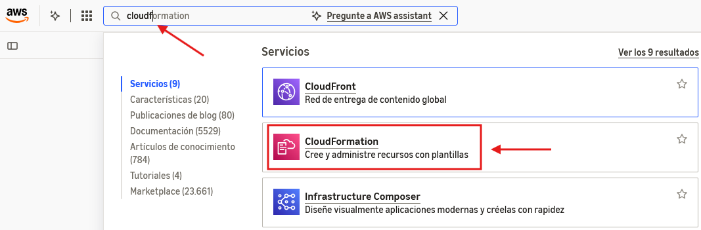{.marco}

### 2.2 Cargar la plantilla

- Haremos clic en "Crear pila" y, una vez desplegado el botón seleccionaremos **con recursos nuevos (estándar)**.

- En el **paso 1** de la creación de la pila, seleccionaremos la opción **Cargar un archivo de plantilla** y haremos clic en "Elegir archivo" para seleccionar nuestra plantilla de CloudFormation desde nuestro equipo.
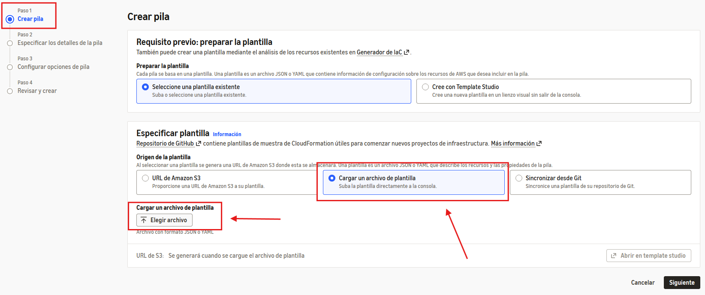{.marco}

- Una vez cargado el archivo, haremos clic en "Siguiente" para continuar con la creación de la pila.
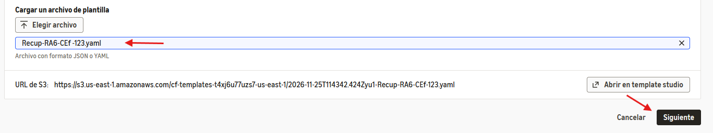{.marco}

- En el **paso 2** de la creación de la pila, eligiremos un nombre para la pila, rellenaremos y revisaremos con mucha atención los campos de los **Parámetros**. Esos campos variarán dependiendo de la plantilla que hayamos cargado, y pueden incluir información como el nombre de la pila, la región, las credenciales de acceso, entre otros. Una vez completados los campos, haremos clic en "Siguiente" para continuar con la creación de la pila.
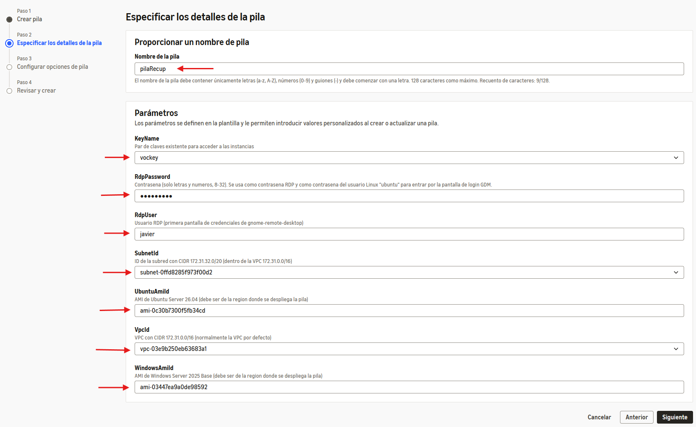{.marco}

- En el **paso 3**, en **Permisos** eligiremos `LabRole`, luego iremos al final de la página y haremos clic en "Siguiente".
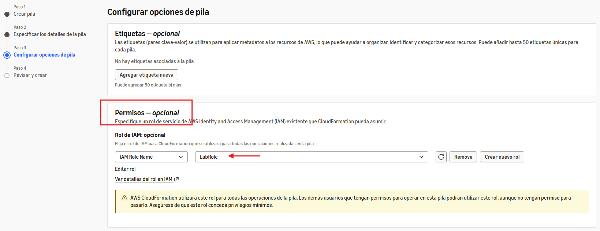{.marco}

- En el **paso 4**, en **Revisar**, revisaremos toda la información de la pila y haremos clic en "Enviar" para iniciar el proceso de creación de los recursos definidos en la plantilla.
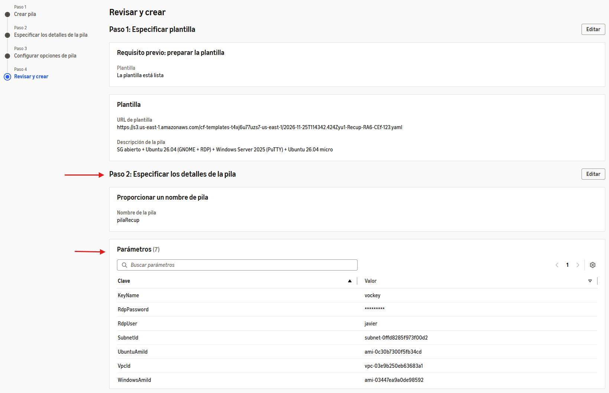{.marco}

### 2.3 Implementación de la plantilla

- Una vez enviada la plantilla, CloudFormation comenzará a crear los recursos definidos en ella. Podemos monitorear el progreso de la creación de la pila en la consola de CloudFormation.

- En **Eventos y Vista de tabla** podremos ver el progreso de la creación de los recursos, así como cualquier error que pueda ocurrir durante el proceso. Una vez que la pila se haya creado correctamente, podremos ver todos los recursos implementados en la sección "Recursos" de la consola de CloudFormation.
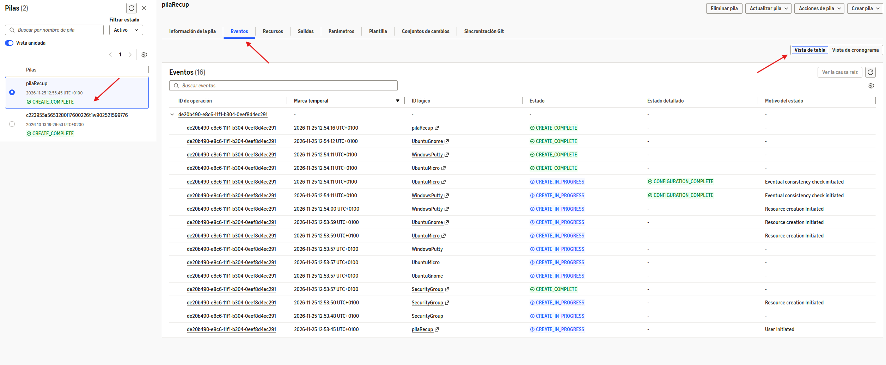{.marco}

- En **Eventos y Vista de cronograma** podremos ver el progreso **visual** de la creación de los recursos.
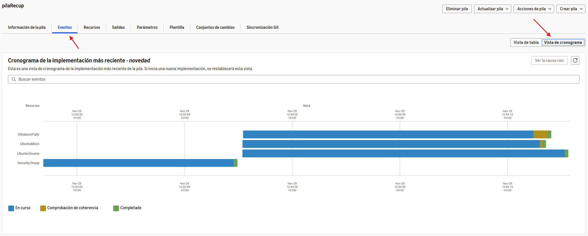{.marco}

!!! warning "Nota importante"
    - Es importante tener en cuenta que **la creación de recursos puede tardar varios minutos**, dependiendo de la complejidad de la plantilla y de los recursos que se estén implementando. Durante este tiempo, es recomendable no realizar cambios en la pila ni en los recursos asociados hasta que la creación haya finalizado correctamente.
    - Que una instancia EC2 esté en estado "running" y con las comprobaciones de estado aprobadas no significa que se pueda usar. Dependerá de la complejidad de las configuraciones que se hayan realizado en la plantilla. Por ejemplo, si se ha configurado un servidor web, puede que aún no esté listo para aceptar conexiones hasta que se completen todas las configuraciones necesarias.  
    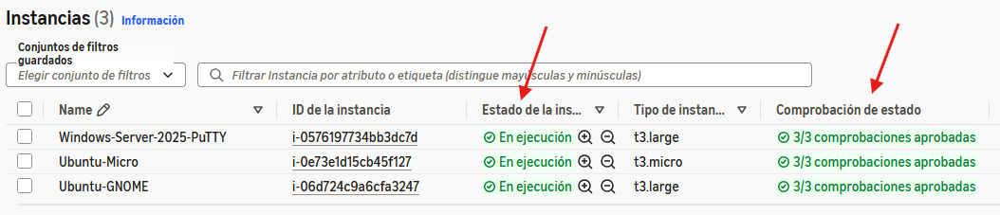{.marco}

### 2.4 Eliminación de la implementación de la plantilla

- Para eliminar la pila y todos los recursos asociados, seleccionaremos la pila en la consola de CloudFormation y haremos clic en "Eliminar". Confirmaremos la eliminación y CloudFormation comenzará a eliminar todos los recursos definidos en la plantilla.
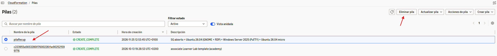{.marco}

- Confirmaremos la eliminación y ecribiendo el nombre de la plantilla en la ventana podremos monitorear el progreso de la eliminación en la consola de CloudFormation. Una vez que la pila se haya eliminado correctamente, todos los recursos asociados también se habrán eliminado.
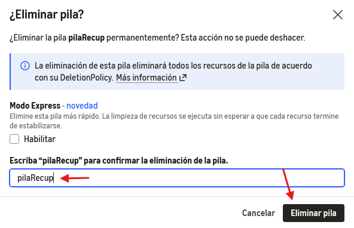{.marco}

- El proceso de eliminación pasará entonces a `DELETE_IN_PROGRESS`.
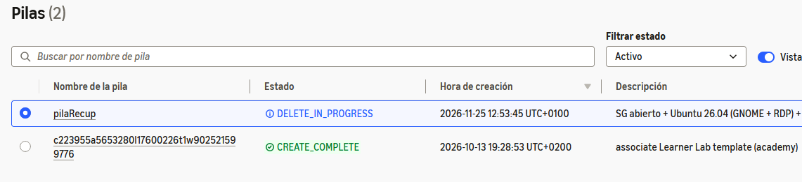{.marco}

- Una vez que la pila se haya eliminado correctamente, podremos ver que la pila ya no aparece en la lista de pilas de CloudFormation.
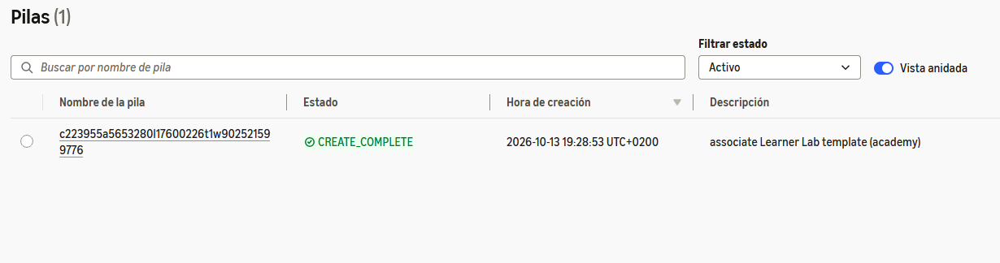{.marco}
