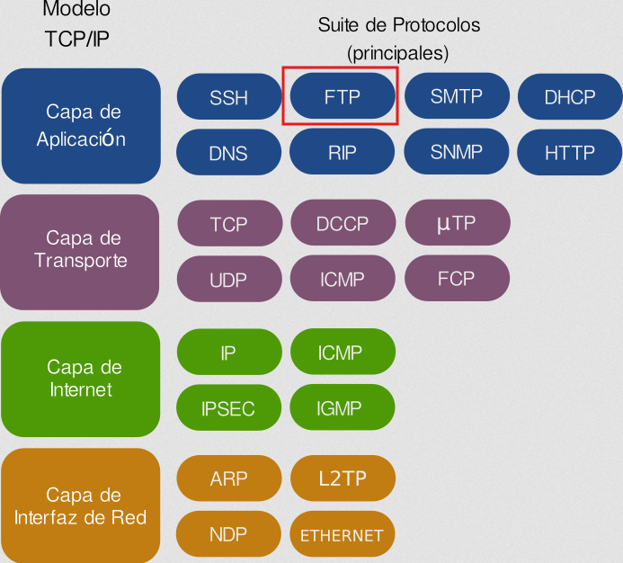
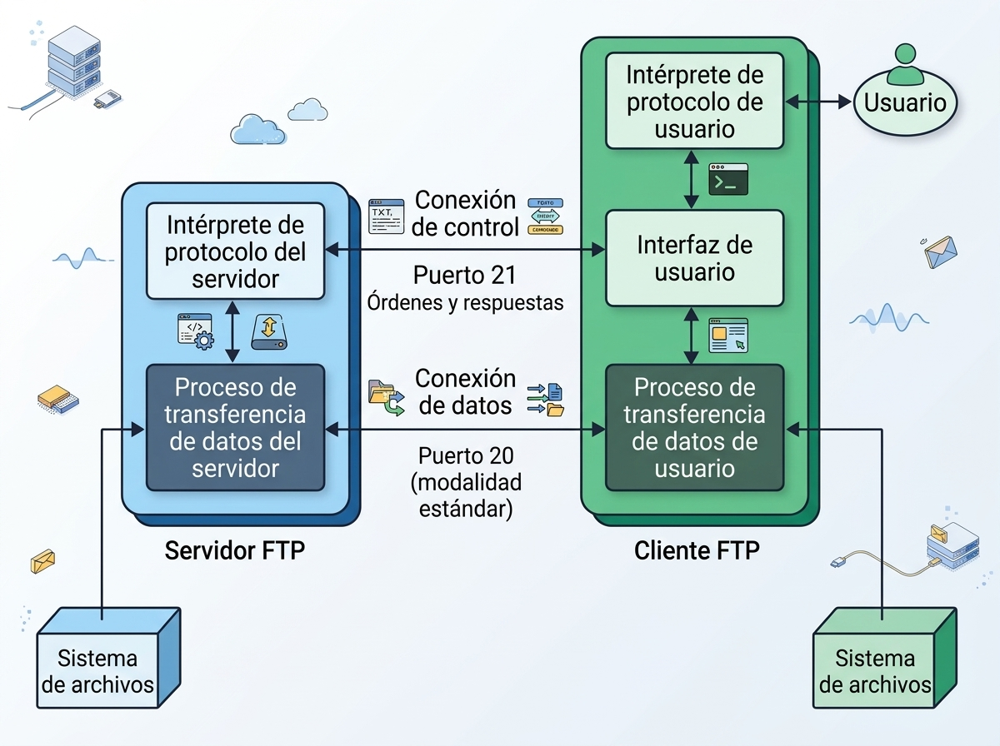
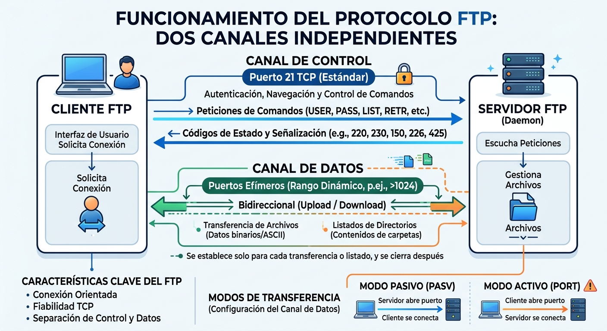
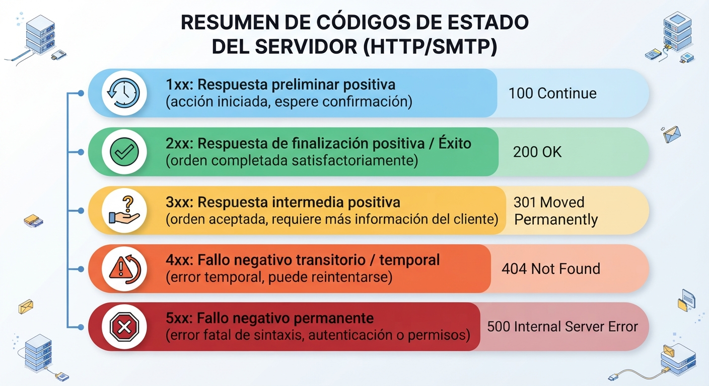
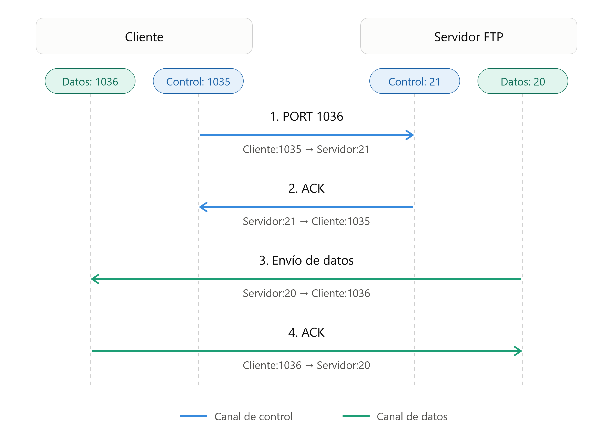
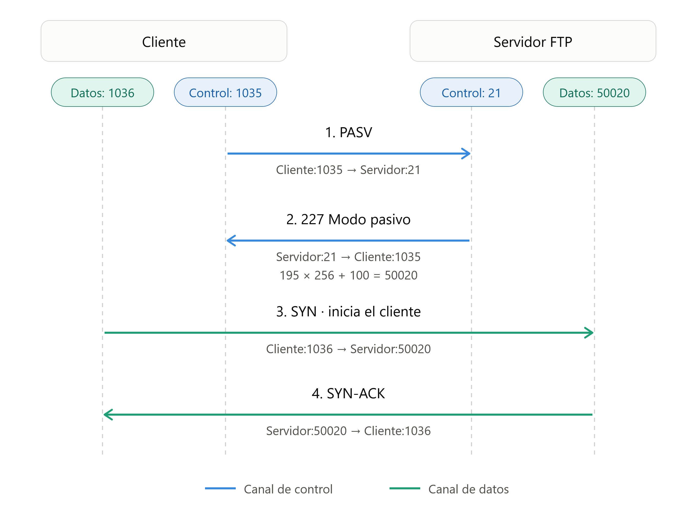
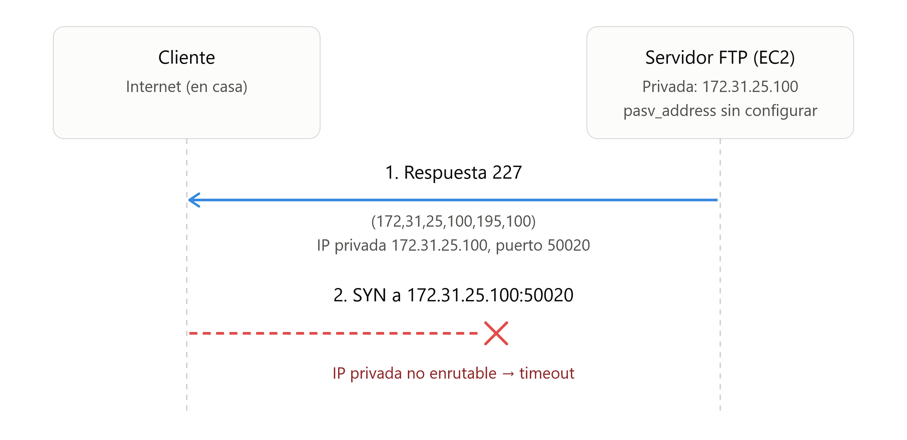
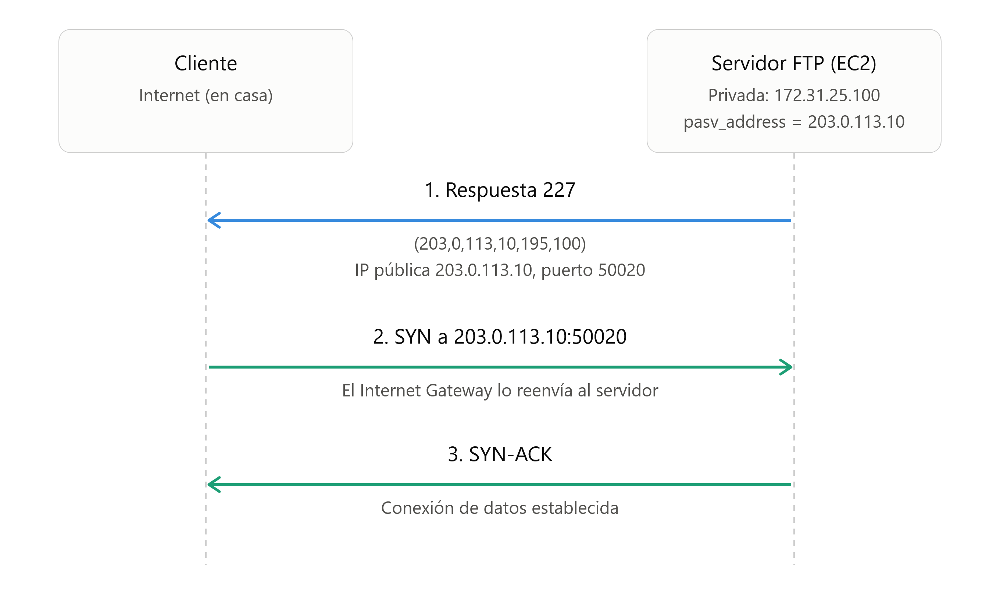

<!-- GUÍA DE REVISIÓN: los comentarios HTML que empiezan por NUEVO señalan apartados añadidos y los que empiezan por CORREGIDO señalan apartados con correcciones técnicas. No se ven al renderizar y se pueden borrar al terminar la revisión. Las rutas de las imágenes se han respetado tal cual (mezclan img_6_1 e img-6-3); conviene unificar el nombre en los ficheros. -->

{ .img2 .marginbottom40}

**Resultados de aprendizaje y criterios de evaluacion que se evaluarán en esta unidad.**  

| **Resultados de aprendizaje de la unidad didáctica:**|
|---|
| **RA3. Gestiona servicios de transferencia de ficheros describiendo sus características e instalando los servidores y clientes correspondientes.**|

| **Criterios de evaluación de la unidad didáctica:**|
|---|
|**a)** Se ha establecido la utilidad y modo de operación del servicio de transferencia de ficheros.|
|**b)** Se ha instalado un servicio de transferencia de ficheros. |
|**c)** Se han creado usuarios y grupos para acceso remoto al servidor.|
|**d)** Se ha configurado el acceso anónimo.|
|**e)** Se han establecido límites en los distintos modos de acceso.|
|**f)** Se ha comprobado el acceso al servidor, tanto en modo activo como en modo pasivo.|
|**g)** Se han realizado pruebas con clientes en línea de comandos y en modo gráfico.|

!!! warning "Nota:"
    Los criterios de evaluación en negrita serán evaluados durante la FCT.

<!-- CORREGIDO: en el original solo el criterio a) estaba en negrita. Aquí se ponen todos en negrita para que cada profesor deje en negrita solo los que realmente se evalúen en la FCT. -->

## 1 - Presentación y evolución de los servicios de transferencia de ficheros

- La transferencia de archivos a través de redes informáticas constituye uno de los **servicios cliente-servidor** más antiguos y esenciales de la arquitectura TCP/IP.
- Antes del desarrollo de la World Wide Web (www) y del protocolo HTTP(S), la necesidad primordial de los centros de cálculo universitarios y militares era compartir programas ejecutables, conjuntos de datos masivos y documentos entre ordenadores distantes y con **sistemas operativos heterogéneos**.

### 1.1 Evolución histórica: Del RFC 114 al RFC 959

<!-- CORREGIDO: cronología. TCP/IP se adoptó en ARPANET el 1 de enero de 1983 (no en 1980). El RFC 765 (1980) ya describe FTP sobre TCP. -->

- El protocolo **FTP (File Transfer Protocol)** nació formalmente el 16 de abril de 1971 con la publicación del **RFC 114** por Abhay Bhushan en el MIT, operando sobre las primeras redes de conmutación de paquetes de ARPANET y la pila NCP (*Network Control Program*).
- En 1980 el protocolo se rediseñó en el **RFC 765** para funcionar sobre TCP/IP. ARPANET abandonó definitivamente NCP y adoptó TCP/IP el **1 de enero de 1983**, y en octubre de 1985 se consolidó FTP con la publicación del **RFC 959**, que continúa siendo el estándar fundacional vigente hoy en día.
- A lo largo de las décadas, FTP ha evolucionado mediante diversas ampliaciones (*RFC extensions*), destacando:
   1. **RFC 2228 (FTP Security Extensions):** Introduce mecanismos de autenticación y cifrado mediante comandos como `AUTH TLS`.
   1. **RFC 2428 (FTP Extensions for IPv6 and NATs):** Define los comandos `EPRT` (*Extended Port*) y `EPSV` (*Extended Passive*) para dar soporte al direccionamiento IPv6 y facilitar la interoperabilidad con pasarelas NAT complejas.
   1. **RFC 3659 (Extensions to FTP):** Añade comandos modernos como `MLST` y `MLSD` para obtener listados de ficheros con metadatos estandarizados e información horaria en UTC.
   1. **RFC 4217 (Securing FTP with TLS):** Define el funcionamiento de FTPS explícito sobre la base de la RFC 2228.

### 1.2 FTP y modelo TCP/IP

{.sietecinco .margintop10 .marginbottom20 .marco}

- FTP se sitúa en la **Capa de Aplicación** (capa 4 de TCP/IP, que equivale a las capas 5, 6 y 7 del modelo OSI: sesión, presentación y aplicación).
- Para el transporte de la información, se apoya de forma estricta en el protocolo **TCP (Transmission Control Protocol)** en la capa de transporte.
- La elección de TCP (frente a protocolos no orientados a conexión como UDP) es indispensable por tres factores determinantes:  
    1. **Fiabilidad absoluta:** Cada paquete de datos debe ser confirmado mediante ACKs para asegurar que ni un solo byte del fichero transferido se pierda o llegue corrupto.
    1. **Entrega secuencial y ordenada:** Garantiza que los segmentos fragmentados en la red se reensamblen en el destino en el orden exacto.
    1. **Control de flujo y congestión:** Regula la velocidad de transmisión adaptándose a la capacidad del receptor y a las condiciones de congestión de los enlaces de red.

<!-- NUEVO: contraejemplo TFTP -->
!!! info "Contraejemplo: TFTP (Trivial FTP, RFC 1350)"
    - Existe una versión simplificada llamada **TFTP** que utiliza **UDP (puerto 69)**, no tiene autenticación, ni listado de directorios, ni cifrado, y implementa su propia confirmación por bloques.
    - Se usa en redes locales para el **arranque por red (PXE)** y para cargar firmwares y configuraciones en equipos de red (routers, switches, teléfonos IP).
    - Nunca debe exponerse a Internet.

### 1.3 Modelo cliente-servidor y arquitectura de servicios

{.sietecinco .margintop10 .marginbottom20 .marco}

- FTP sigue el paradigma **cliente-servidor**:  
  - El **servidor FTP** es un proceso que permanece a la escucha de peticiones en el puerto TCP 21, esperando que los clientes se conecten y soliciten transferencias de ficheros o listados de directorios.
  - El **cliente FTP** es un programa que se ejecuta en la máquina del usuario final, capaz de establecer la conexión con el servidor, enviar órdenes y recibir datos.

### 1.4 Casos de uso corporativos en la administración de sistemas

<!-- CORREGIDO: numeración (en el original este apartado era un segundo 1.3) -->

A pesar del auge de protocolos web (HTTP/HTTPS) y APIs REST, los servicios de transferencia de ficheros basados en FTP, FTPS y SFTP siguen siendo pilares en las infraestructuras de IT:

1. **Despliegue y mantenimiento de portales web:** Carga de contenidos HTML, scripts PHP, hojas de estilo CSS y elementos multimedia en servidores web de alojamiento (*hosting* compartido o dedicado).
1. **Gestión de dispositivos de red y telecomunicaciones:** Actualización masiva de firmwares e imágenes de sistemas operativos (Cisco IOS, JunOS), y volcado de configuraciones en *switches*, *routers* y cortafuegos.
1. **Copias de seguridad remotas (*backups*):** Automatización nocturna del envío de volcados de bases de datos (SQL) y ficheros de archivo comprimidos hacia servidores de almacenamiento remoto (*off-site*).
1. **Intercambio B2B (*Business-to-Business*):** Intercambio automático de albaranes, facturas electrónicas (EDI) y ficheros de transacciones bancarias entre sistemas centrales de diferentes organizaciones.

### 1.5 Alternativas a FTP para mover ficheros

<!-- NUEVO -->

FTP no es la única forma de compartir ficheros. Conviene saber cuándo usar cada tecnología:

| Tecnología | Puerto(s) | Uso típico | Observaciones |
|---|:---:|---|---|
| **TFTP** | UDP 69 | Arranque PXE, firmwares y configuraciones de equipos de red | Sin autenticación ni cifrado. Solo en redes locales de confianza |
| **SMB / CIFS** | TCP 445 | Carpetas compartidas en redes Windows (y Samba en Linux) | Pensado para la red local, no para Internet. Se estudia en la unidad de recursos compartidos |
| **rsync (sobre SSH)** | TCP 22 | Copias de seguridad y sincronización incremental | Solo transfiere las diferencias entre ficheros. Alternativa moderna a `scp` |
| **WebDAV** | TCP 80 / 443 | Edición de ficheros remotos sobre HTTP(S) | Atraviesa fácilmente los cortafuegos al usar el puerto 443 |
| **HTTP(S)** | TCP 80 / 443 | Descarga pública de ficheros | Solo descarga de forma habitual. Es lo más sencillo para repositorios públicos |

## 2 - Protocolo FTP (RFC 959)

### 2.1 Canal de control y Canal de datos

La gran particularidad de FTP frente a casi todos los demás protocolos de red (HTTP, SSH o SMTP) radica en que **no utiliza una única conexión para todo**, sino que desacopla la comunicación en **dos conexiones TCP independientes con ciclos de vida y propósitos completamente distintos**:

{.cien}

!!! info "Canal de control (Puerto 21 TCP por defecto)"
    - Es la conexión principal (*out-of-band signaling*). Se establece al inicio de la sesión entre el cliente y el puerto de escucha 21 TCP del servidor.
    - Permanece **abierta de forma continua** durante toda la sesión del usuario.
    - Por este canal circulan exclusivamente órdenes cortas en texto ASCII (como `USER`, `PASS`, `LIST`, `RETR`, `QUIT`) emitidas por el cliente y las correspondientes respuestas numéricas de estado de 3 dígitos generadas por el servidor.
    - Por este canal **nunca viaja el contenido de los archivos** ni los listados de directorios.

!!! info "Canal de datos (Puertos variables TCP / Puerto 20 en modo activo)"
    - Es una conexión efímera que se abre **bajo demanda** únicamente cuando el cliente solicita una acción que implica intercambio de información volumétrica: transferir un fichero (subida con `STOR` o descarga con `RETR`) o solicitar el listado de archivos de una carpeta (`LIST` o `NLST`).
    - Una vez finalizada la transmisión del archivo o entregado el listado, el canal de datos **se cierra inmediatamente**. Si el usuario desea descargar otro fichero a continuación, se negociará y abrirá una nueva conexión de datos independiente.

!!! question "💡 ¿Por qué FTP desacopló el control de los datos?"
    - Este diseño permite al cliente enviar órdenes de interrupción (como el comando `ABOR` para abortar una descarga) a través del canal de control mientras un archivo enorme se está descargando por el canal de datos, sin tener que esperar a que termine de llegar la totalidad del flujo de bytes.

### 2.2 Tipos de datos: ASCII vs Binario

<!-- CORREGIDO: tabla mal formada (cabecera de 4 columnas y separador incorrecto) y afirmación sobre el modo por defecto de FileZilla -->

- El RFC 959 contempla distintos modos de interpretar la información transmitida a través del canal de datos.
- Su correcta elección permitirá evitar la corrupción irreversible de los ficheros transferidos, especialmente cuando se trabaja con sistemas operativos heterogéneos (Windows, Linux, macOS):

| Modo de Transferencia | Comando FTP | Comportamiento del protocolo | Tipos de ficheros compatibles | Riesgo de corrupción |
|---|:---:|---|---|---|
| **Modo ASCII / Texto** | `TYPE A` | - Convierte automáticamente los caracteres de salto de línea entre sistemas operativos emisores y receptores.<br>- En Windows las líneas terminan en `CR+LF` (`\r\n`, bytes `0x0D 0x0A`), mientras que en Linux/UNIX terminan únicamente en `LF` (`\n`, byte `0x0A`). | Ficheros de texto plano (`.txt`, `.html`, `.css`, `.csv`, `.php`). | **Muy alto:** Si se transfiere un ejecutable, imagen o zip en modo ASCII, el servidor alterará los bytes `0x0D` y `0x0A`, destruyendo por completo la estructura del archivo. |
| **Modo Binario / Imagen** | `TYPE I` | Transmite el archivo byte a byte de forma idéntica, sin interpretar ni modificar ningún carácter ni secuencia de escape. | Ejecutables (`.exe`), imágenes (`.png`, `.jpg`), comprimidos (`.zip`, `.tar.gz`), bases de datos, PDFs. | **Nulo:** Conserva la integridad matemática del fichero íntegra. |

!!! warning "¿Qué modo se usa por defecto?"
    - Según el RFC 959, el tipo por defecto de una sesión FTP es **ASCII** (`TYPE A`). Por eso, con el cliente de consola `ftp`, conviene escribir `binary` antes de transferir ficheros que no sean de texto.
    - **FileZilla** usa por defecto el modo **Auto**: transfiere en ASCII los ficheros cuya extensión está en su lista de tipos de texto y en binario el resto. Se puede forzar en *Editar → Configuración → Transferencias → Tipos de archivo*.
    - **SFTP no tiene este problema**: transfiere siempre los bytes tal cual, sin conversión de saltos de línea.

### 2.3 Repertorio de comandos estándar de FTP (RFC 959)

Las órdenes que viajan por el canal de control son palabras mnemotécnicas de 3 o 4 caracteres en texto plano ASCII seguidas de parámetros y delimitadas por el terminador `CRLF` (`\r\n`):

!!! tip "Autenticación e inicio de sesión:"
    - `USER <nombre>`: Envía el identificador del usuario que desea iniciar sesión.
    - `PASS <contraseña>`: Envía la contraseña de dicho usuario.
    - `QUIT`: Cierra la conexión de control y finaliza la sesión en el servidor.

!!! tip "Navegación e inspección del sistema de ficheros:"
    - `PWD` (*Print Working Directory*): Muestra la ruta del directorio de trabajo actual en el servidor.
    - `CWD <ruta>` (*Change Working Directory*): Cambia al directorio especificado (equivalente a `cd`).
    - `CDUP` (*Change to Parent Directory*): Sube un nivel en el árbol jerárquico de directorios (equivalente a `cd ..`).
    - `MKD <directorio>` (*Make Directory*): Crea una nueva carpeta en la ruta remota.
    - `RMD <directorio>` (*Remove Directory*): Elimina la carpeta remota indicada.

!!! tip "Operaciones de transferencia y gestión de ficheros:"
    - `LIST`: Solicita el listado detallado de ficheros y directorios (permisos, tamaño, fecha de modificación, similar a `ls -la`). Se entrega a través del canal de datos.
    - `NLST` (*Name List*): Solicita una lista simple con únicamente los nombres de los ficheros.
    - `RETR <fichero>` (*Retrieve*): Descarga el archivo solicitado desde el servidor hacia el cliente.
    - `STOR <fichero>` (*Store*): Sube y almacena un archivo desde el cliente en el servidor.
    - `DELE <fichero>` (*Delete*): Elimina el fichero especificado del servidor.
    - `RNFR <origen>` / `RNTO <destino>` (*Rename From / Rename To*): Renombran un fichero. Se envían siempre en pareja.
    - `REST <posición>` (*Restart*): Indica el byte desde el que se reanuda una transferencia interrumpida.
    - `ABOR` (*Abort*): Aborta la transferencia en curso. Se envía por el canal de control.

!!! tip "Negociación del canal de datos:"
    - `PORT <h1,h2,h3,h4,p1,p2>`: Indica al servidor la dirección IP y el puerto TCP en el que el cliente espera la conexión de datos (Modo Activo).
    - `PASV`: Solicita al servidor que abra un puerto pasivo y espere la conexión del cliente (Modo Pasivo).
    - `EPRT` / `EPSV`: Versiones extendidas de `PORT` y `PASV` (RFC 2428) con soporte de IPv6. Se explican en el apartado 2.5.3.
    - `TYPE <A|I>`: Establece el tipo de representación de los datos (`A` para ASCII, `I` para binario/imagen).

<!-- NUEVO: comandos de seguridad y utilidades que el texto menciona pero no listaba -->
!!! tip "Seguridad e información del servidor:"
    - `AUTH TLS`: El cliente solicita cifrar el canal de control con TLS (RFC 2228 y 4217).
    - `PBSZ 0`: Fija el tamaño de búfer de protección. En TLS siempre vale 0.
    - `PROT <P|C>`: Fija el nivel de protección del canal de datos: `P` (*Private*, cifrado) o `C` (*Clear*, sin cifrar).
    - `SYST`: El servidor indica su sistema operativo (por ejemplo, `215 Windows_NT`).
    - `FEAT`: El servidor lista las extensiones que admite (`AUTH TLS`, `EPSV`, `MLST`, `UTF8`...).
    - `SIZE <fichero>` y `MDTM <fichero>`: Tamaño y fecha de modificación de un fichero.
    - `NOOP`: No hace nada. Sirve para mantener viva la conexión de control.

<!-- NUEVO -->
!!! note "No confundas los comandos del protocolo con los comandos del cliente"
    Los comandos anteriores son los que **viajan por la red**. Los clientes de consola (`ftp`, `lftp`) tienen sus propios comandos más amigables, que internamente se traducen a los del protocolo:

    | Escribes en el cliente `ftp` | El cliente envía al servidor |
    |---|---|
    | `open servidor` + usuario y contraseña | `USER` y `PASS` |
    | `ls` / `dir` | `PASV` (o `PORT`) + `LIST` |
    | `cd carpeta` | `CWD carpeta` |
    | `pwd` | `PWD` |
    | `get fichero` | `PASV` (o `PORT`) + `RETR fichero` |
    | `put fichero` | `PASV` (o `PORT`) + `STOR fichero` |
    | `delete fichero` | `DELE fichero` |
    | `mkdir carpeta` | `MKD carpeta` |
    | `binary` / `ascii` | `TYPE I` / `TYPE A` |
    | `bye` / `quit` | `QUIT` |

    Para ver estos comandos en pantalla se puede activar el modo depuración (`debug` en `ftp`, o el panel de mensajes de FileZilla).

### 2.4 Códigos de respuesta del servidor

<!-- CORREGIDO: se añaden los códigos citados en el texto (234, 534) y otros habituales; se explica la taxonomía en texto y se corrige la tabla -->

- Cada vez que el cliente emite una orden por el canal de control, el servidor responde obligatoriamente con un **código numérico de tres dígitos** acompañado de un texto descriptivo legible para humanos.

- La taxonomía del primer dígito categoriza de manera unívoca la respuesta:

{.cien}

| Primer dígito | Tipo de respuesta | Significado |
|:-:|---|---|
| `1xx` | Positiva preliminar | La orden se ha aceptado y se está iniciando la acción. Hay que esperar otra respuesta |
| `2xx` | Positiva de finalización | La acción se ha completado con éxito |
| `3xx` | Positiva intermedia | La orden se ha aceptado, pero el servidor necesita más información (por ejemplo, la contraseña) |
| `4xx` | Negativa transitoria | La acción no se ha realizado, pero el error puede ser temporal. Se puede reintentar |
| `5xx` | Negativa permanente | La acción no se ha realizado y repetirla igual no servirá. Hay que cambiar algo |

El segundo dígito indica la categoría: `x0x` sintaxis, `x1x` información, `x2x` conexiones, `x3x` autenticación y `x5x` sistema de ficheros.

| Código | Significado canónico del RFC 959 | Contexto habitual en el laboratorio y producción |
|:-:|---|---|
| `125` | *Data connection already open; transfer starting.* | Variante de `150` cuando el canal de datos ya estaba abierto. |
| `150` | *File status okay; about to open data connection.* | Notificación previa al inicio del flujo de datos en operaciones `LIST`, `RETR` o `STOR`. |
| `200` | *Command okay.* | La orden solicitada (por ejemplo, `TYPE I` o `PORT`) se ha procesado con éxito. |
| `220` | *Service ready for new user.* | Mensaje de bienvenida (*banner*) enviado por el servidor nada más abrir el canal de control en el puerto 21. |
| `221` | *Service closing control connection.* | Respuesta a `QUIT`. La sesión se cierra correctamente. |
| `226` | *Closing data connection. Requested file action successful.* | La transferencia del archivo o el listado del directorio ha finalizado completamente sin errores. |
| `227` | *Entering Passive Mode (h1,h2,h3,h4,p1,p2).* | Respuesta a la orden `PASV`, proporcionando la IP y puerto efímero del servidor para la conexión de datos. |
| `229` | *Entering Extended Passive Mode (\|\|\|puerto\|).* | Respuesta a `EPSV`: solo incluye el puerto, no la IP. |
| `230` | *User logged in, proceed.* | Autenticación correcta de las credenciales introducidas. El usuario entra a su directorio raíz. |
| `234` | *AUTH command OK; starting TLS handshake.* | El servidor acepta `AUTH TLS` y comienza el cifrado (FTPS explícito). |
| `250` | *Requested file action okay, completed.* | Respuesta correcta a `CWD`, `DELE`, `RMD`, `RNTO`... |
| `257` | *"PATHNAME" created.* | Respuesta a `PWD` y a `MKD`: indica la ruta. |
| `331` | *User name okay, need password.* | Respuesta al comando `USER`; el nombre de cuenta es reconocido y el servidor aguarda el comando `PASS`. |
| `421` | *Service not available, closing control connection.* | El servidor está saturado de conexiones o se ha superado el tiempo máximo de inactividad (*timeout*). |
| `425` | *Can't open data connection.* | Fallo de negociación de red al intentar abrir el canal de datos (típico cuando un firewall bloquea los puertos). |
| `426` | *Connection closed; transfer aborted.* | La conexión de datos se cortó a mitad de transferencia (red inestable, `ABOR` o timeout). |
| `450` | *Requested file action not taken. File unavailable (busy).* | Fichero ocupado o bloqueado temporalmente. Se puede reintentar. |
| `500` | *Syntax error, command unrecognized.* | La orden enviada por el cliente no existe o contiene parámetros sintácticamente inválidos. |
| `530` | *Not logged in.* | Credenciales erróneas (usuario/contraseña incorrectos) o acceso anónimo denegado por directiva. |
| `534` | *Request denied for policy reasons.* | El servidor exige TLS y el cliente intenta conectar sin cifrar, o no admite TLS. |
| `550` | *Requested action not taken. File unavailable or access denied.* | **El código de error más frecuente:** El usuario intenta leer, escribir o borrar un fichero sobre el que no tiene permisos NTFS/Linux, o la ruta indicada no existe. |

### 2.5 Modos de transferencia: Modo Activo (PORT) vs Modo Pasivo (PASV)

- La diferencia fundamental entre ambos modos radica en **quién toma la iniciativa para abrir la conexión TCP del canal de datos**:

#### 2.5.1 Modo Activo

{.cien .marco .marginbottom20}

1. El cliente abre la conexión de control desde un puerto local (1035) hacia el puerto 21 del servidor.
1. Antes de transferir, el cliente abre el puerto 1036 en escucha y se lo comunica al servidor con PORT 192,168,1,50,4,12 (puerto = 4 × 256 + 12 = 1036).
1. El servidor confirma el comando con un ACK por el canal de control (21 → 1035).
1. El servidor inicia la conexión de datos desde su puerto 20 hacia la IP del cliente y el puerto 1036, y envía los datos.
1. El cliente confirma la recepción con un ACK (1036 → 20).

!!! question "Actividad"
    :one: ¿Qué comando FTP de envío de datos ilustra la imagen anterior?  
    :two: ¿Qué comando se usaría para enviar datos en vez de recibirlos?

??? success "Solución (versión del profesor)"
    <!-- Revisar el primer apartado según lo que muestre la imagen img-6-6 -->
    1. En la imagen es el **servidor quien envía los datos al cliente**, es decir, una descarga con **`RETR`** (el mismo mecanismo se aplica a `LIST`, porque el listado también viaja por el canal de datos).
    1. Para **enviar** un fichero desde el cliente al servidor se usaría **`STOR`**. En ese caso es el cliente quien envía los datos por el canal de datos, pero la conexión se sigue abriendo igual: desde el puerto 20 del servidor hacia el cliente.

!!! warning "Limitaciones del modo activo"

    <!-- CORREGIDO: asteriscos sueltos -->
    - Los clientes domésticos y corporativos suelen estar detrás de **un router con NAT/PAT y un cortafuegos con inspección de estado**.
    - El **comando PORT** incluye la IP privada del cliente, que no es alcanzable desde Internet.
    - **Cuando el servidor envía el SYN desde su puerto 20** hacia el puerto del cliente, **el cortafuegos lo trata como tráfico entrante no solicitado y lo descarta** (normalmente en silencio). La conexión de control no sirve de referencia, porque es otra conexión.
    - **Solo funciona si el router tiene un ALG de FTP activo que reescriba la IP y el puerto en PORT y abra el puerto dinámicamente**. Con FTPS el ALG no puede inspeccionar el tráfico, así que la conexión de datos falla igualmente.
    - Por eso en Internet se usa casi siempre **el modo pasivo**, donde es el cliente quien inicia ambas conexiones.

#### 2.5.2 Modo Pasivo

Para solventar el bloqueo originado por los cortafuegos de los clientes, se introdujo el modo pasivo:

{.cien .marco .marginbottom20}

1. El cliente abre la conexión de control desde un puerto local (1035) hacia el puerto 21 del servidor.
1. Al necesitar datos, el cliente envía la orden PASV.
1. El servidor reserva un puerto efímero libre (ej. TCP 50020) y responde por el canal de control con 227 Entering Passive Mode (203,0,113,10,195,100). El puerto es 195 × 256 + 100 = 50020.
1. El cliente inicia la conexión de datos desde otro puerto local (1036) hacia el puerto 50020 del servidor. El servidor responde con SYN-ACK y el cliente cierra el handshake con ACK.
1. Como el cliente inicia ambas conexiones (1035 → 21 y 1036 → 50020), los cortafuegos locales y los routers NAT admiten los paquetes de respuesta en estado ESTABLISHED / RELATED.

#### 2.5.3 Modos extendidos: EPRT y EPSV

<!-- NUEVO -->

- El RFC 2428 definió `EPRT` y `EPSV` para soportar IPv6, porque `PORT` y `PASV` solo pueden transportar direcciones IPv4 de 32 bits.
- Con **`EPSV`** el servidor responde únicamente con el puerto: `229 Entering Extended Passive Mode (|||50020|)`. **No envía su IP**, y el cliente usa la misma dirección con la que abrió el canal de control.
- Esto **atenúa el problema de la IP privada** del apartado 2.6: aunque el servidor no conozca su IP pública, el cliente conectará a la dirección correcta. Sigue siendo necesario limitar y abrir el rango de puertos pasivos.
- Los clientes modernos (FileZilla, `curl`, `lftp`) prueban `EPSV` primero y recurren a `PASV` si el servidor no lo admite.

### 2.6 Problemática del Modo Pasivo en entornos NAT y Cloud (AWS)

- El modo pasivo evita que el cliente tenga que aceptar conexiones entrantes, pero traslada el problema al servidor: si el servidor está detrás de un NAT o en la nube (por ejemplo, AWS), hay que configurarlo para que el cliente pueda alcanzar el puerto de datos.

- Caso sin configurar, donde la conexión de datos falla.
    {.cien .marco .marginbottom20 .margintop10}

- Puntos a configurar:  

    !!! tip ":one: - El servidor desconoce su IP pública."
        - En AWS EC2, la máquina virtual solo ve su IP privada (ej. 172.31.25.100).
        - La IP pública la gestiona el Internet Gateway de Amazon, que hace la traducción.
        - Sin configuración adicional, el servidor responde a PASV con su IP privada: 227 Entering Passive Mode (172,31,25,100,195,100).
        - El cliente intenta conectarse a esa IP, que no es enrutable desde Internet, y la conexión termina por timeout.

    !!! tip ":two: - Hay que indicar la IP pública en el servidor."
        - El administrador debe configurar la IP pública para que se envíe en la respuesta 227:
        - En vsftpd: parámetro `pasv_address`.
        - En IIS (Windows): campo *External IP Address of Firewall* (en la característica *Compatibilidad con firewall FTP* del sitio).
        - En AWS conviene usar una **Elastic IP**, porque la IP pública normal **cambia al detener y volver a iniciar la instancia**. Como en las prácticas se detienen las instancias al terminar (apartado 5.8), sin Elastic IP habría que reconfigurar la IP pública del servidor FTP en cada sesión.
  
    !!! tip ":three: - Hay que limitar el rango de puertos pasivos."
        - Por defecto, el servidor puede elegir cualquier puerto efímero del sistema (unos 16.000 en Windows, más de 28.000 en Linux).
        - Abrir un rango tan grande en el cortafuegos es inviable e inseguro. Se debe fijar un rango reducido, por ejemplo del 50000 al 50100, y dimensionarlo según las transferencias simultáneas esperadas (cada transferencia usa un puerto).
        - En vsftpd: parámetros `pasv_min_port` y `pasv_max_port`.
        - En IIS: *Data Channel Port Range* en *Compatibilidad con firewall FTP* del nodo del servidor.
  
    !!! tip ":four: - Hay que abrir los puertos en todos los cortafuegos."
        Deben permitirse las conexiones entrantes en:
         1. El Security Group de AWS (Inbound Rules): puerto 21 (control) y el rango pasivo (50000-50100).
         1. El cortafuegos del sistema operativo (Windows Firewall o iptables/ufw): los mismos puertos.
        !!! note "Los Security Groups son stateful, así que no hace falta una regla de salida para las respuestas."

- Escenario con `pasv_address` configurado con la IP pública. El Internet Gateway reenvía el tráfico hacia la IP privada del servidor.
    {.cien .marco .marginbottom20 .margintop10}

<!-- NUEVO: ejemplo de configuración -->
!!! example "Resumen de la configuración pasiva en vsftpd"
    ```ini
    pasv_enable=YES
    pasv_min_port=50000
    pasv_max_port=50100
    pasv_address=203.0.113.10
    ```

## 3 - Seguridad en los protocolos de transferencia y acceso remoto

### 3.1 Vulnerabilidades del protocolo FTP tradicional

- El protocolo FTP original fue concebido en los años 70 y fijado en su forma actual en 1985, bajo un paradigma de confianza mutua dentro de redes académicas cerradas.
- Como consecuencia, **carece por completo de mecanismos criptográficos nativos**:  
    1. **Exposición total de credenciales:** Las órdenes `USER` y `PASS` viajan en texto plano por el canal de control. Cualquier analizador de protocolos conectado a la red local o en puntos intermedios de enrutamiento puede interceptar las contraseñas sin esfuerzo (*sniffing*  + `Wireshark`).
    1. **Intercepción y manipulación de datos:** Los archivos transferidos carecen de firmas de integridad o cifrado confidencial, permitiendo a un atacante en posición de intermediario (*Man-in-the-Middle*) leer el contenido o inyectar código malicioso en descargas de ejecutables.

### 3.2 FTPS: FTP sobre TLS

- FTPS añade cifrado TLS al protocolo FTP sin cambiar su modelo de comandos.
- La RFC 4217 define su funcionamiento, basado en la extensión de seguridad de la RFC 2228.
- El servidor se identifica con un certificado digital X.509.

#### 3.2.1 FTPS explícito (FTPES)

1. El cliente se conecta al puerto 21 TCP en texto claro y recibe el banner de bienvenida.
1. El cliente envía AUTH TLS para pedir que se cifre la conexión. Si el servidor acepta, responde 234.
1. Ambos realizan el handshake TLS. El servidor presenta su certificado y el cliente lo valida. Desde ese momento, el canal de control va cifrado con el algoritmo negociado.
1. El cliente envía USER y PASS ya por el canal cifrado.
1. Para cifrar también los datos, el cliente envía PBSZ 0 y PROT P (nivel Private). Sin PROT P, los datos viajan en claro.
1. Si el servidor no admite TLS (por ejemplo, responde 534), es el cliente quien decide si continúa sin cifrar o aborta.

#### 3.2.2 FTPS implícito (en desuso)

1. El cliente se conecta a un puerto dedicado: 990 TCP para control (y 989 TCP como puerto de origen de datos en modo activo).
1. El handshake TLS se realiza nada más abrir la conexión, antes de cualquier comando FTP. No existe AUTH TLS.
1. Estado actual: no está estandarizado y se considera obsoleto. Requiere puertos adicionales y no permite negociar capacidades como el explícito. Aun así, sigue presente en sistemas heredados (IIS y vsftpd todavía lo admiten).

!!! warning "Una consecuencia práctica que enlaza con el modo activo y pasivo:"
    - Como el canal de control va cifrado, los ALG de los routers no pueden leer PORT ni 227.
    - Por eso en FTPS conviene usar **el modo pasivo con un rango de puertos fijo y la IP externa configurada**.

### 3.3 SFTP: SSH File Transfer Protocol (El estándar seguro monocanal)

<!-- CORREGIDO: SFTP nunca llegó a ser RFC y no es un "sistema de archivos distribuido" -->

Existe una confusión conceptual muy extendida: **SFTP NO es FTP con cifrado**. Tampoco es FTP "tunelizado" dentro de SSH ni *Simple FTP*.

- **SFTP (SSH File Transfer Protocol)** es un protocolo totalmente independiente, diseñado desde cero por el grupo de trabajo `secsh` de la IETF como un **subsistema de SSH-2 (Secure Shell)**. Es un protocolo de **acceso remoto a ficheros**: permite transferir, pero también listar, renombrar, borrar, cambiar permisos y reanudar transferencias. Nunca se publicó como RFC definitivo (quedó como borrador, *draft*), pero la versión 3 está implementada de forma universal.
- **Arquitectura de conexión única (Monocanal):** A diferencia de la doble conexión de FTP, SFTP canaliza absolutamente todo (autenticación, navegación, listados, transferencias y control de flujo) a través de **un único puerto TCP: el puerto 22**.
- **Beneficios operativos determinantes:**
    1. **Cero problemas con NAT y cortafuegos:** Basta con permitir el puerto 22 TCP en los grupos de seguridad y reglas de red. No requiere rangos de puertos efímeros ni configuraciones de IP pública pasiva.
    1. **Cifrado extremo a extremo nativo:** Todo el canal viaja protegido por los algoritmos de intercambio de claves Diffie-Hellman y cifrados simétricos de alta seguridad (ChaCha20, AES-GCM).
    1. **Autenticación avanzada:** Se integra de forma nativa con los mecanismos de autenticación de SSH, permitiendo el acceso tanto por contraseñas como mediante **parejas de claves asimétricas pública/privada** sin intervención de contraseñas.

### 3.4 SCP: Secure Copy Protocol

<!-- CORREGIDO: se explica la obsolescencia que la tabla 3.5 indicaba pero el texto no desarrollaba -->

- Es una utilidad de transferencia punto a punto no interactiva basada en el protocolo `rcp` (*Remote Copy*) de los sistemas BSD, operando igualmente sobre el túnel seguro de **SSH (puerto 22 TCP)**. Para copiar, el cliente abre una sesión SSH y ejecuta en el servidor el propio comando `scp` en modo origen o destino.
- **Diferencia con SFTP:** SCP está orientado a la copia directa de archivos mediante una orden puntual de línea de comandos (ej. `scp archivo.txt usuario@servidor:/ruta/`). No mantiene una sesión interactiva de gestión del sistema de ficheros. SFTP, por contra, permite además reanudar descargas, listar directorios, crear o borrar carpetas y modificar permisos y atributos de ficheros.
- **¿Por qué se desaconseja?** El protocolo SCP/RCP original deja que sea el **servidor** quien decida qué nombres de fichero envía, sin que el cliente pueda comprobarlo del todo. Un servidor malicioso o comprometido podía sobrescribir ficheros del cliente. Es un defecto de diseño y no se corrige sin romper la compatibilidad.
- **Situación actual:** desde **OpenSSH 9.0**, el comando `scp` transfiere internamente usando **SFTP**. El comando se mantiene por comodidad (sintaxis conocida), pero el protocolo antiguo ya no se usa por defecto. Para scripts nuevos se recomienda `sftp` o `rsync` sobre SSH.

### 3.5 Tabla resumen de protocolos

<!-- CORREGIDO: tabla mal formada (separador con columna vacía), certificado X.509 (es del servidor) y descripción de SCP -->

| Criterio técnico | FTP clásico (RFC 959) | FTPS Explícito (FTPES) | FTPS Implícito (Legacy) | SFTP (SSH File Transfer) | SCP (Secure Copy) |
|---|:---:|:---:|:---:|:---:|:---:|
| **Protocolo base** | FTP | FTP + TLS/SSL | FTP + TLS/SSL | SSH-2 (Subsistema) | SSH-2 (ejecuta `scp` en remoto sobre la sesión) |
| **Cifrado de datos y credenciales** | ❌ No (Texto claro) | ✔️ Sí (TLS 1.2 / 1.3) | ✔️ Sí (TLS 1.2 / 1.3) | ✔️ Sí (Cifrado SSH) | ✔️ Sí (Cifrado SSH) |
| **Puertos de red utilizados** | TCP 21 (control) + TCP 20/dinámicos (datos) | TCP 21 (control) + Puertos pasivos (datos) | TCP 990 (control) + TCP 989/dinámicos | **Únicamente TCP 22** | **Únicamente TCP 22** |
| **Número de conexiones TCP** | 2 independientes | 2 independientes | 2 independientes | **1 única multiplexada** | **1 única conexión** |
| **Complejidad en NAT / Firewalls** | Muy alta (bloqueo en modo activo) | Alta (requiere abrir rango pasivo e IP pública) | Alta (requiere abrir puertos específicos) | **Mínima (solo requiere abrir el puerto 22)** | **Mínima (solo requiere abrir el puerto 22)** |
| **Mecanismo de autenticación** | Usuario / Contraseña en texto plano | Usuario / Contraseña (cifradas por TLS). **El certificado X.509 identifica al servidor**; el del cliente es opcional | Usuario / Contraseña (cifradas por TLS). **El certificado X.509 identifica al servidor**; el del cliente es opcional | Contraseña o **Claves asimétricas (RSA/Ed25519)** | Contraseña o **Claves asimétricas (RSA/Ed25519)** |
| **Interoperabilidad interactiva** | Sí (cliente gráfico y consola) | Sí (cliente gráfico y consola) | Sí (compatibilidad reducida) | Sí (FileZilla, consola interactiva `sftp`) | No (comando directo de copia puntual) |
| **Estado actual (en desuso vs. uso vigente)** | 🚫 **En desuso.** No debe usarse en redes no confiables: expone credenciales y datos. Solo se tolera en redes aisladas o por compatibilidad con equipos antiguos. | ✅ **Vigente.** Es la forma estándar de FTPS (RFC 4217). Se usa cuando se necesita mantener infraestructura FTP con cifrado y certificados. | 🚫 **En desuso (legacy).** Nunca fue estandarizado oficialmente (anterior a RFC 4217). Solo se mantiene por compatibilidad; se recomienda migrar a FTPES o SFTP. | ✅ **Recomendado.** Es el estándar de facto actual para transferencias seguras de ficheros, en servidores, automatización y entornos cloud. | ⚠️ **Obsoleto / desaconsejado.** El protocolo SCP/RCP original tiene debilidades de seguridad conocidas. OpenSSH 9.0+ lo implementa internamente sobre SFTP, y el comando `scp` se mantiene solo por comodidad. Se recomienda `sftp` o `rsync` sobre SSH. |

### 3.6 Verificación de la identidad del servidor

<!-- NUEVO -->

Hasta ahora hemos visto cómo el servidor identifica al usuario. Pero el **cliente también debe comprobar que habla con el servidor auténtico**, y no con un atacante que se hace pasar por él (*Man-in-the-Middle*).

#### 3.6.1 En SSH/SFTP: la huella de la clave del servidor

1. En la **primera conexión**, el cliente muestra un aviso como este:
    ```text
    The authenticity of host '203.0.113.10' can't be established.
    ED25519 key fingerprint is SHA256:3b0kR...q9Yw.
    Are you sure you want to continue connecting (yes/no/[fingerprint])?
    ```
1. El administrador debería **comparar esa huella con la real** del servidor, que se obtiene en el propio servidor con:
    ```bash
    ssh-keygen -lf /etc/ssh/ssh_host_ed25519_key.pub
    ```
1. Al aceptar, la clave se guarda en `~/.ssh/known_hosts` del cliente.
1. En conexiones posteriores, si la clave **cambia**, el cliente muestra `WARNING: REMOTE HOST IDENTIFICATION HAS CHANGED!` y se niega a conectar. Puede ser una reinstalación legítima del servidor... o un ataque. Si es legítimo, se elimina la entrada antigua con `ssh-keygen -R servidor`.

#### 3.6.2 En FTPS: el certificado X.509

- El cliente valida que el certificado esté **firmado por una CA de confianza**, que el nombre del certificado **coincida con el del servidor** y que **no esté caducado**.
- En el laboratorio se suele usar un **certificado autofirmado** (sin CA). Por eso FileZilla muestra el diálogo *Certificado desconocido* con la huella del certificado, y el usuario decide si confiar en él (`Confiar siempre en este certificado`).
- En producción debe usarse un certificado emitido por una CA reconocida (por ejemplo, Let's Encrypt), para que los clientes no tengan que aceptar avisos que acostumbran a ignorar.

!!! warning "Aceptar sin leer anula el cifrado"
    Si el usuario acepta siempre cualquier aviso, el cifrado sigue existiendo, pero un atacante en medio podría presentar su propia clave o certificado y descifrar todo el tráfico.

## 4 - Ecosistema de software: Servidores y Clientes (Windows y Linux)

### 4.1 Software de Servidor

<!-- CORREGIDO: IIS admite FTPS implícito y no ofrece SFTP; ruta de vsftpd.conf en Red Hat -->

- **Internet Information Services (IIS - Rol Servidor FTP):** Servidor FTP empresarial desarrollado por Microsoft e integrado de forma nativa en las ediciones de Windows Server. Proporciona administración centralizada mediante interfaz gráfica (`inetmgr`) o PowerShell, soportando FTPS (explícito, y también implícito si se enlaza al puerto 990), aislamiento de usuarios basado en directorios o Active Directory, y registro de logs en formato W3C.

!!! warning "IIS no ofrece SFTP"
    El servidor FTP de IIS solo implementa FTP y FTPS. Para ofrecer **SFTP** en Windows hay que instalar **OpenSSH Server**, y esa es la razón de que en la Tarea 6 se instalen ambos servicios.

- **vsftpd (Very Secure FTP Daemon):** Servidor FTP estándar de referencia en distribuciones Linux (Ubuntu, Debian, Red Hat). Reconocido por su seguridad extrema frente a desbordamientos de búfer, bajo consumo de recursos y alto rendimiento. Su configuración reside en el fichero de texto plano `/etc/vsftpd.conf` en Debian y Ubuntu, y en `/etc/vsftpd/vsftpd.conf` en Red Hat y derivadas.
- **OpenSSH Server (`sshd`):** Servicio de administración y acceso remoto multiplataforma que proporciona simultáneamente servicios de consola remota, SFTP y SCP. Disponible de forma nativa tanto en distribuciones Linux (`/etc/ssh/sshd_config`) como característica opcional en Windows Server (`C:\ProgramData\ssh\sshd_config`).

### 4.2 Software de Cliente

- **FileZilla Client:** Herramienta gráfica multiplataforma (Windows, Linux, macOS) líder en el sector. Presenta una interfaz de doble panel (árbol local a la izquierda y árbol remoto a la derecha), con soporte nativo para FTP, FTPS y SFTP, gestor de sitios protegidos y reanudación automática de transferencias interrumpidas.
- **WinSCP:** Cliente gráfico para Windows de SFTP, SCP y FTP(S). Muy usado en administración y permite automatizar tareas con scripts.
- **PuTTY y PuTTYgen:** Suite de utilidades de conectividad para entornos Windows. Permite el acceso a la consola SSH remota de servidores y, mediante la herramienta **PuTTYgen**, la generación, conversión y gestión de parejas de claves criptográficas en formato propietario `.ppk` (*PuTTY Private Key*).
- **Clientes integrados de consola (CLI):** Utilidades nativas en terminales de Linux y PowerShell en Windows, como `ftp`, `sftp`, `scp`, `ssh` y `curl`. Otros clientes de consola muy completos son `lftp` (Linux) y `curl`.

### 4.3 Instalación de los servicios

<!-- NUEVO: criterio de evaluación b) -->

#### 4.3.1 Servidor FTP de IIS (Windows Server)

1. Instalar el rol desde *Administrador del servidor → Agregar roles y características → Servidor web (IIS) → Servidor FTP*. Desde PowerShell (como administrador):
    ```powershell
    Install-WindowsFeature Web-Server, Web-Ftp-Server, Web-Mgmt-Console
    ```
1. Crear el sitio en el Administrador de IIS (`inetmgr`): *Sitios → Agregar sitio FTP...* y definir el nombre, la ruta física (`C:\inetpub\ftproot`), el enlace (IP y puerto 21), el certificado SSL, la autenticación y la autorización.
1. Abrir el puerto de control y el rango pasivo en el Firewall de Windows:
    ```powershell
    New-NetFirewallRule -DisplayName "FTP control 21" -Direction Inbound -Protocol TCP -LocalPort 21 -Action Allow
    New-NetFirewallRule -DisplayName "FTP pasivo 50000-50100" -Direction Inbound -Protocol TCP -LocalPort 50000-50100 -Action Allow
    ```
1. Fijar el rango de puertos pasivos y la IP externa en *Compatibilidad con firewall FTP* (a nivel de servidor y de sitio) y reiniciar el servicio:
    ```powershell
    Restart-Service ftpsvc
    ```

#### 4.3.2 vsftpd (Linux, Debian/Ubuntu)

```bash
sudo apt update
sudo apt install vsftpd
sudo systemctl enable --now vsftpd
sudo systemctl status vsftpd
sudo ufw allow 21/tcp
sudo ufw allow 50000:50100/tcp
```

Después de cada cambio en `/etc/vsftpd.conf` hay que reiniciar el servicio con `sudo systemctl restart vsftpd`. Una configuración mínima de partida:

```ini
# Acceso
listen=YES
anonymous_enable=NO
local_enable=YES
write_enable=YES
local_umask=022

# Enjaulado
chroot_local_user=YES

# Modo pasivo
pasv_enable=YES
pasv_min_port=50000
pasv_max_port=50100
# pasv_address=<IP pública>   (necesaria en AWS)

# Registro
xferlog_enable=YES
vsftpd_log_file=/var/log/vsftpd.log
```

Para activar **FTPS explícito** hay que generar un certificado y añadir estas directivas:

```bash
sudo openssl req -x509 -nodes -days 365 -newkey rsa:2048 \
  -keyout /etc/ssl/private/vsftpd.key -out /etc/ssl/certs/vsftpd.pem
```

```ini
ssl_enable=YES
rsa_cert_file=/etc/ssl/certs/vsftpd.pem
rsa_private_key_file=/etc/ssl/private/vsftpd.key
force_local_logins_ssl=YES
force_local_data_ssl=YES
ssl_tlsv1_2=YES
ssl_tlsv1=NO
ssl_sslv2=NO
ssl_sslv3=NO
```

!!! tip "Error típico con FileZilla"
    Si FileZilla muestra `522 SSL connection failed; session reuse required`, añade `require_ssl_reuse=NO` y reinicia vsftpd.

#### 4.3.3 OpenSSH Server

**En Windows (10/11 y Server 2019 o superior):**

```powershell
Add-WindowsCapability -Online -Name OpenSSH.Server~~~~0.0.1.0
Start-Service sshd
Set-Service -Name sshd -StartupType Automatic
Get-NetFirewallRule -Name *ssh*
```

La instalación crea automáticamente la regla de firewall `OpenSSH-Server-In-TCP` para el puerto 22. Se comprueba con la última orden.

**En Linux (Debian/Ubuntu):**

```bash
sudo apt install openssh-server
sudo systemctl enable --now ssh
sudo ufw allow 22/tcp
```

!!! note "Nombre del servicio"
    En Debian y Ubuntu el servicio se llama `ssh`. En Red Hat y derivadas se llama `sshd`.

En ambos casos, SFTP funciona sin instalar nada más, porque va incluido como subsistema (`Subsystem sftp ...` en `sshd_config`).

### 4.4 Uso práctico de los clientes

<!-- NUEVO: criterios de evaluación f) y g) -->

#### 4.4.1 Cliente `ftp` de consola

```text
C:\> ftp 203.0.113.10
Conectado a 203.0.113.10.
220 Microsoft FTP Service
Usuario: usuari_ventas
331 Password required
Contraseña:
230 User logged in.
ftp> binary
ftp> ls
ftp> cd documentos
ftp> get manual.pdf
ftp> put informe.docx
ftp> bye
```

| Comando | Función |
|---|---|
| `open servidor` | Abre la conexión con un servidor |
| `ls` / `dir` | Lista el directorio remoto |
| `cd` / `lcd` | Cambia de directorio en el servidor / en el equipo local |
| `pwd` | Muestra el directorio remoto actual |
| `get` / `mget` | Descarga un fichero / varios ficheros |
| `put` / `mput` | Sube un fichero / varios ficheros |
| `delete`, `mkdir`, `rmdir` | Gestionan ficheros y carpetas remotas |
| `binary` / `ascii` | Cambia el modo de transferencia |
| `passive` | Activa o desactiva el modo pasivo (cliente `ftp` de Linux) |
| `prompt` | Evita que `mget`/`mput` pregunten por cada fichero |
| `debug` | Muestra los comandos reales que se envían al servidor |
| `quote <comando>` | Envía un comando FTP "en crudo" (por ejemplo, `quote SYST`) |
| `bye` / `quit` | Cierra la sesión |

!!! warning "Limitaciones del `ftp.exe` de Windows"
    El cliente `ftp` incluido en Windows **no soporta FTPS ni SFTP**, y **no soporta modo pasivo**. Para probar FTPS o el modo pasivo hay que usar FileZilla, `curl` o `lftp`.

#### 4.4.2 SFTP, SCP y SSH

```bash
sftp usuario@203.0.113.10             # sesión interactiva
sftp -P 2222 usuario@203.0.113.10     # puerto distinto del 22 (P mayúscula)
sftp -i ~/.ssh/id_ed25519 usuario@203.0.113.10   # con clave privada
```

Dentro de la sesión `sftp`: `ls`, `lls` (listado local), `cd`, `lcd`, `pwd`, `lpwd`, `get fichero`, `get -r carpeta`, `put fichero`, `mkdir`, `rm`, `chmod`, `bye`.

```bash
scp informe.pdf usuario@203.0.113.10:/home/usuario/       # subir
scp usuario@203.0.113.10:/var/log/auth.log .              # descargar
scp -r carpeta/ usuario@203.0.113.10:/srv/datos/          # carpeta completa
```

**Generar y copiar un par de claves:**

```bash
ssh-keygen -t ed25519 -C "alumno@aula"      # crea ~/.ssh/id_ed25519 y .pub
ssh-copy-id usuario@203.0.113.10             # instala la clave pública (Linux/macOS)
```

En un **servidor Windows** no existe `ssh-copy-id`. La clave pública se copia a mano en `C:\Users\<usuario>\.ssh\authorized_keys` o, si el usuario es administrador, en `C:\ProgramData\ssh\administrators_authorized_keys`, y hay que ajustar los permisos de este último:

```powershell
icacls.exe "$env:ProgramData\ssh\administrators_authorized_keys" /inheritance:r /grant "Administrators:F" /grant "SYSTEM:F"
```

#### 4.4.3 `curl` y `lftp`

```bash
# Descarga por FTP
curl -u usuari_ventas ftp://203.0.113.10/manual.pdf -O

# FTPS explícito (certificado autofirmado: -k lo acepta)
curl --ssl-reqd -k -u usuari_ventas ftp://203.0.113.10/manual.pdf -O

# Subida por SFTP
curl -u usuario -T informe.pdf sftp://203.0.113.10/home/usuario/

# lftp con FTPS explícito y modo pasivo desactivado (modo activo)
lftp -u usuari_ventas ftp://203.0.113.10
lftp :~> set ftp:ssl-force true
lftp :~> set ssl:verify-certificate no
lftp :~> set ftp:passive-mode off
```

#### 4.4.4 FileZilla (cliente gráfico)

1. *Archivo → Gestor de sitios → Nuevo sitio*.
1. Elegir el **Protocolo** (FTP, SFTP) y escribir el servidor, el puerto y el usuario. Para FTPS, en **Cifrado** se elige *Requerir FTP explícito sobre TLS*.
1. En **Tipo de acceso** se puede elegir *Normal*, *Anónimo* o *Pedir contraseña*. Para SFTP con clave, *Archivo de clave*.
1. En la pestaña **Configuración de transferencia** se fija el **modo de transferencia**: *Por defecto*, *Activo* o *Pasivo*, y el número máximo de conexiones simultáneas.
1. Al conectar, el **panel de mensajes** superior muestra los comandos enviados y los códigos de respuesta (`Comando:`, `Respuesta:`). Es la mejor herramienta de depuración.

#### 4.4.5 Comprobar el modo activo y el modo pasivo

Para cumplir el criterio de evaluación f), hay que **demostrar** que se ha probado cada modo y qué ocurre en cada uno.

| Prueba | Modo pasivo | Modo activo |
|---|---|---|
| **FileZilla** (*Configuración de transferencia*) | `Pasivo` | `Activo` |
| **`ftp` en Linux** | `passive` (si indica `Passive mode on`) | `passive` (si indica `Passive mode off`) |
| **`curl`** | Opción por defecto (usa `EPSV`/`PASV`) | `--ftp-port -` |
| **`lftp`** | `set ftp:passive-mode on` | `set ftp:passive-mode off` |

**Cómo saber qué modo se está usando**

- **En el panel de mensajes de FileZilla**: en pasivo aparece `Comando: PASV` y `Respuesta: 227 Entering Passive Mode (...)`. En activo aparece `Comando: PORT ...`.
- **En Wireshark**: el filtro `ftp.request.command == "PASV" || ftp.request.command == "PORT"` muestra qué orden se envió. Con `tcp.port == 20` se ven las conexiones de datos del modo activo, y con `tcp.port >= 50000 && tcp.port <= 50100` las del modo pasivo.

**Resultados esperables**

- **Pasivo sin rango abierto en el firewall:** el login funciona, pero el listado se queda colgado y termina con error `425` o con *timeout*.
- **Pasivo con IP privada en AWS:** el servidor anuncia una IP no alcanzable y se produce *timeout* (apartado 2.6).
- **Activo desde un equipo detrás de NAT:** el servidor no puede conectar con el cliente y el listado falla.
- **Activo en la misma red local sin firewall:** funciona.

#### 4.4.6 Errores típicos y cómo diagnosticarlos

| Síntoma | Causa más probable | Qué comprobar |
|---|---|---|
| `530 Login incorrect` / `530 User cannot log in` | Usuario o contraseña erróneos, anónimo deshabilitado o usuario no autorizado | Credenciales, regla de autorización del sitio, `userlist_enable` en vsftpd |
| `550 Access is denied` / `Permission denied` | Falta de permisos NTFS o de Linux sobre la carpeta | Permisos de la carpeta y regla de autorización de IIS |
| `425 Can't open data connection` | Cortafuegos o NAT bloquea el canal de datos | Rango pasivo, `pasv_address`, reglas del firewall y del Security Group |
| `421 Too many connections` o `421 Timeout` | Se alcanzó el límite de conexiones o expiró por inactividad | Apartado 5.5 (límites) |
| `500 OOPS: vsftpd: refusing to run with writable root inside chroot()` | La raíz del enjaulado tiene permisos de escritura | Apartado 5.4.1 |
| `534 Policy requires SSL` / fallo de TLS | El servidor exige FTPS y el cliente usa FTP plano | Cifrado del sitio en el cliente |
| El listado de directorios se queda colgado | Fallo en el canal de datos (modo pasivo mal configurado) | Apartado 2.6 y 4.4.5 |
| `REMOTE HOST IDENTIFICATION HAS CHANGED` | La clave del servidor SSH ha cambiado | Apartado 3.6.1 |
| `Permission denied (publickey)` | La clave pública no está bien instalada o sus permisos son incorrectos | `authorized_keys`, permisos (`chmod 600`) y `ssh -v` |
| `Connection timed out` en el puerto 22 | Puerto cerrado o servicio parado | Security Group, firewall, `Get-Service sshd` o `systemctl status ssh` |

## 5 - Gestión de usuarios, aislamiento, bastionado y auditoría

### 5.1 Tipologías de usuarios en un servidor de ficheros (Anónimos, Locales y Virtuales)

Un aspecto clave en la administración de un servicio de transferencia de ficheros es determinar cómo se identifican los usuarios y qué alcance de permisos reciben:

1. **Acceso anónimo (`anonymous` o `ftp`):**
    - **Propósito:** Permitir que cualquier usuario de Internet descargue recursos públicos (manuales, documentación, parches, distribuciones de software) sin necesidad de contar con una cuenta previa en el sistema.
    - **Credenciales:** Se utiliza convencionalmente el identificador `anonymous` y, como contraseña, cualquier cadena de texto (tradicionalmente la dirección de correo del visitante).
    - **Regla de seguridad vital:** Los usuarios anónimos deben configurarse con **permisos estrictos de solo lectura (`Read-only`)**. Otorgar permisos de escritura o borrado a usuarios anónimos constituye una negligencia crítica, ya que permitiría a actores maliciosos utilizar el almacenamiento del servidor para alojar contenido ilegal, herramientas de ataque o malware.

2. **Usuarios locales del sistema operativo:**
    - **Propósito:** Empleados o usuarios autorizados que disponen de una cuenta de usuario creada en la base de datos de seguridad local del sistema operativo anfitrión (la base de datos SAM en Windows Server o los ficheros `/etc/passwd` y `/etc/shadow` en Linux).
    - **Riesgo:** Si un atacante compromete la contraseña de un usuario local a través de FTP sin cifrar, podría llegar a reutilizar dichas credenciales para acceder a otros servicios locales del servidor (como RDP o SSH).

3. **Usuarios virtuales:**
    - **Propósito:** Cuentas de usuario que existen únicamente en la configuración interna del servicio FTP o en una base de datos externa (MySQL, MariaDB, ficheros Berkeley DB), sin correspondencia directa con cuentas de inicio de sesión del sistema operativo.
    - **Beneficio:** Todas las cuentas virtuales se mapean a un único usuario del sistema sin privilegios de ejecución (como el usuario `nobody` o `ftp`), logrando el máximo grado de aislamiento y seguridad frente a posibles brechas de acceso.

### 5.2 Creación de usuarios y grupos

<!-- NUEVO: criterio de evaluación c) -->

Para no asignar permisos usuario por usuario, se crea un **grupo** (por ejemplo, `ftpusuarios`), se mete en él a las cuentas autorizadas y se asignan los permisos al grupo.

#### 5.2.1 En Windows Server (IIS)

```powershell
New-LocalGroup -Name "FTPUsuarios" -Description "Usuarios del servicio FTP"
$pass = Read-Host -AsSecureString "Contraseña"
New-LocalUser -Name "usuari_ventas" -Password $pass -PasswordNeverExpires
Add-LocalGroupMember -Group "FTPUsuarios" -Member "usuari_ventas"
```

En IIS, un usuario necesita **dos permisos** para poder operar. El acceso efectivo es **la intersección** de ambos, es decir, el más restrictivo:

| Capa | Dónde se configura | Qué controla |
|---|---|---|
| **Reglas de autorización FTP** | Sitio FTP → *Reglas de autorización FTP* | Quién puede entrar al sitio (usuarios, grupos o todos) y con qué permiso: *Lectura* y/o *Escritura* |
| **Permisos NTFS** | Propiedades de la carpeta → *Seguridad* | Qué puede hacer la cuenta en el sistema de ficheros: lectura, modificación, etc. |

!!! example "Ejemplo"
    Se crea la regla *Permitir → grupo FTPUsuarios → Lectura y Escritura*, pero la carpeta solo concede a ese grupo permiso NTFS de *Lectura*. El usuario podrá descargar, pero al subir recibirá `550 Access is denied`.

También se puede restringir el acceso por origen con *Restricciones de direcciones IP y dominios de FTP* (permitir o denegar IP o rangos).

#### 5.2.2 En Linux (vsftpd)

```bash
sudo groupadd ftpusuarios
sudo useradd -m -s /usr/sbin/nologin -G ftpusuarios usuari_ventas
sudo passwd usuari_ventas
echo "/usr/sbin/nologin" | sudo tee -a /etc/shells
```

!!! note "¿Por qué `/etc/shells`?"
    Para que el usuario pueda entrar **solo por FTP** y no por consola, se le asigna un shell sin acceso (`nologin`). Pero el módulo PAM de vsftpd rechaza las cuentas con shells que no estén en `/etc/shells`, por lo que hay que añadirlo.

vsftpd ofrece dos listas de control complementarias:

| Directiva | Fichero | Función |
|---|---|---|
| `userlist_enable=YES` + `userlist_file=/etc/vsftpd.userlist` + `userlist_deny=NO` | Lista de usuarios | **Lista blanca:** solo pueden entrar los usuarios escritos en el fichero (uno por línea). Con `userlist_deny=YES` es una lista negra |
| `chroot_local_user=NO` + `chroot_list_enable=YES` + `chroot_list_file=/etc/vsftpd.chroot_list` | Lista de excepciones del enjaulado | Enjaula **solo** a los usuarios de la lista (o a todos menos a ellos, según `chroot_local_user`) |
| `/etc/ftpusers` | Lista del sistema | Usuarios que **nunca** pueden entrar por FTP (por defecto `root` y otras cuentas de sistema) |

#### 5.2.3 En OpenSSH

El acceso se limita con directivas de `sshd_config`:

```text
AllowGroups sftpusers      # solo los miembros de este grupo pueden entrar por SSH
DenyUsers  invitado        # lista negra de usuarios
```

### 5.3 Configuración del acceso anónimo

<!-- NUEVO: criterio de evaluación d) -->

El acceso anónimo está **desactivado por defecto** en la mayoría de servidores. Si se activa, debe ser de **solo lectura** (apartado 5.1).

#### 5.3.1 En IIS

1. En el sitio FTP, abrir *Autenticación de FTP* y **habilitar** *Autenticación anónima*.
1. En *Reglas de autorización FTP*, añadir una regla: *Permitir acceso → Usuarios anónimos → **solo Lectura***.
1. En la carpeta física, la identidad anónima (por defecto `IUSR`) necesita **solo permiso NTFS de lectura**.
1. Si el sitio usa aislamiento de usuarios por directorio (apartado 5.4.2), los anónimos aterrizan en `LocalUser\Public`.

#### 5.3.2 En vsftpd

```ini
anonymous_enable=YES            # activa el acceso anónimo
anon_root=/srv/ftp              # carpeta a la que accede el anónimo
no_anon_password=YES            # no pedir contraseña (opcional)
anon_upload_enable=NO           # NO permitir subir ficheros
anon_mkdir_write_enable=NO      # NO permitir crear carpetas
anon_other_write_enable=NO      # NO permitir borrar ni renombrar
anon_max_rate=51200             # límite de 50 KB/s (ver apartado 5.5)
```

!!! warning "Permisos de la carpeta"
    La carpeta `anon_root` **no debe ser escribible** por el usuario `ftp`. Un anónimo que pueda escribir en ella podría subir contenido ilegal aunque `anon_upload_enable` esté en `NO` si otra directiva se cambia por error.

**Comprobación:** al conectar con usuario `anonymous`, el servidor debe responder `230 Login successful`, y cualquier intento de `put` debe devolver `550 Permission denied`.

### 5.4 Mecanismos de enjaulado y aislamiento de usuarios (chroot y LocalUser)

<!-- CORREGIDO: numeración (antes 4.2) y la solución recomendada para el error del chroot escribible -->

- Por defecto, si un servidor FTP autentica a un usuario local sin medidas de confinamiento, el usuario aterrizará en su carpeta personal pero tendrá la capacidad técnica de emitir órdenes `cd ..` y navegar libremente hacia directorios raíz del sistema (como `C:\Windows\System32` o `/etc`), pudiendo consultar ficheros confidenciales del sistema operativo.

- Para impedirlo, se aplica el mecanismo de **enjaulado** (*chroot jail* / *User Isolation*):

#### 5.4.1 Enjaulado en Linux con `vsftpd` (`chroot`)

1. **La directiva `chroot_local_user=YES`** instruye a `vsftpd` a realizar una llamada de sistema `chroot()`, convirtiendo el directorio asignado al usuario en su nueva raíz lógica del sistema de ficheros (`/`). Cualquier intento de subir a un nivel superior es bloqueado por el propio kernel.
1. **El error del chroot escribible:** Por seguridad, `vsftpd` se niega a enjaular a un usuario si su directorio raíz tiene permisos de escritura, para evitar una vulnerabilidad conocida de elevación de privilegios. En ese caso aborta con:  
    `500 OOPS: vsftpd: refusing to run with writable root inside chroot()`
1. **Solución recomendada:** la raíz de la jaula **no es escribible** y se crea dentro una subcarpeta donde sí puede escribir:
    ```bash
    sudo chown root:root /home/usuari_ventas
    sudo chmod a-w /home/usuari_ventas
    sudo mkdir /home/usuari_ventas/ficheros
    sudo chown usuari_ventas:usuari_ventas /home/usuari_ventas/ficheros
    ```
1. **Atajo para entornos de laboratorio:** la directiva `allow_writeable_chroot=YES` desactiva la comprobación y permite que la raíz sea escribible. Es rápida, pero **debilita la seguridad**, así que no se recomienda en producción.

#### 5.4.2 Aislamiento de usuarios en Windows Server (IIS `LocalUser`)

1. En el Administrador de IIS, la característica **Aislamiento de usuarios FTP** (*FTP User Isolation*) se configura seleccionando la opción **Directorio de nombre de usuario**.
1. El servidor exige crear una estructura de carpetas estricta bajo la raíz del sitio FTP denominada `LocalUser`:
    - `C:\inetpub\ftproot\LocalUser\<nombre_de_usuario>`: Cada usuario local autenticado es confinado automáticamente a su carpeta homónima. Desde su cliente FTP, esa carpeta aparecerá como la raíz `/`, sin permitirle ver ni acceder a las carpetas de otros compañeros ni al resto del disco duro.
    - `C:\inetpub\ftproot\LocalUser\Public`: Carpeta compartida a la que son dirigidos los usuarios anónimos o no aislados.

#### 5.4.3 Enjaulado en SFTP con OpenSSH

<!-- NUEVO -->

OpenSSH permite confinar a un grupo de usuarios para que **solo puedan usar SFTP**, sin consola y sin salir de su carpeta:

```text
# /etc/ssh/sshd_config
Subsystem sftp internal-sftp

Match Group sftpusers
    ChrootDirectory /srv/sftp/%u
    ForceCommand internal-sftp
    AllowTcpForwarding no
    X11Forwarding no
```

- `Match Group`: aplica las directivas siguientes solo a los miembros del grupo.
- `ChrootDirectory`: define la nueva raíz del usuario (`%u` se sustituye por su nombre).
- `ForceCommand internal-sftp`: obliga a usar solo SFTP e impide abrir una consola.

!!! warning "Requisito de permisos"
    El directorio indicado en `ChrootDirectory` y todos sus padres deben pertenecer a **root** y **no ser escribibles** por el grupo ni por otros. El usuario escribe en una **subcarpeta** propia, igual que en vsftpd. Si no se cumple, la conexión se cierra con el error `bad ownership or modes for chroot directory`.

OpenSSH para Windows también admite `ChrootDirectory` con `internal-sftp`.

### 5.5 Límites de conexiones, tiempos y velocidad

<!-- NUEVO: criterio de evaluación e) -->

Un servidor sin límites es vulnerable a la saturación, ya sea por un ataque o por un uso abusivo. Los límites se establecen para **cada modo de acceso**: anónimos, usuarios locales y conexiones desde una IP.

| Qué se limita | vsftpd | IIS FTP | OpenSSH |
|---|---|---|---|
| **Conexiones simultáneas totales** | `max_clients=50` | Sitio → *Configuración avanzada* → *Conexiones* → **Máximo de conexiones** | `MaxStartups 10:30:60` (conexiones sin autenticar) |
| **Conexiones por dirección IP** | `max_per_ip=3` | No dispone. Se puede restringir por IP con *Restricciones de direcciones IP y dominios de FTP* | Cortafuegos (`ufw limit`, `fail2ban`) |
| **Tiempo de inactividad del control** | `idle_session_timeout=300` | *Tiempo de espera del canal de control* (segundos) | `ClientAliveInterval` / `ClientAliveCountMax` (ver 5.6.2) |
| **Tiempo de inactividad del canal de datos** | `data_connection_timeout=300` | *Tiempo de espera del canal de datos* | No aplica |
| **Velocidad (usuarios locales)** | `local_max_rate=1048576` (bytes/s) | No dispone de forma nativa (se puede aplicar *QoS basada en directivas* de Windows) | No dispone de forma nativa |
| **Velocidad (anónimos)** | `anon_max_rate=51200` (bytes/s) | No dispone | No aplica |
| **Número de sesiones por conexión SSH** | No aplica | No aplica | `MaxSessions 5` |
| **Rango de puertos pasivos** | `pasv_min_port` / `pasv_max_port` | *Data Channel Port Range* | No aplica |
| **Espacio en disco** | Cuotas del sistema (`quota`) | Cuotas de NTFS o de FSRM | Cuotas del sistema |

Cuando un cliente supera el máximo de conexiones, el servidor responde `421 Too many connections` y cierra la conexión de control.

Además, IIS incluye el panel **Sesiones actuales de FTP** (*FTP Current Sessions*), donde se ve quién está conectado, desde qué IP y qué está transfiriendo, y desde donde se puede **desconectar** a un usuario.

!!! info "El rango pasivo también es un límite"
    Cada transferencia simultánea en modo pasivo consume un puerto del rango. Un rango de 100 puertos limita en la práctica a unas 100 transferencias a la vez.

### 5.6 Administración remota segura con SSH y bastionado (Hardening)

<!-- CORREGIDO: numeración (antes 4.3) y varias directivas mal explicadas -->

- La administración de servidores en entornos modernos exige canales cifrados y robustos frente a accesos no autorizados.
- El protocolo **SSH (Secure Shell)** sobre el **puerto 22 TCP** reemplazó a protocolos vulnerables antiguos como Telnet y Rlogin.

#### 5.6.1 Autenticación por parejas de claves asimétricas

La autenticación tradicional por usuario y contraseña es susceptible a ataques de fuerza bruta mediante diccionarios automatizados. La mejor práctica de seguridad consiste en emplear **criptografía de clave pública**:

1. **Clave Privada (*Private Key*):**  
    - Permanece **exclusivamente en el dispositivo cliente** del administrador.
    - Debe protegerse mediante una frase de paso (*passphrase*) que la cifra en disco.
    - **Bajo ninguna circunstancia debe enviarse por la red ni entregarse a terceros**.

1. **Clave Pública (*Public Key*):**  
    - Puede distribuirse libremente sin comprometer la seguridad.
    - Se almacena en el servidor remoto en el fichero:
        - En Linux: `~/.ssh/authorized_keys` del usuario correspondiente.
        - En Windows Server: `C:\ProgramData\ssh\administrators_authorized_keys` (para miembros del grupo Administradores) o `C:\Users\<usuario>\.ssh\authorized_keys`.

1. **Algoritmos recomendados:**
    - **RSA:** Mínimo de 2048 o 4096 bits.
    - **Ed25519:** Algoritmo moderno basado en curvas elípticas (EdDSA), con claves mucho más compactas, mayor velocidad de cálculo y resistencia criptográfica superior frente a ataques.

#### 5.6.2 Bastionado (*Hardening*) del servicio OpenSSH

Para proteger un servidor expuesto a Internet en la nube frente a intrusiones automatizadas, se aplican las siguientes directivas en su fichero de configuración (`/etc/ssh/sshd_config` o `C:\ProgramData\ssh\sshd_config`):

```text
PasswordAuthentication no
PermitRootLogin no
MaxAuthTries 3
LoginGraceTime 30
ClientAliveInterval 300
ClientAliveCountMax 2
AllowGroups sftpusers sshadmins
```

1. **Desactivación de autenticación por contraseña (`PasswordAuthentication no`):**  
   Fuerza que cualquier conexión deba autenticarse obligatoriamente mediante una clave asimétrica válida. Si un atacante lanza un ataque de fuerza bruta con millones de contraseñas de diccionario, no podrá acertar ninguna, porque el servidor no acepta contraseñas.
1. **Desactivación del acceso directo de superusuario (`PermitRootLogin no`):**  
   Impide que se intente iniciar sesión directamente como `root` en Linux. Se debe ingresar con un usuario estándar y posteriormente elevar privilegios mediante `sudo`. En **Windows** esta directiva no aplica a la cuenta `Administrator`, porque OpenSSH usa las cuentas de Windows. Para bloquearla se usa `DenyUsers Administrator` o, mejor, `AllowGroups` con los grupos autorizados.
1. **Limitación de intentos de autenticación (`MaxAuthTries 3`):**  
   Cierra la **conexión** tras tres intentos erróneos. Ojo: un atacante puede volver a conectar y empezar de nuevo, por lo que esta directiva **no frena por sí sola los escaneos masivos**. Para bloquear la IP que falla repetidamente se usa una herramienta como **`fail2ban`**, que lee `/var/log/auth.log` y añade reglas al cortafuegos.
1. **Detección de clientes caídos (`ClientAliveInterval 300` y `ClientAliveCountMax 2`):**  
   El servidor envía un mensaje de comprobación cada 300 segundos y, si el cliente no responde dos veces seguidas, cierra la sesión. Sirve para **liberar sesiones de clientes que han desaparecido** (corte de red, equipo apagado). **No cierra a un usuario conectado que simplemente esté inactivo**, porque su cliente sigue respondiendo. Para cerrar sesiones inactivas en Linux se define la variable de shell `TMOUT=300` (por ejemplo, en `/etc/profile.d/timeout.sh`).
1. **Restricción de usuarios (`AllowGroups`):**  
   Solo los miembros de los grupos indicados pueden iniciar sesión. Es el mecanismo más fiable para reducir la superficie de ataque.

!!! danger "Antes de desactivar las contraseñas"
    **Comprueba que el acceso por clave funciona antes de poner `PasswordAuthentication no`**, y hazlo **abriendo una segunda sesión sin cerrar la primera**. Si activas el cambio con la clave mal instalada, te quedarás **sin acceso al servidor**, y en la nube (AWS) recuperarlo es largo y complicado. Después de editar `sshd_config`, valida la sintaxis con `sudo sshd -t` y reinicia el servicio.

### 5.7 Auditoría, análisis forense y monitorización de registros (Logs y Wireshark)

<!-- CORREGIDO: numeración (antes 4.4), descripción de c-ip y de lo que muestra Wireshark; NUEVO: registros de OpenSSH y vsftpd -->

La observabilidad y el registro de eventos son requisitos indispensables para garantizar la trazabilidad de accesos, detectar intrusiones y cumplir con normativas de ciberseguridad como el **Esquema Nacional de Seguridad (ENS)** y el **RGPD**:

#### 5.7.1 Registros en formato W3C en Microsoft IIS

El servicio FTP de IIS almacena sus accesos en ficheros de texto estructurados conforme al estándar **W3C Extended Log Format** (ubicados por defecto en `C:\inetpub\logs\LogFiles\FTPSVC1\`):

```text
#Fields: date time c-ip cs-username s-ip s-port cs-method cs-uri-stem sc-status sc-win32-status
2026-10-21 10:15:32 198.51.100.25 usuari_ventas 172.31.25.100 21 USER usuari_ventas 331 0
2026-10-21 10:15:32 198.51.100.25 usuari_ventas 172.31.25.100 21 PASS *** 230 0
2026-10-21 10:16:05 198.51.100.25 usuari_ventas 172.31.25.100 21 RETR /manual.pdf 226 0
2026-10-21 10:17:12 198.51.100.25 anonymous 172.31.25.100 21 STOR /subir.exe 550 5
```

- `date`: Fecha en la que se registra el evento (formato `AAAA-MM-DD`, en hora UTC por defecto en el formato W3C).
- `time`: Hora exacta del evento (formato `HH:MM:SS`). Junto con `date` permite reconstruir la cronología de una intrusión o un fallo.
- `c-ip`: Dirección IP del cliente que realiza la conexión (la IP origen que ve el servidor, pública o privada según la red).
- `cs-username`: Nombre del usuario que intenta la operación.
- `s-ip`: Dirección IP del servidor que atiende la conexión (útil cuando el servidor tiene varias interfaces o sitios FTP).
- `s-port`: Puerto TCP del servidor al que se conecta el cliente (`21` para el canal de control FTP/FTPES).
- `cs-method`: Comando FTP ejecutado (`USER`, `PASS`, `LIST`, `RETR`, `STOR`, `DELE`).
- `cs-uri-stem`: Ruta y nombre del fichero afectado en el servidor.
- `sc-status`: Código de estado numérico devuelto por el servidor (ej. `331` para usuario aceptado a la espera de contraseña, `230` para éxito de login, `226` para transferencia completada, `550` para acceso denegado).
- `sc-win32-status`: Código de error de Windows asociado a la operación. El valor `0` indica que no hubo error; otros valores indican la causa a nivel de sistema operativo (por ejemplo, `5` equivale a "Acceso denegado", `2` a "Archivo no encontrado").

**Prefijos de los campos:** `c-` = cliente, `s-` = servidor, `cs-` = del cliente al servidor (petición) y `sc-` = del servidor al cliente (respuesta).

**Lectura del ejemplo:**

1. Las dos primeras líneas muestran el inicio de sesión de `usuari_ventas`: el servidor acepta el usuario (`331`) y la contraseña (`230`). IIS enmascara la contraseña con `***`.
1. La tercera línea muestra una descarga correcta de `/manual.pdf` (`226`, error Win32 `0`).
1. La cuarta línea es un evento sospechoso: el usuario `anonymous` intenta subir `/subir.exe` y el servidor lo deniega (`550`, error Win32 `5` = acceso denegado). Conviene revisar la IP de origen y valorar si se deshabilita el acceso anónimo.

#### 5.7.2 Registros en servidores Linux

- `/var/log/vsftpd.log`: Registra cada conexión entrante, inicios de sesión y operaciones de subida y descarga con indicación exacta de bytes transferidos. Con `log_ftp_protocol=YES` (y `xferlog_std_format=NO`) registra además **todos los comandos FTP** del cliente y las respuestas, lo cual es muy útil para depurar.
- `/var/log/auth.log` (o `/var/log/secure`): Registra todos los intentos de autenticación en el servidor (accesos aceptados por clave pública `Accepted publickey`, intentos fallidos por contraseña `Failed password for invalid user`, y elevaciones mediante `sudo`).
- `journalctl -u ssh` (o `-u sshd` en Red Hat): Muestra los registros del servicio SSH a través de `systemd`.

#### 5.7.3 Registros de OpenSSH

<!-- NUEVO -->

- **En Windows:** *Visor de eventos → Registros de aplicaciones y servicios → OpenSSH → Operational*. Se registran los inicios de sesión correctos y fallidos del servicio `sshd`. También con PowerShell:
    ```powershell
    Get-WinEvent -LogName "OpenSSH/Operational" -MaxEvents 20
    ```
- **En Linux:** por defecto solo se registran las autenticaciones. Para ver **qué ficheros transfiere cada usuario por SFTP** hay que subir el nivel de detalle:
    ```text
    # /etc/ssh/sshd_config
    LogLevel VERBOSE
    Subsystem sftp internal-sftp -l VERBOSE
    ```

#### 5.7.4 Inspección de paquetes de red con Wireshark

Mediante el uso de analizadores de tráfico en el aula o laboratorio, es posible visualizar la diferencia palpable entre la opacidad del tráfico cifrado y la vulnerabilidad del tráfico plano:

- **En FTP estándar (Puerto 21):** Los paquetes TCP revelan claramente las cabeceras `USER` y `PASS` con las contraseñas legibles en texto ASCII, así como los datos transferidos. Con el filtro `ftp` o `ftp-data`, y la opción *Seguir flujo TCP*, se lee toda la conversación.
- **En FTPS (TLS):** El comando `AUTH TLS` y la respuesta `234` **sí se ven en claro**, porque se envían antes del *handshake*. A partir de ahí, los paquetes aparecen etiquetados como *Application Data* de TLS, con *payloads* aleatorios ininteligibles. El filtro útil es `tls`.
- **En SFTP (SSH):** tras el intercambio inicial de versiones y claves, Wireshark muestra los paquetes como *Encrypted packet*, sin posibilidad de ver ni el usuario ni los ficheros. El filtro útil es `ssh`.

### 5.8 Buenas prácticas y control de costes en laboratorios Cloud

Al operar infraestructuras en entornos de nube pública (**AWS Academy / AWS Learner Lab**), el rol del administrador de sistemas incluye la gestión rigurosa de los recursos:

1. **Principio de mínimo privilegio:** Desactivar el acceso directo de cuentas con privilegios de superusuario (`Administrator` o `root`) al servicio FTP.
1. **Defensa en profundidad en cortafuegos:** Limitar la apertura de puertos pasivos en los grupos de seguridad estrictamente al rango acotado necesario para las transferencias del aula. Abrir solo los puertos necesarios: 21 y el rango pasivo para FTP/FTPS, y 22 para SFTP/SSH.
1. **Control y optimización de costes en AWS:** Las instancias virtuales EC2 consumen saldo del laboratorio mientras permanecen en estado `Running`. Al finalizar la sesión lectiva o el trabajo en casa, es **obligatorio detener las instancias (`Stop instance`)** desde la consola web de AWS. Detener la instancia congela el consumo de cómputo preservando íntegros los datos del disco SSD (EBS).
1. **Efecto de detener la instancia sobre la IP:** Al detener y volver a iniciar una instancia, **su IP pública cambia** si no tiene una Elastic IP asociada. Hay que recordar entonces actualizar `pasv_address` o el campo *External IP Address of Firewall* de IIS, y la IP que se usa en el cliente. De lo contrario, el login funcionará pero las transferencias de datos fallarán por *timeout*.

## 6 - Tarea RA3-CEb-1 - Instalación y configuración de IIS FTP y OpenSSH

<!-- NUEVO: introducción de la tarea. El enunciado y los pasos de la práctica están pendientes de redactar. -->

En esta tarea se aborda la puesta en marcha de dos servicios de transferencia de ficheros sobre un servidor Windows, con enfoques y niveles de seguridad distintos. Por un lado, se instalará y configurará el **servicio FTP de Microsoft IIS**, que permite publicar un sitio FTP con control de usuarios, permisos de acceso, aislamiento de directorios y cifrado opcional mediante **FTPS** (TLS/SSL con certificado X.509). Por otro lado, se desplegará **OpenSSH Server**, que ofrece **SFTP** a través de un único puerto (TCP 22) y admite autenticación por contraseña o por claves asimétricas.

El objetivo es comparar en la práctica ambas alternativas, tomando como referencia lo visto en el análisis teórico de los protocolos (FTP, FTPS, SFTP y SCP): comprobar cómo se instalan y configuran, qué reglas de **firewall** requiere cada una y qué diferencias existen en cuanto a seguridad y facilidad de administración. Además, se verificará su funcionamiento con clientes como **FileZilla** o la consola `sftp`, y se revisarán los **registros de acceso** generados (como los logs W3C de IIS) para auditar conexiones correctas y accesos denegados.

Al finalizar la tarea, se habrá obtenido un entorno funcional con ambos servicios operativos y se dispondrá de criterios técnicos para decidir cuál es más adecuado según el escenario: FTPS cuando se necesita compatibilidad con infraestructura FTP existente, y SFTP como opción recomendada para entornos actuales por su simplicidad y robustez.

!!! info "Apartados de la unidad que se aplican en esta tarea"
    | Fase de la tarea | Apartado de consulta |
    |---|---|
    | Instalación de IIS FTP y OpenSSH | 4.3.1 y 4.3.3 |
    | Usuarios, grupos y permisos | 5.2.1 y 5.2.3 |
    | Acceso anónimo | 5.3.1 |
    | Aislamiento de usuarios | 5.4.2 y 5.4.3 |
    | Límites de conexión | 5.5 |
    | Modo activo y pasivo, firewall e IP externa | 2.5, 2.6 y 4.4.5 |
    | FTPS y certificado | 3.2 y 3.6.2 |
    | Claves SSH | 4.4.2 y 5.6.1 |
    | Pruebas con clientes | 4.4 |
    | Revisión de logs | 5.7 |

## 7 - Cierre de la unidad

<!-- NUEVO: resumen, glosario, cuestionario y bibliografía -->

### 7.1 Resumen de la unidad

- **FTP** (RFC 959) usa **dos conexiones TCP**: control (puerto 21) y datos (puerto 20 en activo o puerto efímero en pasivo). Todo viaja **sin cifrar**.
- En **modo activo** el servidor abre la conexión de datos hacia el cliente (suele ser bloqueada por NAT y cortafuegos). En **modo pasivo** es el cliente quien abre ambas conexiones, y es el modo habitual en Internet.
- En servidores detrás de NAT o en la nube hay que configurar **la IP pública, un rango acotado de puertos pasivos y todos los cortafuegos**.
- **FTPS** añade TLS a FTP (explícito con `AUTH TLS` por el puerto 21, implícito en desuso por el 990). **SFTP** es otro protocolo sobre **SSH** y usa solo el puerto 22. **SCP** está desaconsejado como protocolo.
- La administración de un servidor incluye **usuarios y grupos**, **acceso anónimo** (solo lectura), **enjaulado**, **límites**, **bastionado de SSH** y **auditoría de logs**.
- Los clientes deben **verificar la identidad del servidor** (huella SSH o certificado) para evitar ataques de intermediario.

### 7.2 Glosario

| Término | Definición |
|---|---|
| **ALG** (*Application Layer Gateway*) | Función de un router o cortafuegos que inspecciona un protocolo (por ejemplo, FTP) y modifica los paquetes para que funcione con NAT |
| **NAT / PAT** | Traducción de direcciones (y puertos) privadas a públicas |
| **Canal de control / de datos** | Las dos conexiones de FTP: órdenes y respuestas, frente a ficheros y listados |
| **Modo activo / pasivo** | Quién abre la conexión de datos: el servidor (activo) o el cliente (pasivo) |
| **TLS** | Protocolo de cifrado que sustituye a SSL. Es la base de HTTPS y FTPS |
| **Certificado X.509** | Documento digital que une una clave pública con una identidad y está firmado por una autoridad de certificación |
| **CA** (*Certificate Authority*) | Entidad de confianza que firma certificados |
| **Handshake** | Negociación inicial en la que cliente y servidor acuerdan algoritmos y claves |
| **chroot / enjaulado** | Mecanismo que restringe a un usuario a un directorio, que pasa a ser su raíz |
| **Clave pública / privada** | Pareja de claves asimétricas: la pública se reparte y la privada nunca sale del cliente |
| **Huella (*fingerprint*)** | Resumen corto de una clave, que sirve para comprobar que es la esperada |
| **Hardening / bastionado** | Conjunto de ajustes para reducir la superficie de ataque de un servicio |
| **Elastic IP** | Dirección IP pública fija de AWS que no cambia al reiniciar la instancia |
| **Security Group** | Cortafuegos virtual de AWS asociado a una instancia (*stateful*) |

### 7.3 Cuestionario de repaso

1. ¿Por qué FTP usa dos conexiones TCP y qué ventaja aporta separarlas?
1. Un servidor responde `227 Entering Passive Mode (203,0,113,10,195,100)`. ¿A qué IP y a qué puerto debe conectar el cliente?
1. ¿Por qué el modo activo suele fallar cuando el cliente está detrás de un NAT?
1. Un usuario consigue iniciar sesión pero el listado de directorios se queda colgado. Indica dos posibles causas.
1. ¿Qué diferencia hay entre FTPS explícito e implícito? ¿Cuál se considera obsoleto?
1. ¿Es SFTP "FTP con cifrado"? Razona la respuesta.
1. ¿Por qué se desaconseja el protocolo SCP original? ¿Qué hace OpenSSH 9.0 con el comando `scp`?
1. ¿Qué error de vsftpd aparece si la raíz del enjaulado es escribible y cuál es la solución recomendada?
1. En IIS, un usuario tiene permiso de *Escritura* en la regla de autorización pero solo *Lectura* en NTFS. ¿Qué ocurre al subir un fichero?
1. ¿Por qué hay que comprobar el acceso por clave antes de poner `PasswordAuthentication no`?
1. ¿Qué pasa con la configuración pasiva de un servidor en AWS al detener y volver a arrancar la instancia si no tiene Elastic IP?
1. ¿Qué te indica en un log de IIS la línea `STOR /subir.exe 550 5` de un usuario `anonymous`?

??? success "Respuestas (versión del profesor)"
    1. Porque el canal de control permanece abierto para órdenes mientras el de datos se abre solo para transferir. Así el cliente puede enviar órdenes como `ABOR` durante una transferencia larga.
    1. A la IP **203.0.113.10** y al puerto 195 × 256 + 100 = **50020**.
    1. Porque el servidor intenta abrir una conexión entrante hacia una IP privada (la que va en `PORT`) y el cortafuegos o NAT del cliente la descarta como tráfico no solicitado.
    1. El servidor anuncia su IP privada en la respuesta `227`; el rango de puertos pasivos no está abierto en el firewall o el Security Group; no se ha configurado la IP externa; o se está usando modo activo detrás de NAT.
    1. En el explícito se conecta al puerto 21 y se pide el cifrado con `AUTH TLS`. En el implícito se usa un puerto dedicado (990) y el TLS empieza nada más conectar. El **implícito** es el obsoleto.
    1. No. Es un protocolo distinto que funciona como subsistema de SSH, con un solo puerto (22) y autenticación de SSH. Tampoco es FTP tunelizado.
    1. Porque en el protocolo antiguo el servidor decide qué ficheros envía y el cliente no puede verificarlo del todo, así que un servidor malicioso podía sobrescribir ficheros. Desde OpenSSH 9.0 el comando `scp` usa SFTP internamente.
    1. `500 OOPS: vsftpd: refusing to run with writable root inside chroot()`. Se soluciona quitando la escritura a la raíz (`chmod a-w`) y creando una subcarpeta escribible. El atajo es `allow_writeable_chroot=YES`.
    1. El acceso es la intersección de ambos permisos: el usuario podrá leer, pero al subir recibirá `550 Access is denied`.
    1. Porque si la clave no funciona, nadie podrá entrar al servidor al estar las contraseñas desactivadas.
    1. La IP pública cambia, por lo que `pasv_address` o *External IP Address of Firewall* dejan de ser correctos. El login funciona, pero las transferencias fallan por *timeout*.
    1. Un intento de subir un ejecutable por parte de un usuario anónimo, denegado (`550`, error Win32 `5`). Es un evento sospechoso: hay que revisar la IP de origen y valorar deshabilitar el acceso anónimo.

### 7.4 Bibliografía y referencias

- **RFC 959** - File Transfer Protocol (1985).
- **RFC 2228** - FTP Security Extensions.
- **RFC 2428** - FTP Extensions for IPv6 and NATs.
- **RFC 3659** - Extensions to FTP.
- **RFC 4217** - Securing FTP with TLS.
- **RFC 1350** - The TFTP Protocol (Revision 2).
- **RFC 4251 a 4254** - Arquitectura, autenticación, transporte y conexión del protocolo SSH.
- Documentación de **vsftpd**: `man vsftpd.conf`.
- Documentación de **OpenSSH**: `man sshd_config` y [openssh.com](https://www.openssh.com).
- Microsoft Learn: documentación del **servidor FTP de IIS** y de **OpenSSH en Windows**.
- Documentación de **FileZilla**: [wiki.filezilla-project.org](https://wiki.filezilla-project.org).
