# Condiciones de lanzamiento de las instancias `alumnos` y `profesor`

Lanzar 2 instancias con las siguiente condiciones.

1. AMI: **Windows Server 2025 Base**.
1. Tipo de instancia: `m7i.xlarge` o `t3.large`.
1. Almacenamiento: 30GB.
1. Zona de despliegue  **Configuración de red** → pulsar el botón de **editar** y en **subred** buscar la subred **172.32.31.0/20**.
1. Configurar **grupo de seguridad** de la instancia. 
    - **Reglas de entrada**: Permitir todo el tráfico.
    - **Reglas de salida**: Permitir todo el tráfico.

## Cambiar nombre de las instancias a `alumnos` y `profesor`

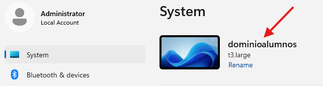{.margintop10 .marginbottom20 .sietecinco}

## Configurar las instancias para que tengan IP fija y tengan como servidor DNS preferido al DNS del dominio ad.practicadns.es

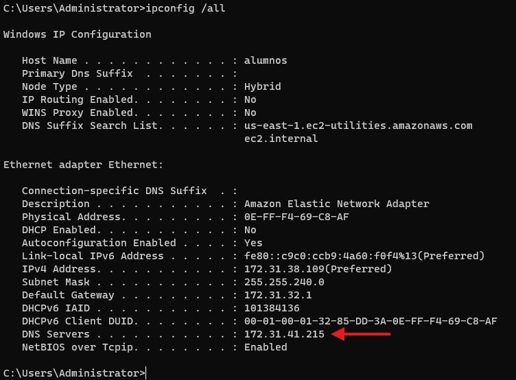{.margintop10 .marginbottom20 .sietecinco}

## Añadir las instancias al dominio `ad.practicadns.es`

!!! tip "Estos pasos se deberán repetir en las 2 instancias"

Accedemos al workgroup de la instancia.
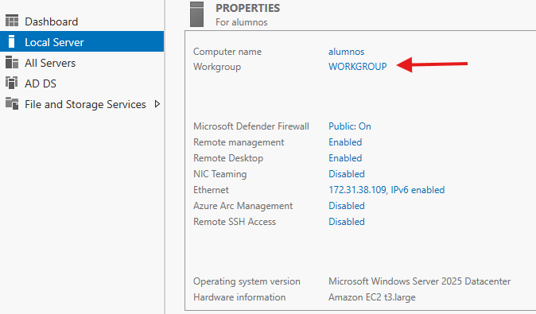{.margintop10 .marginbottom20 .sietecinco}

Seleccionamos cambiar el dominio o grupo de trabajo.
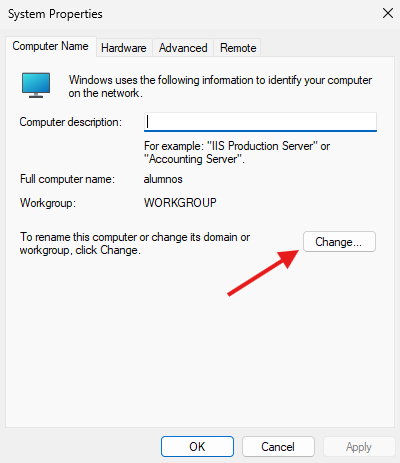{.margintop10 .marginbottom20 .sietecinco}

Indicamos el dominio al que queremos incorporar la instancia.
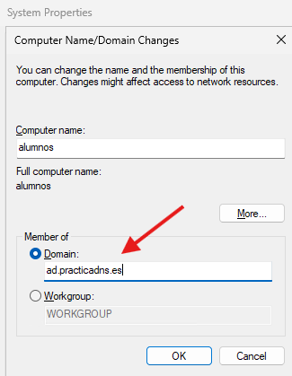{.margintop10 .marginbottom20 .sietecinco}

Introducimos la contraseña para `Administrator`.
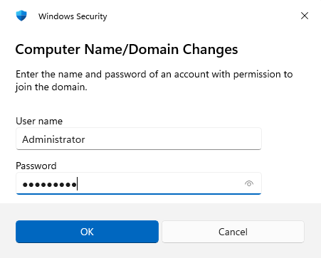{.margintop10 .marginbottom20 .sietecinco}

Si todo ha ido bien habremos añadido las instancias al dominio.
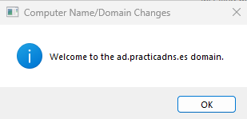{.margintop10 .marginbottom20 .sietecinco}

Para completar el proceso, debermos reiniciar la instancia.
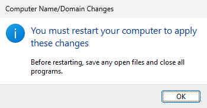{.margintop10 .marginbottom20 .sietecinco}

Si vamos a la instancia controladora del dominio `ad.servidordns.es` podremos como la instancia ha sido incorporada al dominio.
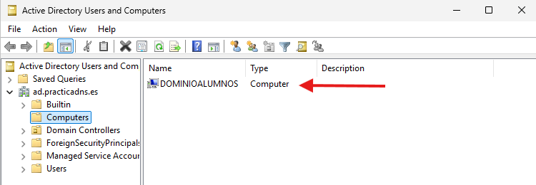{.margintop10 .marginbottom20 .sietecinco}

En la propia instancia, tambien podremos su pertenencia al dominio ´as.practicadns.es´.
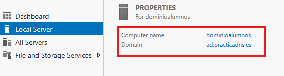{.margintop10 .marginbottom20 .sietecinco}

## Roles AD DS + DNS a las instancias

!!! tip "Estos pasos se deberán repetir en las 2 instancias"

- Añadiremos los roles a nuestras instancias.
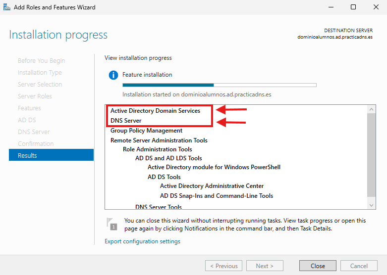{.margintop10 .marginbottom20 .sietecinco}

- Luego promocionaremos la instancia a controladora de dominio **añadiendo el dominio de la instancia al bosque existente**.
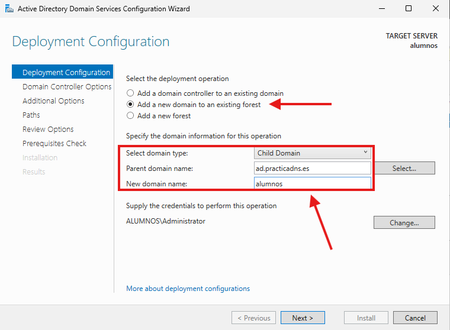{.margintop10 .marginbottom20 .sietecinco}
- Introducimos una contraseña de recuperación ante catástrofes.
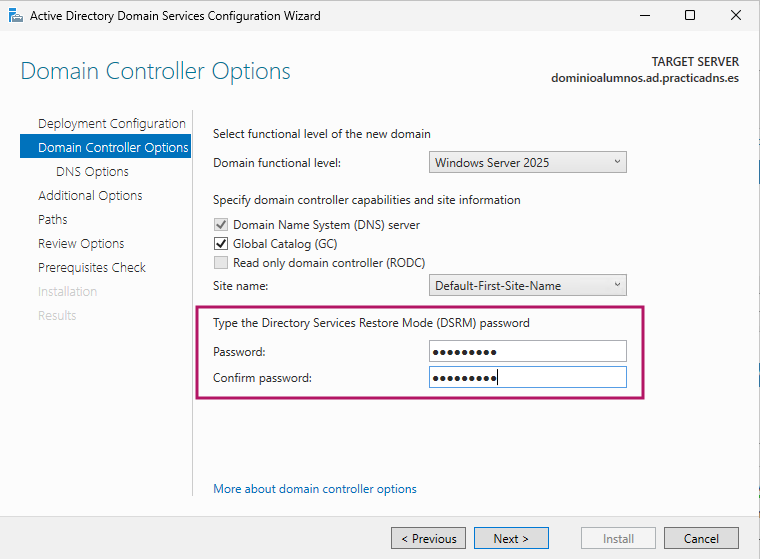{.margintop10 .marginbottom20 .sietecinco}

