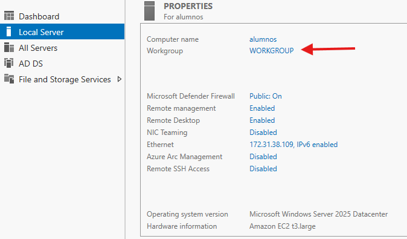
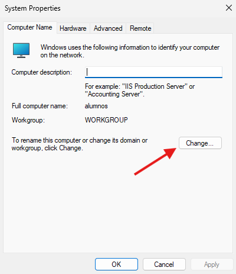
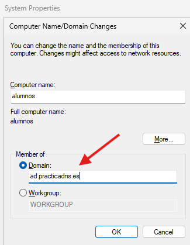
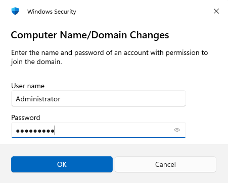
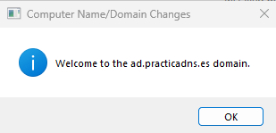
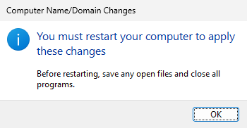
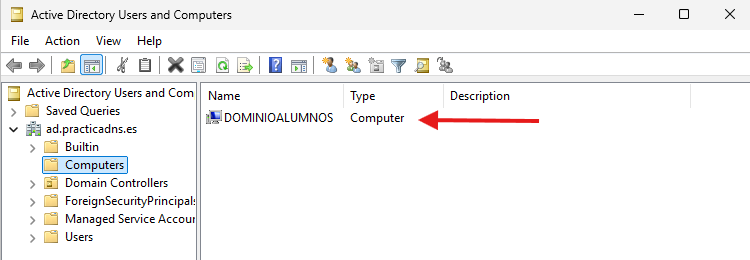
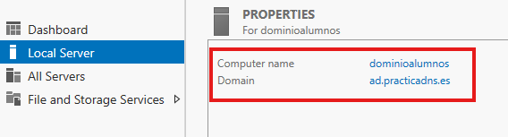

## Añadir las instancias al dominio `ad.practicadns.es`

!!! tip "Estos pasos se deberán repetir en las 2 instancias"

- Accedemos al workgroup de la instancia.
{.margintop10 .marginbottom20 .sietecinco}

- Seleccionamos cambiar el dominio o grupo de trabajo.
{.margintop10 .marginbottom20 .sietecinco}

- Indicamos el dominio al que queremos incorporar la instancia.
{.margintop10 .marginbottom20 .sietecinco}

- Introducimos la contraseña para `Administrator`.
{.margintop10 .marginbottom20 .sietecinco}

- Si todo ha ido bien habremos añadido las instancias al dominio.
{.margintop10 .marginbottom20 .sietecinco}

- Para completar el proceso, debermos reiniciar la instancia.
{.margintop10 .marginbottom20 .sietecinco}

- Si vamos a la instancia controladora del dominio `ad.servidordns.es` podremos como la instancia ha sido incorporada al dominio.
{.margintop10 .marginbottom20 .sietecinco}

- En la propia instancia, tambien podremos su pertenencia al dominio ´as.practicadns.es´.
{.margintop10 .marginbottom20 .sietecinco}

alumnos
principal
B)GfBWuQP$k?(3J9hgSXMFE%C50.-56f

1 - Crear instancia
2 - Cambiar nombre
3 - cambiar ip + dns preferido = dns instancia ad.practicadns.es
4 - agregar maquina al dominio ad.practicadns.es
5 - rol adds + dns
6 - promocionar.

- habilitar la transferencia de zona.

Habilitar las transferencias de zona en cada servidor primario.
Autorizar únicamente las direcciones IP de los otros dos servidores DNS.
Crear una zona secundaria en cada uno de los servidores receptores.
Indicar la dirección IP del servidor que contiene la zona primaria.

###########################################
ver la configuracion de los dns secundarios
###########################################

Servidor-DNS -. Servidor-DNS.ad.practicadns.es - 172.31.33.127
Servidor-DNS-2 - Servidor-DNS-2.ad.practicadns.es -  172.31.40.94
ADDS-Alumnos - alumnos.ad.practicadns.es -  172-31.47.142
ADDS-profesores - profesores.ad.practicadns.es -  172-31.33.153

Subred: 172.31.32.0/20
Netmask: 255.255.240.0
IGW 172.31.32.1

configuracion de las interfaces de red en Servidor-DNS-2 primer DNS → Servidor-DNS

https://claude.ai/chat/575d97b4-fa10-4773-b6f5-12bc3577330d