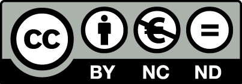

{ .original  }
  
**Resultados de aprendizaje y criterios de evaluacion que se evaluarán en esta unidad.**  

| **Resultados de aprendizaje de la unidad didáctica:**|
||
| **RA. 1:** Identifica los aspectos ambientales, sociales y de gobernanza (ASG) relativos a la sostenibilidad teniendo en cuenta el concepto de desarrollo sostenible y los marcos internacionales que contribuyen a su consecución.|

|**Criterios de evaluación de la unidad didáctica:**|
||
|**e)** Se han identificado los principales estándares de métricas para la evaluación del desempeño en sostenibilidad y su papel en la rendición de cuentas que marca la legislación vigente y las futuras regulaciones en desarrollo. |
|**f)** Se ha descrito la inversión socialmente responsable y el papel de los analistas, inversores, agencias e índices de sostenibilidad en el fomento de la sostenibilidad. |

## 1 - Introducción  

- Las métricas e indicadores de sostenibilidad (o KPIs ESG / Key Performance Indicator in Environmental, Social, and Governance) cuantifican el desempeño de una organización en los ámbitos ambiental, social y de gobernanza.
- Para ser considerados verdaderos indicadores, deben estar vinculados a un objetivo formal, contar con una definición cerrada, una unidad de medida, una fuente identificada y un responsable.
- Su función principal es **convertir los compromisos corporativos en datos comparables, detectar desviaciones de gestión y sostener la rendición de cuentas ante terceros mediante información verificable**.

---

## 2 - Estándares de métricas de sostenibilidad y su papel en la rendición de cuentas (Legislación vigente y regulaciones en desarrollo)

### 2.1 Principales marcos y estándares internacionales

- **Global Reporting Initiative (GRI)**: Es el marco modular y estandarizado más utilizado a nivel global para la elaboración de memorias o reportes de sostenibilidad. Se compone de **Estándares Universales** (GRI 1, GRI 2 y GRI 3), **Sectoriales** y **Temáticos**.

??? tip "Estándares Universales (GRI 1, 2 y 3):"
    - Son la base obligatoria para cualquiera.
    - Explican las reglas del reporte (GRI 1), la información general de la organización y su gobierno (GRI 2), y cómo identifican sus temas más importantes o relevantes (GRI 3).

??? tip "Estándares Sectoriales:"
    - Indicadores específicos diseñados para industrias concretas (por ejemplo, minería, agricultura o petróleo), donde los impactos son particulares.

??? tip "Estándares Temáticos:"
    - Fichas concretas para medir temas específicos si aplican a la empresa (como emisiones de carbono, diversidad, derechos laborales o anticorrupción).

- Guía a las empresas a identificar y reportar sus impactos basándose en el principio de **materialidad** (aquellos temas con mayores impactos económicos, ambientales y sociales).
- **Norma ISO 14031**: Define el proceso interno de **Evaluación del Desempeño Ambiental (EDA)**. Clasifica los indicadores en dos grandes bloques: **Indicadores de Desempeño Ambiental (IDA)**, subdivididos en Indicadores de Desempeño de la Gestión (IDG) e Indicadores de Desempeño Operacional (IDO) e **Indicadores de Condición Ambiental (ICA)**.
- **Marco ODS y SDG Compass**: Desarrollado por GRI, el Pacto Mundial de la ONU y el WBCSD, proporciona un marco y un inventario de indicadores para alinear las estrategias empresariales y medir la contribución a las metas de los **Objetivos de Desarrollo Sostenible (ODS)**.
- **Otros esquemas de referencia**:
    1. Estándares del **ISSB** (International Sustainability Standards Board)
    1. **SASB** (Sustainability Accounting Standards Board)
    1. **CDP** y metodologías para el cálculo de la huella de carbono como el **GHG Protocol** e **ISO 14064**.

### 2.2 Paso hacia la obligatoriedad regulatoria y la rendición de cuentas

El reporte no financiero ha experimentado una transición acelerada desde la adopción voluntaria hacia un régimen de exigencia legal obligatoria

1. **Marco legislativo vigente**:
    - **Ley 11/2018 de Información No Financiera y Diversidad (España)**: Obliga a las empresas a formular y publicar el **Estado de Información No Financiera (EINF)**. Asigna la responsabilidad directa al Consejo de Administración sobre la veracidad de métricas clave comparables relativas al medio ambiente, cambio climático, economía circular, plantilla y derechos humanos.
    - **Reglamento sobre la Divulgación de Sostenibilidad en los Servicios Financieros (SFDR)** y la **Directiva Europea 2017/828**, orientados a aumentar la transparencia sobre riesgos extrafinancieros y fomentar la implicación a largo plazo.
    - **Código de Buen Gobierno de la CNMV**, que enfatiza la supervisión del Consejo sobre riesgos reputacionales y la sostenibilidad.

1. **Regulaciones futuras y en desarrollo**:
    - **Directiva de Presentación de Informes de Sostenibilidad Corporativa (CSRD) y Estándares ESRS**:
        1. Imponen la obligación de divulgar indicadores bajo el principio de **doble materialidad** (evaluando tanto el impacto de la empresa en el entorno como el efecto financiero que los factores ESG tienen en la organización).
        1. La regulación europea continúa ajustando los ESRS (incluyendo versiones simplificadas que reducen puntos de datos obligatorios) y acotando los umbrales de aplicación por tamaño de plantilla y facturación.
    - **Nuevas normativas de mercado y licitaciones**:
        1. Exigen cada vez más contar con indicadores verificados (como la huella de carbono trazable o el cumplimiento de la Directiva de Debida Diligencia CSDDD) para operar en las cadenas de valor, acceder a contratos públicos y responder a requerimientos legales futuros.

---

### 2.3 Inversión Socialmente Responsable (ISR) y el papel de analistas, inversores, agencias e índices de sostenibilidad

#### 2.3.1 La Inversión Socialmente Responsable (ISR)

- La ISR o inversión sostenible es un enfoque financiero que **incorpora formalmente los criterios ESG en la toma de decisiones de inversión y la asignación de capital**.
- Reemplaza el enfoque cortoplacista tradicional por la búsqueda de **creación de valor sostenible a largo plazo**.

- Este modelo ha impulsado la creación de instrumentos financieros innovadores como:

    1. **Préstamos vinculados a la sostenibilidad** (*Sustainable Improvement Loans*): Financiación cuyo tipo de interés o margen varía en función del desempeño o evolución del *rating* ESG de la compañía.
    1. **Bonos verdes y sostenibles**: Emisiones destinadas exclusivamente a financiar proyectos empresariales o institucionales con impacto positivo (como eficiencia energética, energías renovables o infraestructuras sostenibles).

#### 2.3.2 El papel de inversores y analistas financieros

- **Inversores institucionales y grandes gestoras**:
    1. Actúan como uno de los principales motores de la sostenibilidad al exigir mayor calidad y cantidad de información no financiera.
    1. Utilizan el desempeño ESG de las empresas para evaluar riesgos estratégicos (reputacionales, climáticos y de cadena de suministro) que impactan la valoración del negocio.
- **Analistas e integración en el gobierno corporativo**:
    1. Los analistas examinan los datos no financieros para medir la exposición al riesgo de las carteras.
    1. A su vez, los Consejos de Administración responden a este interés integrando **cuadros de mando con 15-20 métricas de sostenibilidad clave** y creando comisiones delegadas específicas de sostenibilidad.

    ??? tip "Métricas ambientales"
        - Los indicadores ambientales miden el impacto de las actividades empresariales sobre el entorno natural.
        - Su objetivo es garantizar un uso responsable de los recursos y minimizar la huella ecológica.
        - Algunos ejemplos de KPIs ambientales más comunes incluyen:
            1. Emisiones de gases de efecto invernadero (GEI): toneladas de CO₂ equivalente emitidas por año.
            1. Consumo energético: cantidad total de energía utilizada (kWh) y porcentaje procedente de fuentes renovables.
            1. Gestión del agua: volumen de agua consumida, reutilizada o tratada.
            1. Residuos y reciclaje: proporción de residuos valorizados frente al total generado.
            1. Huella de carbono corporativa: medición integral de emisiones directas e indirectas.

    ??? tip "Métricas sociales"
        - Los indicadores sociales reflejan el compromiso de la organización con las personas, empleados, clientes, proveedores y comunidad.
        - Su finalidad es medir cómo las políticas corporativas influyen en el bienestar, la equidad y la inclusión social.
        -Ejemplos de KPIs sociales son:
            1. Tasa de rotación o retención del talento.
            1. Igualdad de género y diversidad en la plantilla.
            1. Horas de formación por empleado.
            1. Índice de satisfacción laboral o clima organizacional.
            1. Inversión en proyectos comunitarios o de impacto social.

    ??? tip "Métricas de gobernanza"
        - Los indicadores de gobernanza (G) miden la estructura, ética y transparencia con la que la empresa toma decisiones y gestiona sus operaciones.
        - Una gobernanza sólida refuerza la confianza y asegura la sostenibilidad a largo plazo.
        - Ejemplos de KPIs de gobernanza incluyen:
            1. Cumplimiento normativo y ético: número de incidentes o sanciones por incumplimiento.
            1. Estructura de gobierno corporativo: diversidad y composición del consejo directivo.
            1. Transparencia financiera: grado de divulgación de información no financiera.
            1. Políticas anticorrupción y código ético.
            1. Participación de las partes interesadas en la toma de decisiones.

#### 2.3.3 Papel de las agencias de calificación e índices de sostenibilidad

- **Evaluación y comparación (Benchmarking)**: Los índices (como el *SDG Index* o índices bursátiles sostenibles) y las agencias de calificación combinan múltiples fuentes de datos para emitir un *rating* de sostenibilidad comparable.
- **Fomento y dinamización de la sostenibilidad**:
    1. **Generación de confianza y acceso al capital**: Proporcionan un lenguaje transparente que permite a los mercados distinguir a las empresas con un compromiso genuino, facilitando la atracción de capital institucional y mejorando la reputación corporativa.
    1. **Ajuste de costes de financiación**: Al vincular la evolución de la calificación ESG con las condiciones de crédito y la estructuración de deuda, las agencias e índices otorgan una ventaja competitiva directa y reducen costes financieros a largo plazo a las empresas con mejor desempeño ambiental y social.
    1. **Promoción de la mejora continua**: Obligan a las empresas a implantar procesos de recogida de datos robustos, estructurar sus controles internos y someter sus indicadores a auditoría y verificación externa

---

## 3 - Ejemplo práctico

1. Buscar información corporativa sobre el [Grupo COX](https://grupocox.com) y más particularme datos relativos a la sostenibilidad.

1. Interpretar los datos corporativos del último año.

1. ¿Esos datos son buenos?

## 4 - Foro de discusión

!!! question "¿Es el cálculo de la huella de carbono suficiente para evaluar el compromiso de sostenibilidad empresarial?"

<!--
**No, la sostenibilidad empresarial y la evaluación del desempeño van mucho más allá de reducirlo todo al cálculo de la huella de carbono**.

Aunque la huella de carbono es el indicador ambiental más habitual, más comparable y uno de los más exigidos en licitaciones e informes corporativos, cuantificar únicamente las emisiones de gases de efecto invernadero (Alcances 1, 2 y 3) deja fuera dimensiones fundamentales de la gestión ambiental, social y de gobernanza (ESG).

Las razones principales por las que la sostenibilidad no puede simplificarse a una sola cifra son:

---

### 1\. Existen múltiples impactos ambientales más allá del carbono

Medir la sostenibilidad ambiental requiere evaluar el comportamiento global de la empresa ante los límites del planeta. La huella de carbono no refleja por sí sola otros factores críticos como:

* **Uso y estrés hídrico**: Volumen de agua captado, consumo hídrico y huella en zonas de estrés hídrico.
* **Gestión de recursos y renovables**: Consumo energético total y proporción procedente de energías renovables.
* **Residuos y economía circular**: Volumen de residuos generados (peligrosos y no peligrosos), tasa de valorización, tasa de reciclabilidad de los productos, ecodiseño y reutilización de materiales.
* **Biodiversidad y ecosistemas**: Uso del suelo, vertidos, emisiones atmosféricas distintas de los GEI y afectación al capital natural.

---

### 2\. La dimensión Social (S) es determinante

La sostenibilidad exige evaluar el impacto de la organización sobre las personas y la sociedad. Un indicador de carbono no mide aspectos sociales clave como:

* **Salud y seguridad laboral**: Índice de frecuencia de accidentes y siniestralidad laboral.
* **Equidad e inclusión**: Brecha salarial de género, rotación de plantilla y presencia de grupos subrepresentados en cargos de liderazgo.
* **Cadena de suministro y comunidad**: Estándares laborales en la cadena de valor, derechos humanos e inversión e impacto en la comunidad.

---

### 3\. La dimensión de Gobernanza y Ética (G) garantiza la gestión responsable

La gobernanza asegura que la empresa opere bajo reglas claras, éticas y transparentes. Esto abarca áreas extrafinancieras que la huella de carbono no contempla:

* **Estructura y diversidad del Consejo de Administración**.
* **Políticas anticorrupción y formación en ética empresarial** para la plantilla.
* **Transparencia fiscal, remuneración ejecutiva y seguridad/privacidad de la información**.
* **Homologación de la cadena de suministro**: Porcentaje del gasto en proveedores evaluado bajo criterios ESG.

---

### 4\. Exigencia regulatoria y estándares globales

Marcos internacionales como el **Global Reporting Initiative (GRI)**, la norma **ISO 14031** para la Evaluación del Desempeño Ambiental, el marco de los **ODS (SDG Compass)** y la regulación vigente y en desarrollo (**CSRD/ESRS** y **Ley 11/2018**) exigen reportar bajo el principio de **doble materialidad**. Esto implica medir no solo el impacto de la empresa en el entorno, sino también cómo los riesgos y oportunidades extrafinancieros (sociales, climáticos y éticos) afectan a la viabilidad financiera del negocio a largo plazo.

Por estas razones, la práctica recomendada no consiste en reducirlo todo a la huella de carbono, sino en articular un conjunto equilibrado y representativo de **entre 10 y 20 KPIs materiales** que abarquen las tres dimensiones ESG y permitan tomar decisiones estratégicas reales.
-->

!!! question "¿Hasta qué punto la exigencia legal de presentar estados de información no financiera garantiza una veracidad real sobre el desempeño corporativo sin sobrecargar operativamente a las empresas?"

<!--
* **Posibles soluciones y líneas de debate**:
* **Enfoque en la materialidad**: Las organizaciones pueden apoyarse en el marco modular de los **Estándares GRI** (GRI 1, 2 y 3) para focalizar el reporte únicamente en aquellos temas que representen los impactos más significativos[1], evitando la dispersión de datos y optimizando recursos[4][5].
* **Uso de herramientas públicas e indicadores estandarizados**: Para evitar duplicidades operativas, las empresas pueden utilizar calculadoras e índices oficiales (como los del MITECO para calcular los Alcances 1 y 2)[6][7] e implantar controles internos orientados al principio de **verificabilidad** de los datos[8].
* **Estructuración mediante la norma ISO 14031**: Aplicar el proceso interno de **Evaluación del Desempeño Ambiental (EDA)** clasificando las métricas en **Indicadores de Desempeño de la Gestión (IDG)** e **Indicadores de Desempeño Operacional (IDO)**[9], conectando la toma de decisiones directiva con las operaciones diarias[11][12].
-->

!!! question "¿Es suficiente centrar la estrategia de sostenibilidad en el cálculo y reducción de la huella de carbono (Alcances 1 y 2), o se corre el riesgo de caer en una "visión de túnel" que ignore otros aspectos ambientales y sociales clave?"

<!-- 
**Posibles soluciones y líneas de debate**:
* **Ampliación del alcance climático**: Si bien el cálculo básico se enfoca en multiplicar datos de actividad por factores de emisión para los Alcances 1 y 2[6][13], una medición rigurosa exige incorporar progresivamente las emisiones del **Alcance 3** a lo largo de la cadena de valor para reflejar el impacto total[6][14].
* **Integración de métricas de Economía Circular**: Complementar la medición de gases de efecto invernadero con marcos de circularidad (como el marco de Forética), midiendo la tasa de reciclabilidad, la valorización de residuos, el ecodiseño y la eficiencia de los materiales de entrada[15].
* **Equilibrio entre las tres dimensiones (ESG)**: Incorporar un cuadro equilibrado de indicadores extrafinancieros que abarque salud y seguridad laboral, brecha salarial de género, captación hídrica y formación en ética y anticorrupción[14][18].
-->

!!! question "¿Cómo pueden las organizaciones equilibrar la "materialidad de impacto" (lo que la empresa impacta en el entorno) y la "materialidad financiera" (cómo los factores extrafinancieros afectan al negocio) para evitar reportes meramente promocionales?"

<!-- 
**Posibles soluciones y líneas de debate**:
* **Aplicación estricta del principio de equilibrio**: Exigir que los reportes de sostenibilidad incluyan de forma transparente tanto los avances positivos como las tendencias anuales negativas y los impactos desfavorables[19].
* **Rigor en la determinación de temas materiales**: Utilizar la metodología de **GRI 3** junto con los **Estándares Sectoriales** para identificar y priorizar los impactos reales y potenciales con la participación activa de los grupos de interés[5].
* **Contextualización de la información**: Evitar afirmaciones ambiguas enmarcando el desempeño corporativo dentro del contexto más amplio de desarrollo sostenible y los Objetivos de Desarrollo Sostenible (ODS)
-->

!!! question "¿De qué manera debe estructurarse el gobierno corporativo para transformar la recopilación de métricas de sostenibilidad en una herramienta de gestión estratégica y atracción de Inversión Socialmente Responsable (ISR)?"

<!--
**Posibles soluciones y líneas de debate**:
* **Cuadro de Mando con frecuencias realistas de medición**: Establecer un seguimiento continuo de los KPIs según su naturaleza (frecuencia mensual para consumos directos y siniestralidad; trimestral o anual para brecha salarial, Alcance 3 y evaluación de proveedores)[14].
* **Alineación estratégica mediante el SDG Compass**: Conectar las metas de la empresa con los ODS mediante los cinco pasos recomendados por el Pacto Mundial de la ONU: comprender, definir prioridades, establecer objetivos, integrar y reportar[22][23].
* **Responsabilidad directiva y rendición de cuentas**: Involucrar directamente al Consejo de Administración y a la Alta Dirección en la supervisión de la información no financiera[24], garantizando que los datos sean confiables tanto para auditorías internas como para analistas e inversores
-->

| **Licencia Creative Commons:** | |
| - | - |
|  { .by-nc-nd-eu_ } | **Reconocimiento-NoComercial-CompartirIgual CC BY-NC-SA:**  No se permite un uso comercial de la obra original ni de las posibles obras derivadas, la distribución de la cuales se debe hace con una licencia igual a la que regula la obra original. |

<!-- Ra1 c https://www.youtube.com/watch?v=0hlIl9mhCXE&list=PLy_p4f0UmJpYVdYTPDn7sRnoLI3fGJpe2&index=6 -->
<!-- ra1 b https://www.youtube.com/watch?v=-GozBVKAioI&list=PLy_p4f0UmJpYVdYTPDn7sRnoLI3fGJpe2&index=7 -->
<!-- ra1 a https://www.youtube.com/watch?v=nmIhqAbBkqk&list=PLy_p4f0UmJpYVdYTPDn7sRnoLI3fGJpe2&index=8  -->
<!-- https://www.un.org/sustainabledevelopment/es/2023/08/fast-facts/ -->
<!-- https://www.sostenibilidad.com/desarrollo-sostenible/5-curiosos-inventos-sostenibles -->