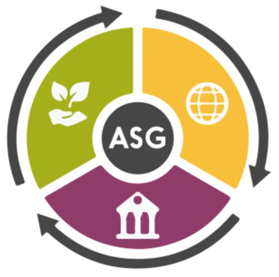

{ .sietecinco }
  
**Resultados de aprendizaje y criterios de evaluacion que se evaluarán en esta unidad.**  

| **Resultados de aprendizaje de la unidad didáctica:**|
||
| **RA. 2:** Caracteriza los retos ambientales y sociales a los que se enfrenta la sociedad, describiendo los impactos sobre las personas y los sectores productivos y proponiendo acciones para minimizarlos.|

|**Criterios de evaluación de la unidad didáctica:**|
||
|**a)** Se han identificado los principales retos ambientales y sociales. |
|**b)** Se han relacionado los retos ambientales y sociales con el desarrollo de la actividad económica. |

## 1 - Retos ambientales y sociales en el Desarrollo Sostenible

