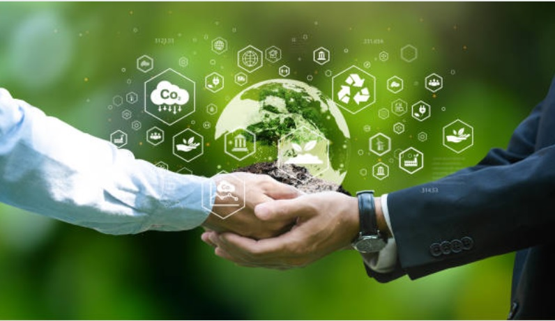{ .sietecinco .marginbottom20}
  
**Resultados de aprendizaje y criterios de evaluacion que se evaluarán en esta unidad.**  

| **Resultados de aprendizaje de la unidad didáctica:**|
||
| **RA. 2:** Caracteriza los retos ambientales y sociales a los que se enfrenta la sociedad, describiendo los impactos sobre las personas y los sectores productivos y proponiendo acciones para minimizarlos.|

|**Criterios de evaluación de la unidad didáctica:**|
||
|**a)** Se han identificado los principales retos ambientales y sociales. |
|**b)** Se han relacionado los retos ambientales y sociales con el desarrollo de la actividad económica. |

## 1 - Retos ambientales y sociales en el Desarrollo Sostenible

- La sociedad contemporánea se enfrenta a una crisis sistémica donde los desafíos ambientales y sociales están intrínsecamente interconectados de forma bidireccional.
- El deterioro de los ecosistemas mina el desarrollo socioeconómico, mientras que la desigualdad y los modelos insostenibles de producción y consumo aceleran la degradación ambiental.

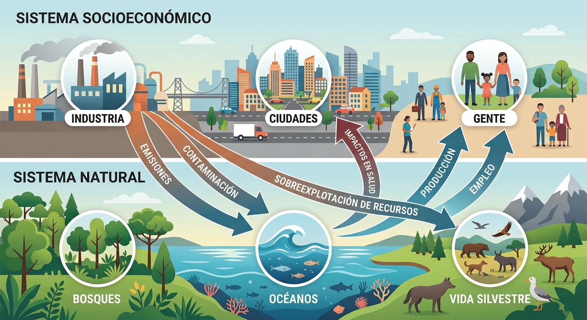{.cien}

### 🌎 Desafíos ambientales principales

!!! abstract "1. Cambio climático y transición energética"
    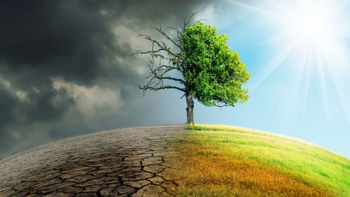{.sietecinco}

    - Aumento de las temperaturas globales provocado por la emisión de Gases de Efecto Invernadero (GEI) procedentes de combustibles fósiles.
    - Provoca un incremento en la frecuencia e intensidad de fenómenos meteorológicos extremos (olas de calor, sequías prolongadas, precipitaciones torrenciales y DANA), el aumento del nivel del mar y la alteración de los patrones climáticos.

!!! abstract "2. Pérdida de biodiversidad y colapso de ecosistemas"
    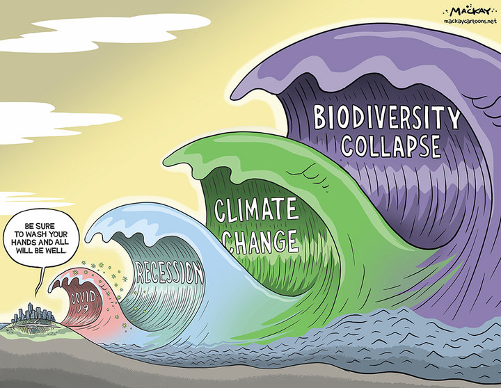{.sietecinco}

    - Extinción acelerada de especies y destrucción de hábitats clave (bosques, humedales, arrecifes) por sobreexplotación, deforestación y contaminación, reduciendo la resiliencia de la naturaleza y los servicios ecosistémicos.

!!! abstract "3. Contaminación y gestión ineficiente de residuos"
    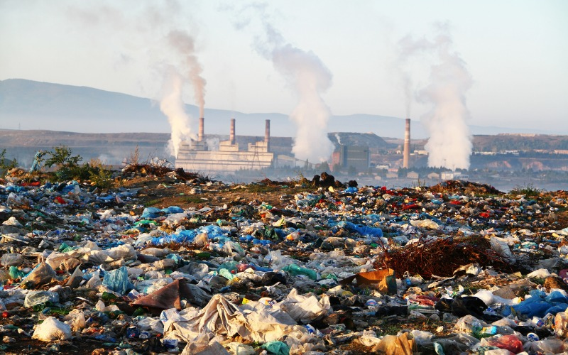{.sietecinco}

    -Presencia masiva de plásticos, microplásticos, vertidos químicos e industriales y emisiones contaminantes en el aire, agua y suelo.

!!! abstract "4. Escasez hídrica y estrés de agua dulce"
    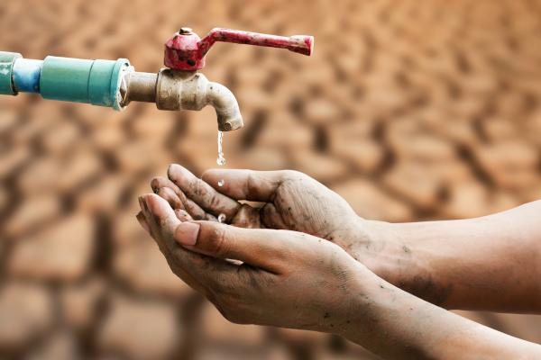{.sietecinco}

    - Desequilibrio creciente entre la demanda humana/productiva y la disponibilidad real de agua dulce, agravado por el cambio climático y la contaminación de acuíferos.

!!! abstract "5. Degradación del suelo y desertificación"
    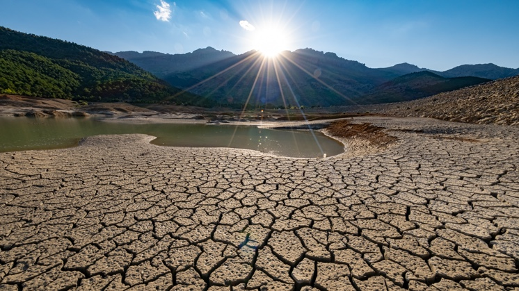{.sietecinco}

    - Pérdida de la fertilidad de la tierra, erosión y salinización debido a la agricultura intensiva, la deforestación y el aumento del estrés térmico.

### 👥 Desafíos Sociales Principales

!!! abstract "1. Pobreza, desigualdad y brecha climática"
    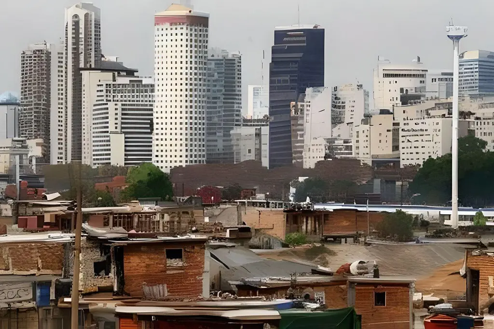{.sietecinco}

    - Gran disparidad socioeconómica en el acceso a recursos y oportunidades.
    - La exposición a los riesgos ambientales es inequitativa: las poblaciones con menor nivel de renta sufren los mayores daños a pesar de haber contribuido sustancialmente menos a las emisiones globales.

!!! abstract "2. Acceso limitado a servicios básicos e inseguridad alimentaria"
    {.sietecinco}

    - Dificultades para garantizar agua potable, saneamiento digno, energía asequible y alimentos nutritivos debido a caídas en la producción agropecuaria y sequías.

!!! abstract "3. Desplazamientos y migraciones climáticas"
    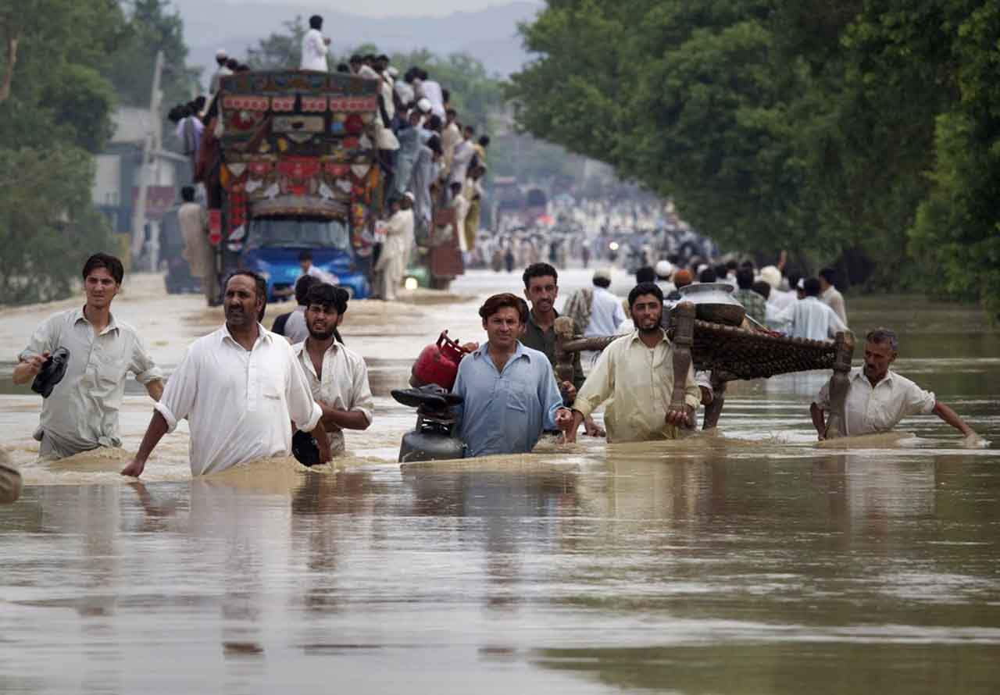{.sietecinco}

    - Éxodo rural y migraciones forzosas internas e internacionales provocadas por la pérdida de medios de vida, desertificación, inundaciones o escasez extrema de agua.

!!! abstract "4. Reto demográfico y vulnerabilidad territorial"
    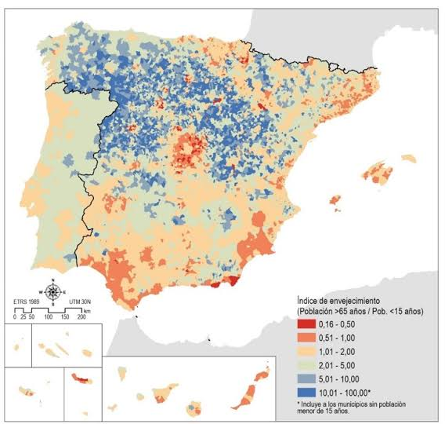{.sietecinco}

    - Concentración poblacional en grandes áreas urbanas y zonas costeras, dejando entornos rurales envejecidos y desatendidos ante catástrofes naturales

## 2. Impactos sobre las personas (eje social)

{.sietecinco}

Los impactos ambientales y de la transición afectan de manera directa e inmediata a la salud, la economía doméstica, la equidad de género y los medios de vida de la ciudadaníar.

|Dimensión de Impacto|Manifestaciones clave y evidencia|
|||
|**Salud Pública**|**- Mortalidad por calor extremo:** Incremento de muertes directas por olas de calor (alcanzando 116 fallecidos por millón en España, muy por encima de la media europea). **- Afecciones respiratorias y cardiovasculares:** Agravadas por la concentración de ozono troposférico y partículas finas. **- Enfermedades infecciosas y gastrointestinales:** Expansión de vectores (dengue, malaria) y patógenos en el agua por mala calidad o sequía.
|**Economía Doméstica**|**- Pobreza Energética:** Incapacidad de mantener una temperatura adecuada en el hogar en invierno o verano debido al bajo aislamiento edilicio y la volatilidad tarifaria. **- Encarecimiento de la Cesta de la Compra:** Aumento sostenido de precios en alimentos frescos e insumos básicos por caídas de cosechas. **- Gastos Extraordinarios:** Coste adicional directo por la compra de agua embotellada o camiones cisterna en municipios con escasez.|
|**Injusticia y Desigualdad**|**- Afectación desproporcionada:** Niños, ancianos, personas con discapacidades, hogares monomarentales y migrantes son los más vulnerables. **- Desigualdad de Emisiones:** Mientras el 70% de la población habita en municipios donde la temperatura subió más de 1,5 °C (con rentas familiares bajo la media), las grandes fortunas y corporaciones registran huellas de carbono drásticamente superiores.|
|**Empleo y Trabajo**|**- Pérdida de Puestos Directos:** Extinción de empleo en agricultura tradicional y sectores dependientes de recursos amenazados.  **- Riesgos Laborales Térmicos:** Mayor exposición a golpe de calor en trabajos al aire libre (construcción, agricultura).|

## 3. Impactos sobre los sectores productivos (eje económico)

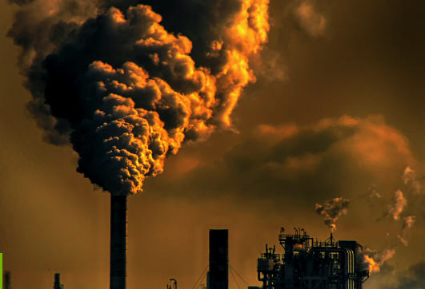{.sietecinco}

Las actividades económicas enfrentan riesgos físicos (daños directos por el clima) y riesgos de transición (costes de adaptación normativa, penalizaciones al carbono y cambios de demanda).

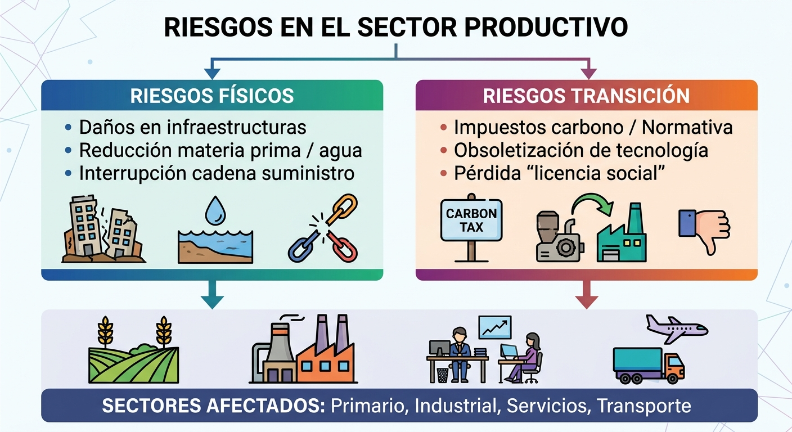{.cien }

### 🌽 Sector primario (agricultura, ganadería y pesca)

!!! abstract "1. Agricultura"
    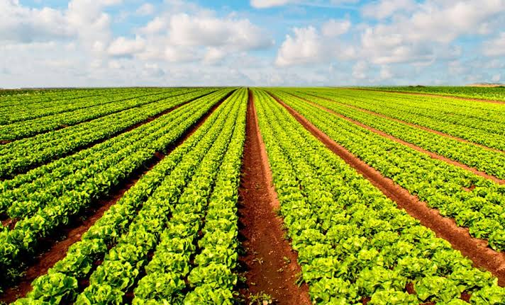{.sietecinco }

    - Reducción drástica del potencial productivo y pérdida de cosechas por sequías y lluvias torrenciales (p. ej., pérdidas anuales estimadas en 1.500 millones de euros en España por escasez hídrica y caídas de más del 20% de ingresos en explotaciones locales). Pérdida de suelos por erosión y salinización de acuíferos

!!! abstract "2. Ganadería"
    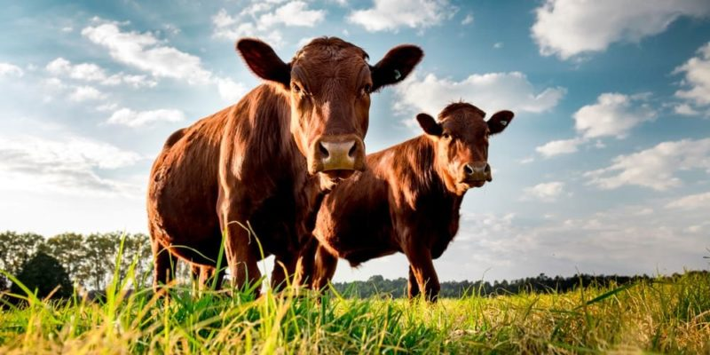{.sietecinco }

    - Estrés térmico animal que reduce la productividad de leche y carne, aumentando la morbilidad y los costes operativos por la escasez de pastos y mayor gasto en refrigeración o piensos.

!!! abstract "3. Pesca y Acuicultura"
    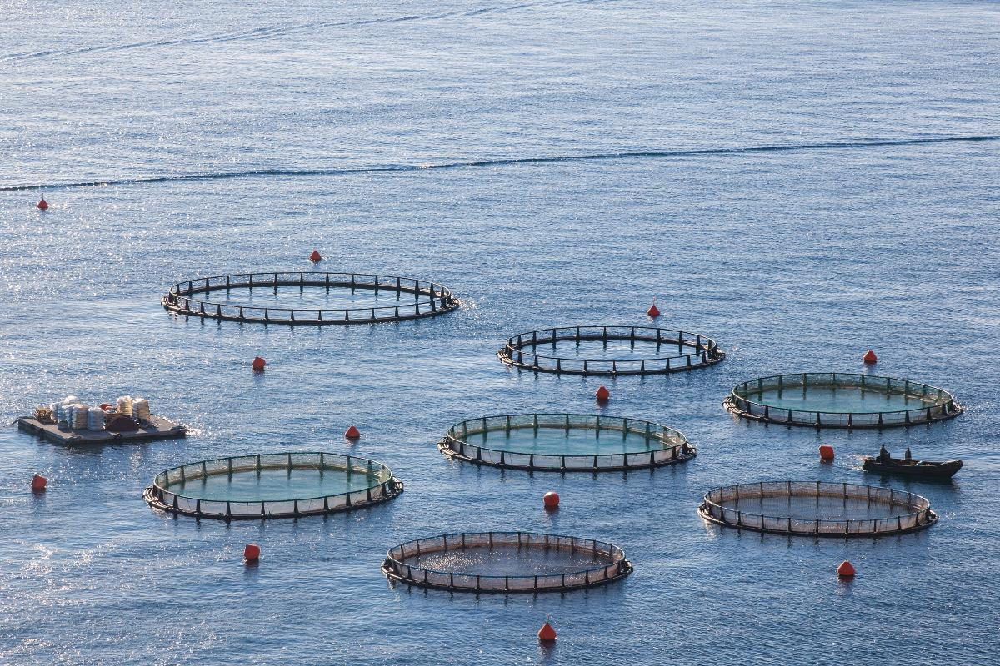{.sietecinco }

    - Desplazamiento y reducción de caladeros por el aumento de la temperatura del mar, la acidificación oceánica y la pérdida de biodiversidad

### 🏭 Sector industrial y energético

!!! abstract "1. Industria Manufacturera y Agroalimentaria"
    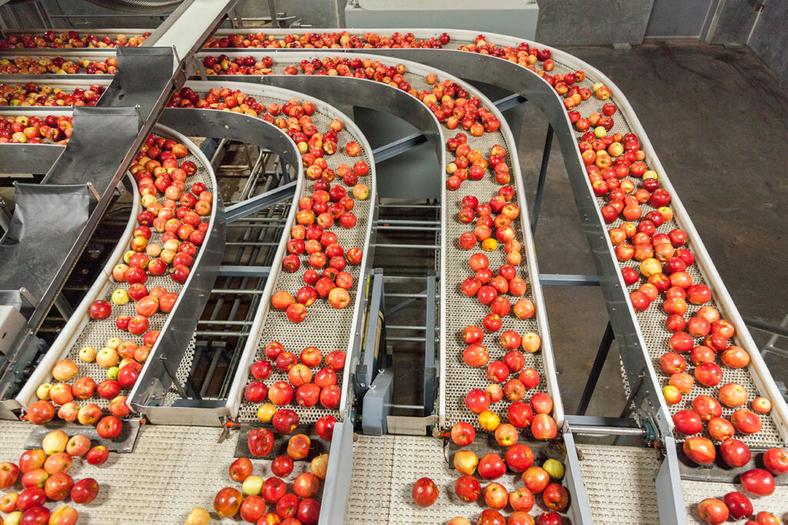{.sietecinco }

    - Interrupción de cadenas de suministro por eventos meteorológicos y sobrecostes por restricción de insumos clave como el agua (especialmente intensivo en minería, textil, bebidas y procesado de alimentos).
    - Necesidad de asumir inversiones de descarbonización e impuestos al carbono para mantener la competitividad.

!!! abstract "2. Sector Energético"
    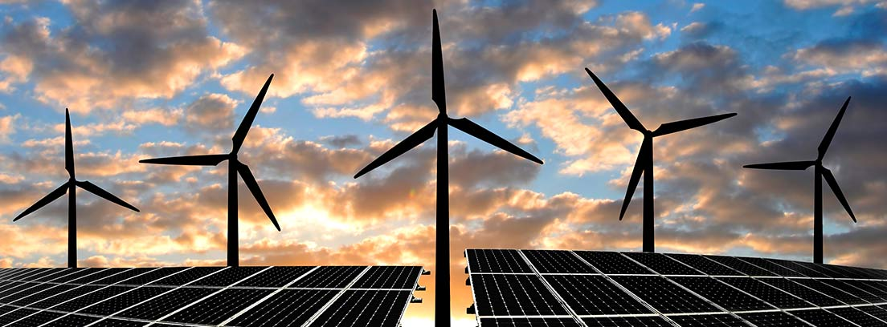{.sietecinco }

    - La menor disponibilidad de agua compromete la generación hidroeléctrica, la producción de biomasa y los sistemas de refrigeración de plantas no renovables.
    - A su vez, el cambio en los patrones térmicos altera la demanda energética provocando picos de consumo en verano.

### 🏙️ Sector servicios, turismo, transporte y finanzas

!!! abstract "1. Turismo"
    {.sietecinco }

    - Deterioro de atractivos naturales (blanqueamiento de corales, erosión de playas, falta de nieve en estaciones de esquí), sobrecalentamiento estival en zonas del sur y alteración de las temporadas de afluencia

!!! abstract "2. Transporte y Logística"
    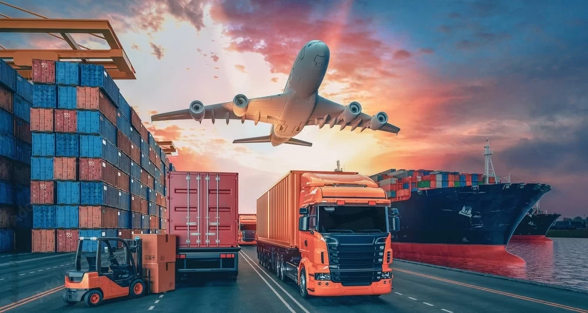{.sietecinco }

    - Daños en infraestructuras viales y ferroviarias por eventos extremos y retrasos logísticos por sequías en vías fluviales.
    - Desafío de renovar flotas hacia vehículos de cero emisiones ante el diferencial de precios de los combustibles limpios.

!!! abstract "3. Sector Financiero y Seguros"
    {.sietecinco }

    - Aumento del riesgo de impago en carteras crediticias expuestas al clima y fuerte elevación de las primas e indemnizaciones por siniestros y catástrofes naturales.

## 4. Acciones y respuestas para minimizar los impactos

Para frenar la degradación y construir resiliencia, las respuestas abarcan iniciativas ambiental-tecnológicas, transformaciones productivas y políticas de protección social.

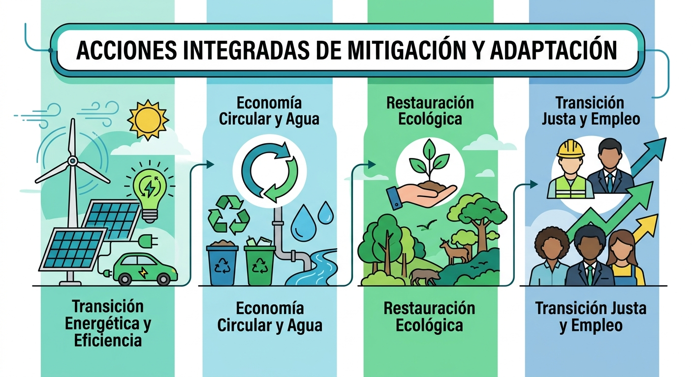{.sietecinco }

### 🌎 Medidas ambientales y de eficiencia productiva

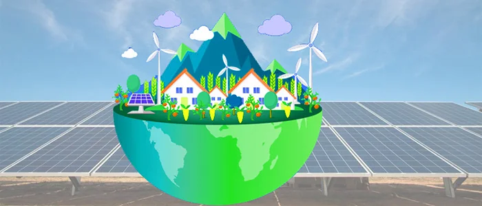{.sietecinco }

!!! abstract "Mitigación Climática y Transición Energética"
    - **Descarbonización del Mix:** Sustitución gradual de combustibles fósiles por energías renovables (fotovoltaica, eólica, geotérmica) y despliegue de almacenamiento energético.
    - **Eficiencia y Rehabilitación:** Planes masivos de optimización térmica en viviendas e instalaciones industriales (sistemas LED, aislamiento, climatización de alto rendimiento).
    - **Movilidad Sostenible:** Electrificación del transporte, potenciación del transporte público y fomento de biocombustibles avanzados en aviación y transporte pesado.
    - **Fiscalidad Ambiental:** Aplicación de precios al carbono y revisión de subsidios para internalizar costes ambientales.

!!! abstract "Gestión de Recursos y Economía Circular"
    - **Estrategia R (Reducir, Reutilizar, Reparar, Reciclar):** Implantación de diseño modular, ecodiseño para alargar la vida útil del producto, eliminación de plásticos de un solo uso y valorización de residuos.
    - **Simbiosis Industrial:** Configuración de redes donde los subproductos o residuos de una empresa actúan como materia prima de otra.
    - **Ciclo Eficiente del Agua:** Modernización de regadíos (riego por goteo inteligente), tratamiento y reutilización de aguas grises/residuales y detección digital de fugas en redes.

!!! abstract "Restauración Ecológica y Agroecología"
    - **Soluciones Basadas en la Naturaleza:** Reforestación con especies autóctonas, restauración de humedales y ríos, y creación de infraestructura verde urbana para mitigar islas de calor.
    - **Agricultura de Conservación:** Rotación de cultivos, reducción de fertilizantes sintéticos y pesticidas, y manejo de suelos vivos para retener agua y capturar carbono.

### 👥 Medidas sociales, laborales y de transición justa

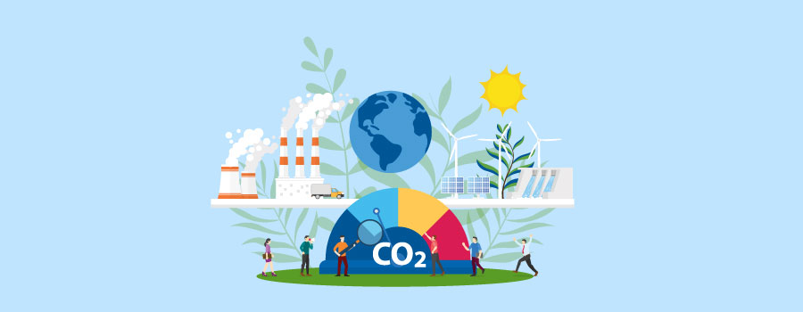{.sietecinco }

!!! abstract "Políticas Activas de Empleo (PAE) y Competencias Verdes"
    - **Recualificación (Reskilling) y Capacitación (Upskilling):** Programas de formación continua para adaptar la mano de obra de sectores en declive ("empleos marrones") hacia actividades sostenibles ("empleos verdes") como la rehabilitación energética, la gestión de residuos o el montaje de renovables.
    - **Fomento del Empleo Joven y de Género:** Incentivos mediante convocatorias específicas (como el programa Empleoverde+) y fomento de titulaciones STEM e insumos sostenibles entre colectivos infrarepresentados.

!!! abstract "Estrategia de Transición Justa"
    - **Convenios de Transición Justa:** Planes de reconversión territorial para comarcas afectadas por el cierre de minas o centrales térmicas, incluyendo bolsas de trabajo prioritarias, prejubilaciones y proyectos de restauración ambiental.
    - **Protección Social y Redistribución:** Mecanismos de compensación para familias en situación de pobreza energética, bonos sociales y subsidios directos a la rehabilitación de vivienda en barrios de baja renta.

!!! abstract "Diálogo Social y Marco Laboral"
    - **Negociación Colectiva Verde:** Inclusión de cláusulas ambientales y de adaptación climática en convenios colectivos, impulsadas por acuerdos marco entre patronal y sindicatos.
    - **Mecanismos de Flexibilidad e Higiene Laboral:** Integración de protocolos específicos en la Prevención de Riesgos Laborales frente a fenómenos extremos (olas de calor) y uso de sistemas de flexibilidad interna (como los ERTE o Mecanismo RED) para salvaguardar el empleo en crisis climáticas.
