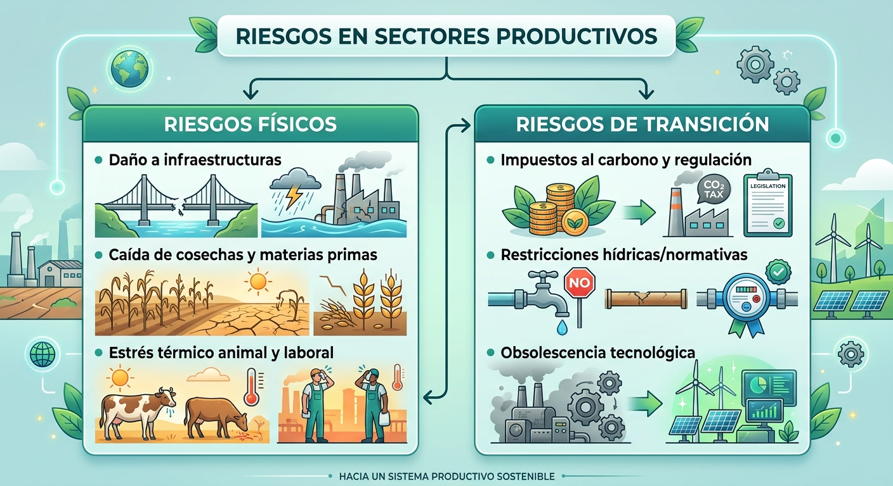
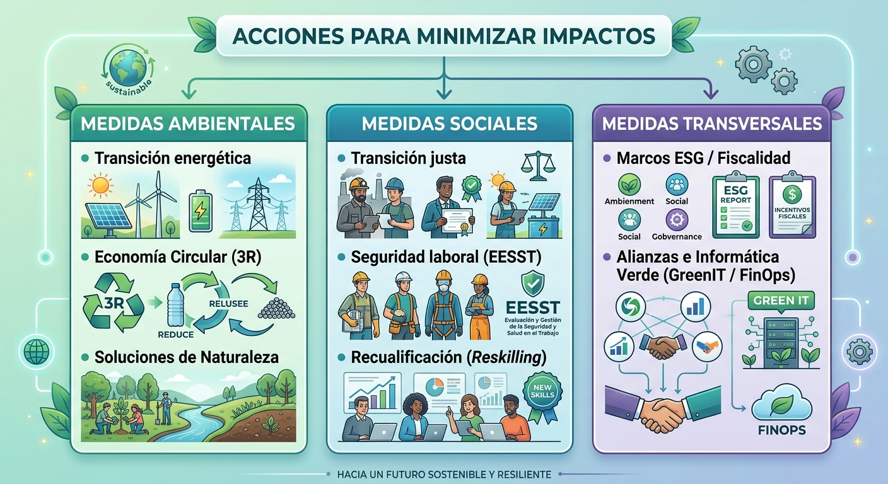

{ .sietecinco .marginbottom20}
  
**Resultados de aprendizaje y criterios de evaluacion que se evaluarán en esta unidad.**  

| **Resultados de aprendizaje de la unidad didáctica:**|
||
| **RA. 2:** Caracteriza los retos ambientales y sociales a los que se enfrenta la sociedad, describiendo los impactos sobre las personas y los sectores productivos y proponiendo acciones para minimizarlos.|

|**Criterios de evaluación de la unidad didáctica:**|
||
|**c)** Se ha analizado el efecto de los impactos ambientales y sociales sobre las personas y los sectores productivos.|
|**d)** Se han identificado las medidas y acciones encaminadas a minimizar los impactos ambientales y sociales.|

## 1 - Impacto ambiental y social sobre las personas y los sectores productivos

Los problemas ambientales y los desafíos sociales actúan como fuerzas externas negativas que alteran la base de la actividad económica, desestabilizando el bienestar ciudadano e incrementando los costes y riesgos operacionales de las empresas.

### 1.1 Efectos sobre las personas

- **Salud y bienestar físico**:

    1. La contaminación atmosférica incrementa drásticamente las enfermedades respiratorias y cardiovasculares.
    1. Asimismo, la degradación de las aguas dulces provoca brotes gastrointestinales y el aumento global de temperaturas extiende el rango geográfico de transmisión de vectores infecciosos como el dengue o la malaria.

---

- **Seguridad alimentaria y humana**:

    1. La desertificación, la erosión del suelo y las sequías recurrentes reducen los rendimientos agrícolas, amenazando la disponibilidad de alimentos básicos.
    1. Ante la pérdida de sustento o la ocurrencia de eventos climáticos extremos, se generan desplazamientos forzados de población (migrantes climáticos), lo que aumenta la presión sobre los servicios urbanos y el riesgo de conflictos por recursos escasos

---

- **Justicia climática y economía familiar**:

    1. Los grupos socioeconómicamente más vulnerables sufren los efectos negativos de manera desproporcionada al contar con menor capacidad financiera de adaptación o aseguramiento.
    1. A nivel doméstico, esto se traduce en pérdidas de ingresos por el colapso de actividades locales (agrícolas, pesqueras o turísticas) y en una mayor carga de gastos por el encarecimiento de alimentos y energía.

### 1.2 Efectos sobre los sectores productivos

Los sectores productivos enfrentan tres categorías principales de riesgo: **riesgos físicos** (daños climáticos directos), **riesgos de transición** (adaptación regulatoria y tecnológica) y **riesgos reputacionales** (pérdida de la licencia social para operar).

 {.cien}

---

- **Sector primario (agricultura, ganadería y pesca)**:
    1. **Agricultura**: Disminuye el potencial productivo del suelo por erosión y salinización de acuíferos, exigiendo inversiones elevadas en sistemas de riego eficientes y seguros agrarios910.
    1. **Ganadería**: Se registran mermas productivas por estrés térmico en los animales, mayor morbilidad y desajuste en dietas por escasez de pastos
    1. **Pesca**: Sufre el colapso de caladeros y el desplazamiento de especies a causa del aumento de temperatura marina, la acidificación oceánica y la desoxigenación

---

- **Sector industrial y energético**:
    1. **Industria**: Las industrias intensivas en consumo de agua (minería, textil, bebidas, procesamiento alimentario) enfrentan restricciones operativas y sobrecostes. Sectores clave como la industria, el transporte y la energía son responsables del 63,6% de las emisiones de GEI en España, asumiendo los mayores costes de descarbonización e impuestos al carbono
    1. **Energía**: La menor disponibilidad de agua compromete la generación hidroeléctrica, la producción de biomasa y la refrigeración de plantas no renovables, mientras las olas de calor disparan los picos de demanda eléctrica

---

- **Sector servicios, turismo y finanzas**:
    1. **Turismo**: Representa alrededor del 12% del PIB y del empleo en España, pero padece la degradación de atractivos naturales (blanqueamiento de corales, erosión costera, menor acumulación de nieve) y la pérdida de confort climático en verano.
    1. **Finanzas y Seguros**: Las entidades financieras asumen mayores riesgos de impago en sus carteras crediticias y las aseguradoras enfrentan desembolsos elevados por la alta siniestralidad de catástrofes naturales

## 2 - Identificación de las medidas y acciones encaminadas a minimizar los impactos ambientales y sociales

Las respuestas estratégicas para mitigar la degradación ambiental y **construir resiliencia** abarcan políticas públicas, transformación tecnológica y medidas laborales organizadas en torno a los **Objetivos de Desarrollo Sostenible (ODS)**.

 {.cien }

### 2.1 Medidas ambientales y tecnológicas

- **Mitigación y transición energética**:
    1. **Descarbonización** mediante el despliegue de energías renovables (fotovoltaica, eólica, geotérmica), electrificación de la movilidad, rehabilitación térmica de viviendas y aplicación del precio al carbono para internalizar costes ambientales.
    1. **Gestión de recursos y economía circular**: Aplicación del **principio de las 3R (Reducir, Reutilizar, Reciclar)**, adopción de la simbiosis industrial (aprovechamiento de subproductos de una empresa como materia prima de otra) y optimización del ciclo del agua mediante riego por goteo inteligente y reutilización de aguas grises
    1. **Restauración ecológica y agroecología**: Creación de reservas naturales, reforestación con especies autóctonas y transición hacia la agricultura de conservación para retener humedad y fijar carbono en el suelo.

### 2.2 Medidas sociales y de transición justa

- **Protección laboral y salud**:
    1. **Integración de los riesgos climáticos y del estrés térmico** en la prevención de riesgos laborales (destacando el Marco de la Estrategia Española de Seguridad y Salud en el Trabajo 2023-2027).
    1. **Políticas activas de empleo (PAE) y competencias verdes**: Impulso a la recualificación (reskilling) y actualización de competencias (upskilling) para reconvertir a trabajadores de sectores "marrones" hacia "empleos verdes" (como a través del programa Empleoverde+).
    1. **Mecanismos de equidad y transición justa**: Aplicación de convenios de transición justa con bolsas de trabajo prioritarias para trabajadores afectados, prejubilaciones bonificadas y ayudas directas a familias vulnerables para combatir la pobreza energética.

### 2.3 Medidas Transversales

- **Gobernanza y sector TIC**
    1. **Finanzas sostenibles y fiscalidad**: Redirección de flujos de capital privado hacia inversiones ASG (ambientales, sociales y de gobernanza) y aplicación de reformas fiscales progresivas sobre los superricos y grandes emisores
    1. **Debida diligencia y transparencia corporativa**: Marco normativo que obliga a las empresas a auditar sus cadenas de suministro, previniendo impactos adversos en derechos humanos y medio ambiente.
    1. **Sostenibilidad digital e informática verde (Green IT)**: Reducción de la huella de carbono en el sector de las TIC mediante optimización de código, minimización de datos (data minimization), gestión FinOps/GreenOps en servidores en la nube y uso de modelos de Inteligencia Artificial eficientes (cuantización e inferencia en lotes).

## 3 - Foro de discusión

!!! question "Gestión de la Escasez Hídrica: ¿Deben aplicarse restricciones operativas a los sectores productivos o priorizar estrictamente el consumo humano y los caudales ecológicos?"
    - Argumentos a favor de priorizar la salud pública y el medio ambiente:
    - Argumentos a favor de salvaguardar el suministro a la agricultura e industria:

<!--

Criterios trabajados:
    c) Impacto de la sequía en el sector primario e industrial vs. 
    d) Gestión eficiente del agua

A favor de priorizar la salud pública y el medio ambiente:
- La contaminación y escasez de agua dulce provocan problemas gastrointestinales, deshidratación y riesgos sanitarios.
- El desequilibrio en cuencas con alto estrés hídrico degrada gravemente los ecosistemas acuáticos y continentales.

A favor de salvaguardar el suministro a la agricultura e industria:
- Las restricciones severas provocan la caída del potencial productivo agrícola y pérdidas directas de cosechas, además de restar capacidad operativa a industrias intensivas como la alimentaria, la textil o la minería

-->

!!! question "¿Tienen las grandes corporaciones y rentas altas la obligación de financiar la adaptación climática de los colectivos vulnerables?"
    - A favor de la redistribución e impuestos al carbono:
    - A favor de no sobrecargar fiscalmente al tejido empresarial:

<!--

Criterios trabajados:
    c) Desigualdad y vulnerabilidad social vs. 
    d) Fiscalidad ambiental y justicia redistributiva.

# A favor de la redistribución e impuestos al carbono: 
- Existe una clara injusticia climática: las poblaciones de menores ingresos sufren con mayor dureza las olas de calor y la pobreza energética, mientras que los hogares de mayores ingresos y grandes corporaciones generan la mayor parte de las emisiones domésticas. Por ello, se propone una fiscalidad sobre grandes contaminantes para financiar viviendas ecoeficientes y protección social.

# A favor de no sobrecargar fiscalmente al tejido empresarial: 
- El sector industrial, el transporte y la energía absorben ya la mayor carga financiera derivada del reto de la descarbonización e impuestos al carbono.
- Imponer impuestos excesivos arriesga mermar la competitividad industrial frente a otros mercados.

-->

!!! question "Transición laboral exigente ¿Es justificable acelerar la eliminación de "empleos marrones" para cumplir metas ambientales, a pesar del impacto en el empleo industrial y rural?"
    - A favor de acelerar el cierre y la descarbonización:
    - A favor de ritmos de transición graduales:

<!--
Criterios trabajados: 
    c) Impactos del ajuste en sectores industriales y primarios vs. 
    d) Estrategias de Transición Justa y recualificación (reskilling).
    
# A favor de acelerar el cierre y la descarbonización: 
Los sectores de transporte, energía e industria representan conjuntamente el 63,6% de las emisiones de GEI16. Mantener empleos contaminantes solo aplaza la crisis; la transición ecológica genera oportunidades de empleo de mayor cualificación en energías renovables, rehabilitación y economía circular.

# A favor de ritmos de transición graduales:
Los empleos "marrones" se concentran a menudo en sectores maduros con trabajadores de cualificación media-baja24. Si la velocidad de descarbonización supera la capacidad real de recualificación profesional (reskilling) mediante Políticas Activas de Empleo (PAE), se genera despoblación y desprotección territorial
-->

!!! question "Protección y salud laboral frente al cambio climático ¿Deben imponerse limitaciones normativas a la jornada de trabajo durante episodios extremos de calor?""
    - A favor de la regulación estatal estricta.
    - A favor de la flexibilidad negociada por empresas y sindicatos.

<!--
Criterios trabajados: 
c) Repercusiones del clima en la salud laboral vs. d) Prevención de riesgos y negociación colectiva verde.

# A favor de la regulación estatal estricta: 
Las altas temperaturas e incrementos de concentración de ozono provocan un aumento masivo de la morbilidad y mortalidad. 
La inclusión de la protección ante fenómenos climáticos extremos en la Estrategia Española de Seguridad y Salud en el Trabajo (EESST 2023-2027) y en la legislación laboral es una obligación para salvaguardar la vida.

# A favor de la flexibilidad negociada por empresas y sindicatos: 
Cada sector productivo presenta realidades operativas distintas; por ello, la regulación del tiempo de trabajo debe articularse mediante la negociación colectiva verde (distribución irregular de la jornada, teletrabajo o ajustes estacionales) para mantener la viabilidad de las empresas sin destruir tejido productivo
-->

!!! question "Responsabilidad empresarial y sostenibilidad digital: ¿Debe obligarse a las empresas a auditar sus cadenas de valor (debida diligencia) y adoptar prácticas de informática verde (Green IT)?"
    - A favor de marcos regulatorios obligatorios.
    - A favor de incentivos voluntarios y flexibilidad de mercado.

<!--
Criterios trabajados: 
c) Riesgos reputacionales y de cadena de suministro vs. d) Debida diligencia y economía circular en servicios y TIC

# A favor de marcos regulatorios obligatorios: 
Las empresas deben asumir la debida diligencia empresarial para prevenir vulneraciones de derechos laborales y daños ambientales en su cadena de valor. Además, el sector TIC —como elemento tractor de la economía— debe descarbonizar sus desarrollos y servidores altamente intensivos en energía

# A favor de incentivos voluntarios y flexibilidad de mercado: 
La auditoría continua de proveedores e infraestructuras digitales implica costes burocráticos y tecnológicos elevados que pueden perjudicar especialmente a las pymes y microempresas. Es preferible fomentar la adopción voluntaria de la economía circular (principios de las 3R y simbiosis industrial).

-->
